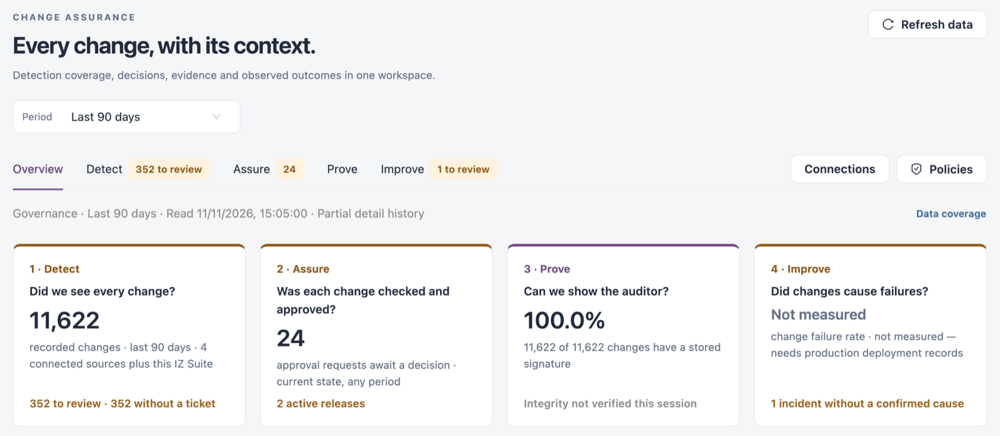

# Change Assurance

Change Assurance collects changes from the systems you connect (source control, cloud accounts, integration platforms, ticket trackers), runs each change through a gate, and keeps signed evidence of what it found. Change approvers, release managers, auditors and platform owners use it to answer four questions, one per stage:

* **Detect** · Did we see every change? Every change your connections record, who made it and which ticket it cites.
* **Assure** · Was each change checked and approved? Approval decisions, release planning and sign-off.
* **Prove** · Can we show the auditor? Evidence, signatures, controls, exceptions and the auditor export.
* **Improve** · Did changes cause failures? Incidents, recovery and the controls that would prevent a repeat.

Open it from **Workspaces** → **Change Assurance** in the sidebar. The sidebar then lists **Overview**, **Detect**, **Assure**, **Prove**, **Improve**, **Policy** and **Connections**, and the same stages show as tabs under the page header.


Requires the **Change Assurance** licence.


<figure><figcaption></figcaption></figure>

## Stages

| Stage                         | What it holds                                                                                                                                     | Use it to                                             |
| ----------------------------- | ------------------------------------------------------------------------------------------------------------------------------------------------- | ----------------------------------------------------- |
| [Overview](overview.md)       | One card per stage, the decisions waiting, changes outside the process, audit readiness and incidents.                                            | See where to start.                                   |
| [Detect](detect.md)           | **Change feed**, **Calendar**, **Timeline**, **Ticket lineage**, **Freeze windows**, **Governance drift**, **Inventory by Platform**, **People**. | Find every recorded change and the gaps in its trail. |
| [Assure](assure.md)           | **Decision work**, **Release planning**, **Changed after release**, **Remedial actions**, **Environment progression**, **Gate skips**.            | Decide on held changes and get a release ready.       |
| [Prove](prove.md)             | **Evidence**, **Controls**, **Exceptions**, **Export & auditor pack**.                                                                            | Show the evidence behind every change.                |
| [Improve](improve.md)         | **Incidents**, **Changes before incidents**, **Delivery stability**, **Controls to add**, **Decisions**.                                          | Learn from incidents and tighten the gates.           |
| [Policy](policy.md)           | Gate policies, approval rules and the other policy settings.                                                                                      | Decide which changes need a person and who signs off. |
| [Connections](connections.md) | The connected source systems and what they collect.                                                                                               | Connect the systems Change Assurance reads.           |

A tab with a count (for example **Detect** · **352 to review**) shows how many items wait in that stage.


Each stage shows only when your role can read its data. If a stage is missing, ask an administrator for a role that can view that part of Change Assurance.


## Page Header

Every stage shares the same header.

| Control                        | Description                                                                                                                                                                                                                                                                     |
| ------------------------------ | ------------------------------------------------------------------------------------------------------------------------------------------------------------------------------------------------------------------------------------------------------------------------------- |
| **Refresh data**               | Reads the latest recorded data again. The time of the last read shows under the tabs.                                                                                                                                                                                           |
| **Period**                     | The activity window every stage counts: **Last 7 days**, **Last 30 days**, **Last 90 days**, **Last 12 months**, **This quarter to date**, **Last quarter**, **Last calendar year**, **Custom period** or **All retained history**. The period travels with you between stages. |
| **Connections** / **Policies** | Open [Connections](connections.md) and [Policy](policy.md).                                                                                                                                                                                                                     |
| **Data coverage**              | Shows which sources the figures are read from and where detail history is partial.                                                                                                                                                                                              |

## Shared Building Blocks

* **Do these next**: most stages open with a short, numbered list of the most important things to look at, each with a button that opens the matching rows. **Show all** lists every action.
* **Tiles**: the counts above a list. Select a tile (↗) to open the records behind it.
* **Lists**: a filter bar, search, **Refresh**, **Columns** and **Export**. A row's actions open its record.
* **Dossiers**: a change, release or incident opens as a dossier with tabs; **Open full dossier** opens it as its own page.


Change Assurance reports what the records show. A gate result, a human approval, a ticket link and a signature are separate checks: none of them on its own authorizes a deployment.


## Next Steps

* [Overview](overview.md): start with the overview.
* [Connections](connections.md): connect the systems Change Assurance collects from.
* [Policy](policy.md): decide which changes need a human decision.
