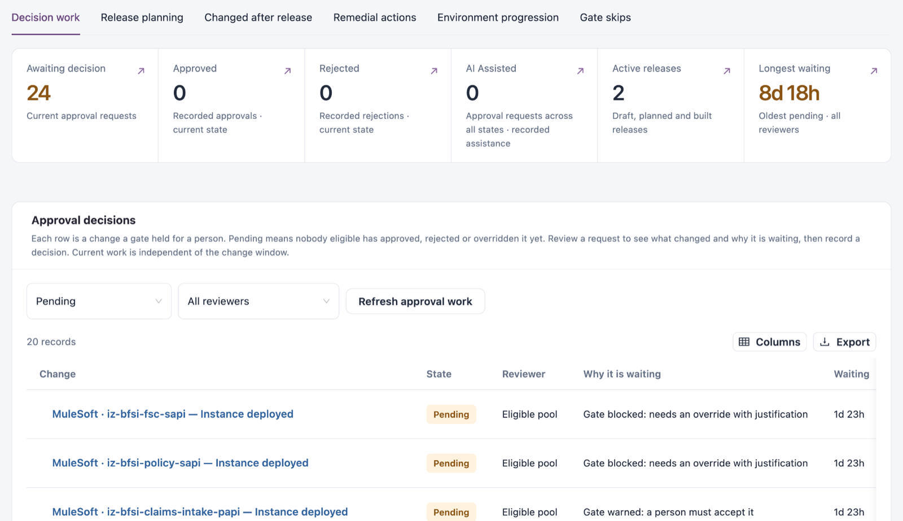
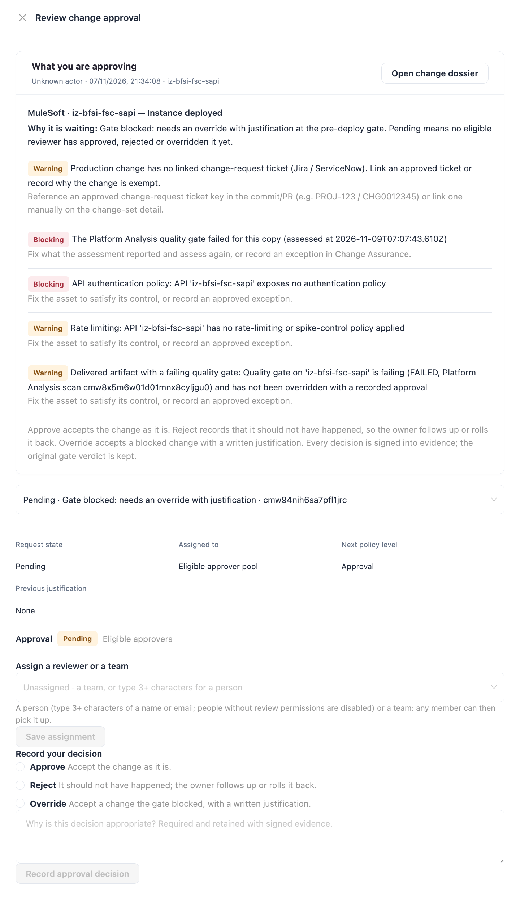
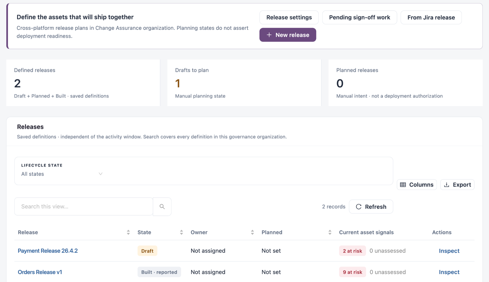

# Assure

**Assure** answers "What needs to be resolved before release?". It compares gate conditions, approvals, freezes and evidence, holds the approval requests waiting for a person, and lets release managers define a release, collect sign-offs and record a Go or No-go decision.

Open it from **Workspaces** → **Change Assurance** → **Assure** in the sidebar. The tab shows how many approval requests are waiting.


Requires the **Change Assurance** licence. You need a role that can view the Change Assurance dashboard; recording approval decisions needs a role that can manage approvals. **Environment progression** and **Gate skips** need a role that can view assets.


## Do These Next

The page opens with the most important actions across active releases, for example a required release step that is not met yet. Each has a button such as **Review release decision**. **Show all** _n_ **actions** lists every action.

## Views

| View                        | Use it to                                                                             |
| --------------------------- | ------------------------------------------------------------------------------------- |
| **Decision work**           | Decide on changes the gate held for a person.                                         |
| **Release planning**        | Define releases, collect sign-offs and record the release decision. Opens by default. |
| **Changed after release**   | Place changes made to a shipped release's assets.                                     |
| **Remedial actions**        | Remediate failing configurations and policy checks.                                   |
| **Environment progression** | Review promotion chains between environment stages.                                   |
| **Gate skips**              | Review deployments that skipped a required stage.                                     |

## Decision Work

<figure><figcaption></figcaption></figure>

| Tile                  | Description                                |
| --------------------- | ------------------------------------------ |
| **Awaiting decision** | Current approval requests.                 |
| **Approved**          | Recorded approvals.                        |
| **Rejected**          | Recorded rejections.                       |
| **AI Assisted**       | Approval requests for AI-assisted changes. |
| **Active releases**   | Draft, planned and built releases.         |
| **Longest waiting**   | The oldest pending request.                |

**Approval decisions** lists each change a gate held for a person. Pending means nobody eligible has approved, rejected or overridden it yet. The list starts on **Pending** for **All reviewers**; change either filter to see other states or your own requests. Current work does not depend on the **Period**.

| Column                | Description                                                                  |
| --------------------- | ---------------------------------------------------------------------------- |
| **Change**            | The change the gate held.                                                    |
| **State**             | For example **Pending**.                                                     |
| **Reviewer**          | The assigned reviewer, or **Eligible pool** when anyone eligible can decide. |
| **Why it is waiting** | For example "Gate blocked: needs an override with justification".            |
| **Waiting**           | How long the request has waited.                                             |
| **Actions**           | **Review approval** and **Open change dossier**.                             |

### Review and Decide a Request


You need a role that can manage approvals. A decision is real and audited: it is signed into the evidence, and the original gate verdict is kept.


<figure><figcaption></figcaption></figure>

1. Click **Review approval** on the request. **Review change approval** shows **What you are approving**, why it is waiting, and each finding with what to do about it. **Open change dossier** opens the change.
2. Optionally assign it under **Assign a reviewer or a team**: type 3 or more characters of a person's name or email, or pick a team (any member can then pick it up), and click **Save assignment**.
3. Under **Record your decision**, choose:
   * **Approve**: accept the change as it is.
   * **Reject**: it should not have happened; the owner follows up or rolls it back.
   * **Override**: accept a change the gate blocked, with a written justification.
4. Write the justification. It is required and kept with the signed evidence.
5. Click **Record approval decision**.

## Release Planning

Define the cross-platform assets that ship together. Planning states are reported by people and do not assert that a release is ready to deploy.

<figure><figcaption></figcaption></figure>

| Button                    | Description                                                           |
| ------------------------- | --------------------------------------------------------------------- |
| **Release settings**      | Central release sign-off templates: versioned, reusable review steps. |
| **Pending sign-off work** | The sign-off steps waiting for reviewers.                             |
| **From Jira release**     | Start a release from a collected Jira release version.                |
| **New release**           | Define a release from scratch.                                        |

| Tile                 | Description                                                                 |
| -------------------- | --------------------------------------------------------------------------- |
| **Defined releases** | Saved release definitions in Draft, Planned and Built.                      |
| **Drafts to plan**   | Releases still in Draft.                                                    |
| **Planned releases** | Releases marked Planned. Planned is intent, not a deployment authorization. |

**Releases** lists every saved definition, independent of the **Period**. Filter: **LIFECYCLE STATE**. Columns: **Release**, **State**, **Owner**, **Planned**, **Current asset signals** (assets at risk and unassessed) and **Actions** (**Inspect** opens the release dossier).

**Suggested release scopes** proposes releases from what was collected: **Jira releases** (versions with their issues, **Review Jira release**) and groups of assets that share a ticket (**Evidence & assets**, **Review suggestion**). Review the scope before saving a draft.

### Define a Release

1. Click **New release** (or review a suggestion).
2. Under **Release details**, fill in the fields below.
3. Under **Selected assets**, click **Choose assets** and pick the assets that ship together. **Pin version** selects the assessed version or source reference of an asset.
4. Under **Release sign-off requirements**, choose a saved template and click **Apply template to this draft**, or click **Configure release-specific steps** to add steps, reviewers and due dates for this release only.
5. Optionally add **Related recorded changes** and **Related tickets** under **Related work & notes**. A release with assets only is valid.
6. Click **Save release**. **Back to releases** leaves without saving.

| Field                                                                    | Description                                                                                                                                                              |
| ------------------------------------------------------------------------ | ------------------------------------------------------------------------------------------------------------------------------------------------------------------------ |
| **Release name**                                                         | The release's name.                                                                                                                                                      |
| **Lifecycle state**                                                      | **Draft**, **Planned**, **Built · reported**, **Released · reported** or **Archived**. States and dates are reported by the person saving, not verified pipeline events. |
| **Owner (name or team)**                                                 | Who owns the release.                                                                                                                                                    |
| **Planned date and time**                                                | When it should ship.                                                                                                                                                     |
| **Built at (reported, optional)** / **Released at (reported, optional)** | When it was built and released.                                                                                                                                          |


Saving a release records a new revision, and sign-offs are needed again for that revision. Only a reviewer who can manage approvals and can see the release may sign; an assigned step can be signed only by that person.


### Release Dossier

**Inspect** opens the release dossier; **Open full dossier** opens it as a page. The header shows the state, number of assets and attached changes and the definition revision, with **Manage** and **Edit definition**.

| Tab                           | What it shows                                                                                                                                                                                                                                                                                                                                                                                                                                               |
| ----------------------------- | ----------------------------------------------------------------------------------------------------------------------------------------------------------------------------------------------------------------------------------------------------------------------------------------------------------------------------------------------------------------------------------------------------------------------------------------------------------- |
| **Readiness & decision**      | The recommendation (for example "Not ready: 2 blocking conditions") and the checks: every change has a ticket, is attributed, clears its gate and its approvals, and has signed evidence. **Do these next** lists the conditions to resolve before Go. Then the sign-off steps, the release decision and its history, and the release checks (assets with risk, passing and unassessed assets, changes to review, owner, planned date and freeze overlaps). |
| **Assets**                    | The assets in the release.                                                                                                                                                                                                                                                                                                                                                                                                                                  |
| **Changes**                   | The changes attached to the release.                                                                                                                                                                                                                                                                                                                                                                                                                        |
| **Outcomes**                  | Incidents its changes caused (confirmed in an incident review, each a failed change for the release) and incidents on its assets after it shipped.                                                                                                                                                                                                                                                                                                          |
| **Build & lifecycle history** | The reported lifecycle and build history.                                                                                                                                                                                                                                                                                                                                                                                                                   |
| **Evidence & tickets**        | The evidence and tickets behind the release.                                                                                                                                                                                                                                                                                                                                                                                                                |
| **Management**                | The release plan (owner, lifecycle state, planned, built and released dates, version) with **Edit scope, owner & state**. Built and Released are reported planning states: editing a definition does not deploy, approve or certify a release.                                                                                                                                                                                                              |

### Sign Off and Record the Release Decision

1. In **Readiness & decision**, click **Assign reviewers** to give each manual step one reviewer. Unassigned steps stay open to every eligible reviewer.
2. Each reviewer signs their own steps. Recorded-evidence checks are satisfied by the evidence itself, not by a person's approval.
3. Record the decision: **No-go**, **Go with exception** or **Go**. A **Reason** is required for an exception: include the accepted risk, owner and follow-up.


Recording a release decision does not clear a blocked gate or replace its approval or override requirements.


## Changed After Release

Changes to the assets of a shipped release, recorded after it shipped and held by no release yet. Each is listed once, against the most recent release that holds its asset. Decide where it belongs: carry it into the next release that holds the asset, or record it on the shipped release as a hotfix. An unplanned or emergency change goes through its own approval and ticket.

Filters: **SHIPPED IN** and **SUGGESTED HOME**. Columns: **Change**, **Asset**, **Shipped in**, **Suggested home** and **Actions**.

## Remedial Actions

**Issues & actions** lists the current failing configurations and policy checks, grouped by issue type and platform. Choose an issue to review its actions and remediate an affected asset. **Run history** lists the remediation runs.

Filters: **ISSUE**, **PLATFORM**, **CONFIGURATION** and **SEVERITY**. Columns: **Issue type**, **Platform**, **Configuration**, **Affected assets**, **Severity**, **Last assessed** and **Actions**.


A recorded run does not establish that an issue is fixed: assess the asset again to verify the result. Drift investigations stay in [Detect](detect.md) → **Governance drift**.


## Environment Progression

Each application from its earliest environment stage to its latest, with what every stage depends on. **Promotion chains** shows the chains as **Chains**, **Links**, **Graph** or **Table**; **Review proposals** lists proposed promotion links to confirm. Filters: **LINKS INCLUDED**, **PLATFORM** and **ASSET TYPE**. Choose a chain, then a copy, to explore it end to end. **Confirm all awaiting** confirms every proposed link in the shown chains.

## Gate Skips

Deployments that reached a stage without passing a required stage before it. Gate policies check required stages when a change is evaluated; optional stages can be skipped. **Stage configuration** opens the stages, and **What do these statuses mean?** explains each status.

Filters: **SOURCE OR POLICY** and **STATUS**. Columns: **Severity**, **Source / policy**, **Reached**, **Skipped gate in**, **Asset**, **What happened**, **Detected**, **Status** and **Actions**. No findings does not prove every change passed its gates.

## Next Steps

* [Detect](detect.md): find the changes behind a request.
* [Prove](prove.md): export the evidence behind decisions.
* [Policy](policy.md): set who must approve and by when.
