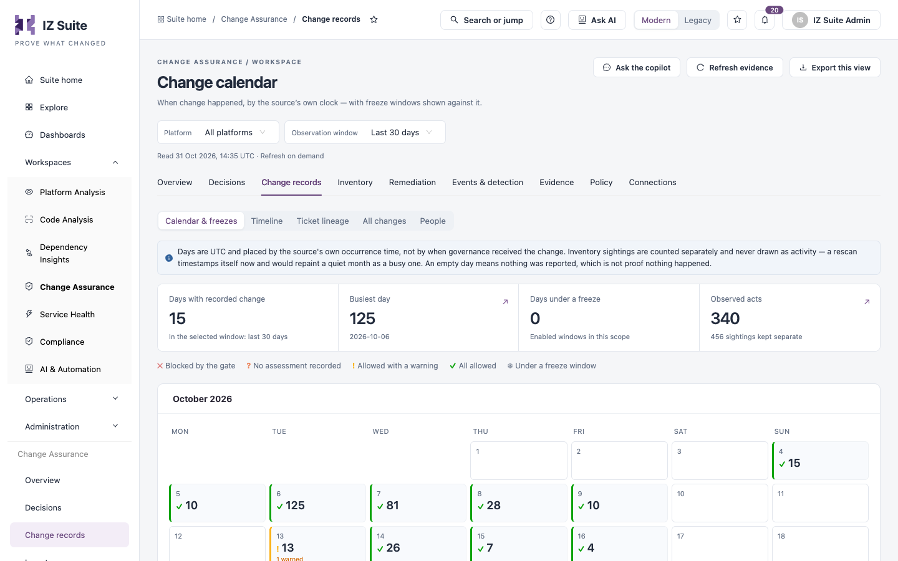
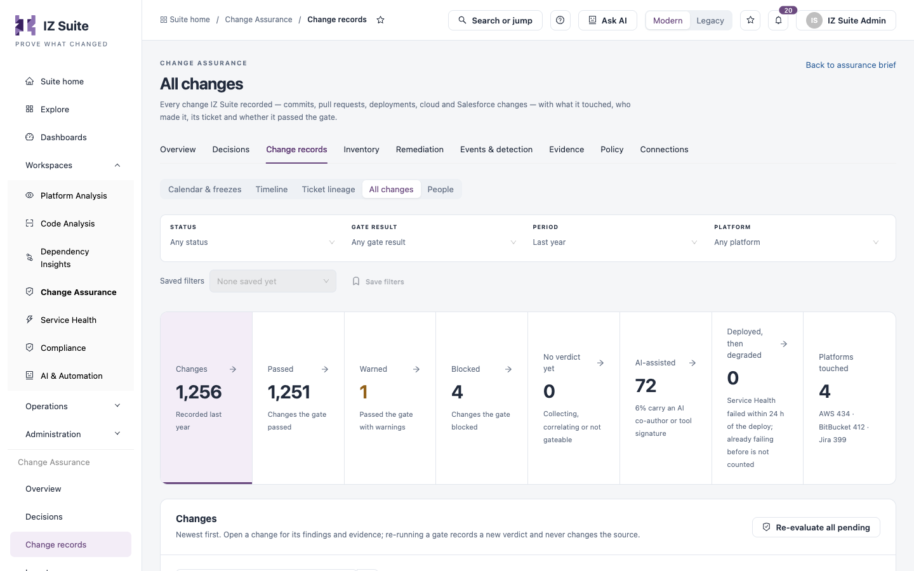
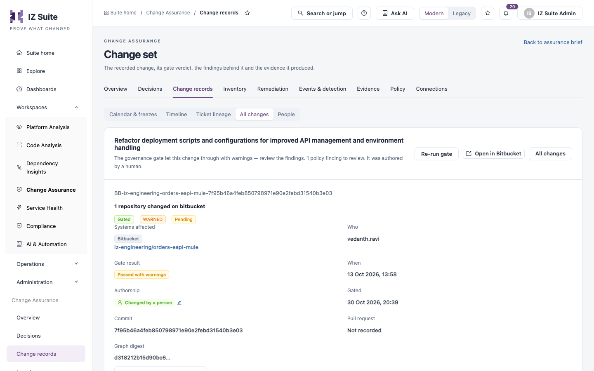

# Change Records

Change Records holds every change your connections recorded. Use it to see when changes happened, which ticket each change cites, who made it, and to declare freeze windows that restrict production changes.

Open it from **Workspaces** → **Change Assurance** → **Change records** in the sidebar, then pick a tab in the switcher.


Requires the **Change Assurance** licence. **Calendar & freezes** needs a role that can view the Change Assurance dashboard; **Timeline**, **Ticket lineage** and **All changes** need a role that can view changes; **People** needs a role that can manage changes.


## Calendar & freezes

A month-by-month calendar of recorded change. Days are UTC and placed by the source system's own time, not by when Change Assurance received the change. Inventory sightings are counted separately and never drawn as activity.

<figure><figcaption>
Calendar &#x26; freezes
</figcaption></figure>

| Tile                          | Description                                                        |
| ----------------------------- | ------------------------------------------------------------------ |
| **Days with recorded change** | Days in the window that have at least one change.                  |
| **Busiest day**               | The day with the most changes. Select it to open that day.         |
| **Days under a freeze**       | Days covered by enabled freeze windows.                            |
| **Observed acts**             | Changes in the window, with the number of sightings kept separate. |

Each day shows a mark for its worst result: **✕** blocked by the gate, **?** no assessment recorded, **!** allowed with a warning, **✓** all allowed, **❄** under a freeze window. Select a day to see its changes.

### Freeze windows

Configured restriction periods and what each does to a production change's verdict. A freeze is a statement of intent; it does not by itself prove nothing changed. The list shows **Name**, **Window**, **Environments**, **Effect on a production change**, **State** and **Actions**. **Review release readiness against these windows** opens [Release readiness](decisions.md).

### Declare a freeze window


You need a role that can manage changes. A freeze window is a real restriction: while it is active and enabled, a production change inside it adds its effect to the gate verdict.


1. Click **Declare a freeze window**.
2. Fill in the form.
3. Click **Declare window**.

| Field                             | Description                                                                                   |
| --------------------------------- | --------------------------------------------------------------------------------------------- |
| **Name**                          | **Required.** The window's name.                                                              |
| **Window (UTC)**                  | **Required.** Start and end of the window.                                                    |
| **Environment scope**             | Leave empty for all environments, or enter a name or pattern such as `Production` or `prod*`. |
| **Effect on a production change** | **Block — the gate refuses the change** or **Warn — recorded, not refused**.                  |
| **Reason**                        | Why the freeze applies.                                                                       |
| **Enabled**                       | Whether the window is in force.                                                               |

## Timeline

Days with recorded change, newest first, with the number of changes per gate verdict.

Filter: **PERIOD**.

| Tile                                   | Description                                                |
| -------------------------------------- | ---------------------------------------------------------- |
| **Changes**                            | All changes in the period, by source time.                 |
| **Allowed** / **Warned** / **Blocked** | Changes per gate verdict.                                  |
| **Not gated**                          | Changes with no verdict recorded. Not gated is not a pass. |

Columns: **Date**, **Changes by verdict**, **Total**, **Blocked**, **Warned**, **Not gated**. Select a date to open its changes. **Change calendar** opens **Calendar & freezes**.

## Ticket lineage

Shows which changes cite a ticket.

**Changes citing a ticket (90 days)** lists each source with **Changes**, **Citing a ticket** and **Without a ticket**. Only commits, pull requests and pipeline runs can carry a ticket key:

* **Missing a ticket**: the change has a message where a key could be cited, and cites none.
* **No place for a ticket**: the change has no message that could carry a key (for example a console change).

Select a count to see its changes. A note shows which tracker and projects accept keys. A linked ticket's own status is not read, so linked does not mean approved.

**Tickets referenced by governed changes** lists tickets, most-linked first, with **Ticket**, **System**, **Change sets** and **Source**. The **KEYS** filter limits the list to keys a connected tracker accepts; **Show them** lists the keys no tracker accepts. **Open ticket** opens a ticket by key.

### Ticket record

Select a ticket to open its record. It shows the ticket title, **Open in Jira**, and **Stages recorded** from request to deployment: **Requested**, **Built**, **Checked**, **Governed**, **Deployed** and **Verified**. Each stage names the system that recorded it; a stage with no record says so and is never shown as done. **Every change citing** the ticket lists its changes, with **VERDICT**, **MADE BY** and **PLATFORM** filters.

## All changes

Every change recorded in the period.

<figure><figcaption>
All changes
</figcaption></figure>

Filters: **STATUS**, **GATE RESULT**, **PERIOD** and **PLATFORM**. Search accepts a ticket key, commit or pull request.

| Tile                        | Description                                                    |
| --------------------------- | -------------------------------------------------------------- |
| **Changes**                 | Changes recorded in the period.                                |
| **Passed**                  | Changes the gate passed.                                       |
| **Warned**                  | Changes that passed the gate with warnings.                    |
| **Blocked**                 | Changes the gate blocked.                                      |
| **No verdict yet**          | Changes still collecting, correlating, or not gateable.        |
| **AI-assisted**             | Changes that carry an AI co-author or tool signature.          |
| **Deployed, then degraded** | Deployments after which Service Health failed within 24 hours. |
| **Platforms touched**       | Platforms with changes, with counts.                           |

| Column               | Description                                              |
| -------------------- | -------------------------------------------------------- |
| **What changed**     | The change summary and its identifier.                   |
| **Systems affected** | Platform and assets. Select an asset to open its record. |
| **Who**              | The actor.                                               |
| **Ticket**           | Linked tickets, or **None linked**.                      |
| **Gate result**      | The verdict.                                             |
| **When**             | When the change happened.                                |

**Re-evaluate all pending** runs the gate again for changes without a verdict. Re-running a gate records a new verdict and never changes the source.

### Change details

Select a change to open its details: **Systems affected**, **Who**, **Gate result**, **When**, **Tickets**, **Authorship**, **Commit**, **Pull request**, **Status** and **Approval**, then the **Findings** recorded against it. **Open full record** opens the [full change record](change-records.md#full-change-record), **Evidence recorded for this change** opens its ledger records, and **Record identity** shows its identifier.

## People

Joins the names a change's author goes by on different platforms into one person, so attribution counts each person once.

| Tile             | Description                                       |
| ---------------- | ------------------------------------------------- |
| **Same person?** | Groups of names awaiting a decision.              |
| **People**       | Confirmed people, with all their names.           |
| **Names read**   | Distinct change authors in the window.            |
| **AI-assisted**  | Share of attributed changes that are AI-assisted. |
| **Platforms**    | Platforms with named authors.                     |

**Same person?** lists proposed groups. Each name says why it matched (same email, same name, or the name part of an email). A group that shares only a name, no email, needs checking before you confirm it. Use **Same person** or **Not the same person** on each group.

**Not matched to a person** lists every name outside a confirmed person, busiest first, with **Name**, **Platforms**, **Changes**, **Blast radius** (distinct assets changed under that name), **AI-assisted**, **Recorded as**, **Match** and **Latest change**. Filters: **PLATFORM**, **RECORDED AS** and **MATCH**.

**Platform accounts** lists every account a connector records as the one who acted, with **Platform**, **Account**, **Person**, **Events**, **In changes**, **Blast radius** and **Last seen**. Bitbucket and Jira record a display name, not an account id.

## Full change record

The full record of one change: its gate verdict, the findings behind it, its approval, its tickets and the evidence it produced. Open it from a change's details with **Open full record**.

<figure><figcaption>
Full change record
</figcaption></figure>

### Summary

The header shows the change's headline and a sentence on its verdict, how many policy findings it has and who authored it. Below are the change identifier, its status, gate verdict and approval state, and these facts: **Systems affected**, **Who**, **Gate result**, **When**, **Authorship**, **Gated**, **Commit**, **Pull request** and **Graph digest**. An AI-assisted change also shows which tool assisted it and the evidence for that.

| Button                                           | Description                                                                  |
| ------------------------------------------------ | ---------------------------------------------------------------------------- |
| **Re-run gate**                                  | Runs the gate again. It records a new verdict and never changes the source.  |
| **Open in** _source system_ (or **Open source**) | Opens the run, commit, pull request or issue in the system that recorded it. |
| **All changes**                                  | Returns to the list.                                                         |
| **Correct who made this change**                 | Opens **Set attribution** (see below).                                       |

### Correct who made a change

Attribution is normally worked out from connector events. Setting it here overrides that and survives later re-correlation.

1. Click **Correct who made this change**, or the edit icon next to **Authorship**.
2. Under **Authored by**, choose **A person**, **An AI agent** or **Unknown**. **Required.**
3. For an AI agent, optionally enter **Generator (optional)** and **Share of AI-authored hunks (optional, %)** (0–100).
4. Click **Save**.

**Return to automatic** clears an earlier correction.

### Assessment

Whether Code Analysis (by commit) and Platform Analysis (per copy) assessed what the change touched, from its latest signed record.

* **Code verdict**: the Code Analysis quality-gate result for the change's commit.
* **Runtime posture**: one row per Platform Analysis copy the change touched, with **Asset**, **Stage**, **State**, **What the record says**, **Version** (whether the assessed version matches the deployed one) and **Rescan**.

### Asset controls

The enabled asset requirements checked against the collected state of each touched asset when the gate ran, with counts of failed, passed and not assessed checks. Columns: **Result**, **Control**, **Asset**, **Gate effect** and **Evidence**. This is the state at gate time; it does not reconstruct the asset at the original change time.

### Gate approval

The approval request for the change, with **Reason**, **Decision**, **Approver**, **Decided** and **Justification**. The gate verdict stands until an approver decides. **Open approval** opens the request in [Decisions](decisions.md).

### Change-request tickets

The tickets linked to the change, with **Ticket**, **System**, **Status** and **How linked** (**Confirmed**, **Confirmed relationship** or **Detected reference**). Production changes without a linked ticket are flagged by the gate.

| Row action        | Description                                                      |
| ----------------- | ---------------------------------------------------------------- |
| **Confirm link**  | Confirms a Jira ticket that was detected from the change's text. |
| Open ticket       | Opens the ticket at its address.                                 |
| **Unlink ticket** | Removes the link.                                                |

To link a ticket:

1. Click **Link ticket**.
2. Fill in the form and click **Link ticket**.

| Field                         | Description                                            |
| ----------------------------- | ------------------------------------------------------ |
| **System**                    | **Required.** **Jira**, **ServiceNow** or **Generic**. |
| **Ticket key**                | **Required.** For example `PROJ-123` or `CHG0012345`.  |
| **Ticket address (optional)** | The ticket's full `https://` address.                  |

The link is recorded as manual.

### Tabs

| Tab                 | What it shows                                                                                                                                                                                                         |
| ------------------- | --------------------------------------------------------------------------------------------------------------------------------------------------------------------------------------------------------------------- |
| **Findings**        | Each finding with **Severity**, **Source**, **What was found**, **Asset**, **Controls** and **Remediation**. **Remediate** on a row starts remediation for that finding on its asset.                                 |
| **Affected assets** | The assets the change touched, with **Asset**, **Type**, **Platform**, **Operation** and **Reachable**, and the relationships in the change. **Explore impact from this asset** opens [Explore impact](inventory.md). |
| **Evidence**        | The ledger records for the change, with **Sequence**, **Kind**, **Gate**, **Hash** and **Occurred**. A stored hash is not verification. **Open this change in the evidence ledger** opens [Raw ledger](evidence.md).  |
| **Source events**   | The source events behind the change. **See event details** opens one.                                                                                                                                                 |
| **Recorded data**   | The **Resolved graph** and **Normalized change set** as recorded.                                                                                                                                                     |

**Record identity** shows the change's record id.


**Re-run gate** and **Remediate** need a role that can manage assets. Correcting attribution and linking, confirming or unlinking tickets need a role that can manage changes.


## Next steps

* [Decisions](decisions.md): check a release against freeze windows.
* [Inventory](inventory.md): open the assets a change touched.
* [Evidence](evidence.md): the signed records behind each change.
