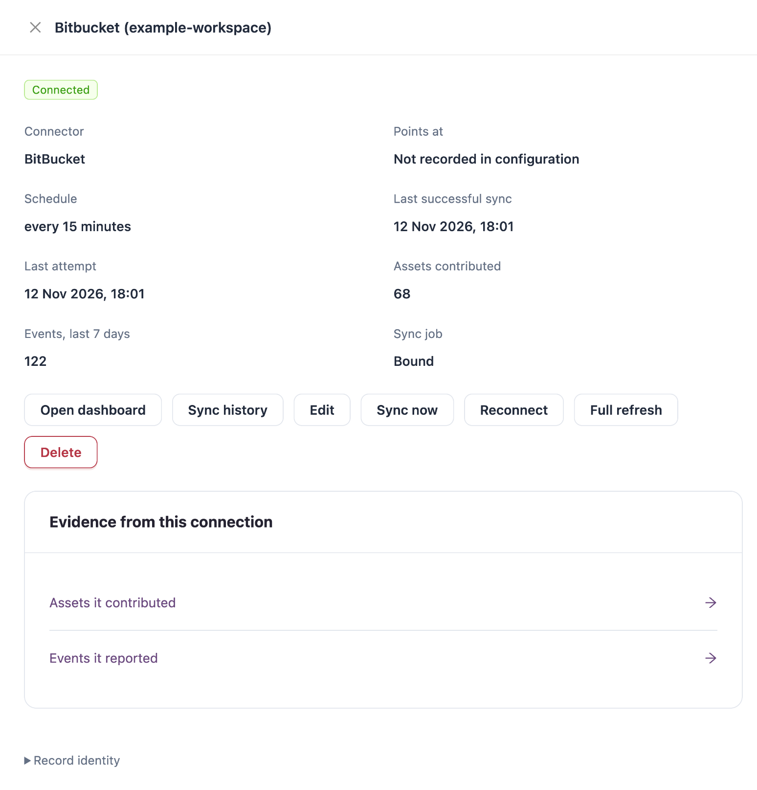

# Connections

Connections are how Change Assurance learns about change. Each connection reads one source system (a source-control workspace, a cloud account, an integration platform, a ticket tracker) on a schedule and records its assets and events.

Open it from **Workspaces** → **Change Assurance** → **Connections** in the sidebar, or with **Connections** at the top right of the Change Assurance stages. **Back to Overview** returns to the Change Assurance overview; the switcher next to it opens **Connections** and **Collection coverage**.


Requires the **Change Assurance** licence. **Connections** needs a role that can view connections; **Collection coverage** needs a role that can view the Change Assurance dashboard.


## Connections

<figure><figcaption></figcaption></figure>

Filters: **CONNECTOR** and **STATUS**. **Save filters** keeps the current filters under a name; **Saved filters** brings them back.

| Tile                                  | Description                                                                           |
| ------------------------------------- | ------------------------------------------------------------------------------------- |
| **Connections**                       | Connections configured in this organization.                                          |
| **Reported connected**                | Connections whose last reported status is connected, and the oldest good sync.        |
| **In error**                          | Connections reporting an error.                                                       |
| **Connected but no sync in 24 hours** | Connections not in error or paused whose last success is over 24 hours ago, or never. |
| **Organization assets**               | Assets from all sources in this organization.                                         |
| **Events, last 7 days**               | Events recorded by all connections.                                                   |

Columns: **Connection** (name, connector and address), **Status**, **Schedule**, **Last success**, **Assets**, **Events (7d)** and **Sync**. The **Sync** column pauses or resumes a connection's sync.

**Import** loads connection configurations from a JSON file; credentials are not imported, so edit each imported connection to enter them before it syncs. **Export** above the table downloads the list.


A reported status is not proof of complete or continuous collection. Check **Collection Coverage** below for what each connection substantiates.


### Connection Details

Select a connection to open its details.

<figure><figcaption></figcaption></figure>

The details show **Connector**, **Points at**, **Schedule**, **Last successful sync**, **Last attempt**, **Assets contributed**, **Events, last 7 days** and **Sync job**.

| Button             | Description                                                  |
| ------------------ | ------------------------------------------------------------ |
| **Open dashboard** | Opens the connection's dashboard.                            |
| **Sync history**   | Lists past sync runs.                                        |
| **Edit**           | Changes the connection's settings.                           |
| **Sync now**       | Starts a sync.                                               |
| **Reconnect**      | Signs in to the source system again.                         |
| **Full refresh**   | Forces a full re-sync of everything the connection collects. |
| **Delete**         | Removes the connection.                                      |

**Evidence from this connection** links to **Assets it contributed** and **Events it reported**.


Deleting a connection cannot be undone.


### Add a Connection


You need a role that can manage connections.


1. Click **Add connection**. The steps open on their own page; **Cancel** leaves without creating anything.
2. **Choose connector**: select the system to bring into assurance and click **Continue**.
3. **Connection details**: enter the address and credentials, or sign in for connectors that use OAuth.
4. **Collection settings**: choose what to collect and how often.
5. **Review & create**: check the settings and create the connection.

| Connector                      | Collects                                                                                                                                        |
| ------------------------------ | ----------------------------------------------------------------------------------------------------------------------------------------------- |
| **Amazon Web Services**        | AWS resources across selected regions, and CloudTrail write activity as attributable change evidence.                                           |
| **AutoRABIT ARM**              | Salesforce release management: deployments, changed metadata, Apex test results and coverage, linked stories and commits, builds and rollbacks. |
| **AutoRABIT Vault**            | Salesforce backup and recovery activity.                                                                                                        |
| **Azure DevOps**               | Repository commits, completed pull requests and completed pipeline runs.                                                                        |
| **Azure Integration Services** | API Management services and APIs, Logic Apps and Function Apps.                                                                                 |
| **BitBucket**                  | Commits and merged pull requests across a workspace's repositories. Uses OAuth.                                                                 |
| **CodeScan**                   | Static-analysis projects with their quality-gate verdict and issue counts.                                                                      |
| **GitHub**                     | Commits and merged pull requests across an organization's repositories. Uses OAuth.                                                             |
| **Jira**                       | Projects and issues, with each issue's key and title.                                                                                           |
| **MuleSoft Anypoint Platform** | API management, specs and contracts, runtime deployments and access management.                                                                 |
| **Salesforce**                 | Change, security configuration, integration surface and Agentforce metadata activity.                                                           |

### Jira Release Timing

A Jira connection can record when versions are released. Its settings include **Capture issue release membership history** and **Receive signed Jira release actions**.

To receive release actions:

1. Edit the Jira connection, turn on **Capture issue release membership history** and **Receive signed Jira release actions**, and save it.
2. Sync the selected projects.
3. Copy the **Jira webhook URL** shown on the connection, and generate the **Webhook signing secret**.
4. In Jira, a Jira administrator opens **Jira administration** → **System** → **Webhooks** and adds an enabled webhook with that URL. Paste the signing secret into the webhook's **Secret** field and keep the request body included.
5. Select only the events `jira:version_released` and `jira:version_unreleased`.


Never put the signing secret in the URL. Rotating the secret stops the existing Jira webhook from authenticating until you update its **Secret** field.


Only deliveries received after setup are recorded; missed or earlier release actions stay unknown.

## Collection Coverage

Which connection substantiates which assets. The page reads stored data live; that does not mean the source systems are streaming. It uses the selected organization, not the platform or activity-window filters.

**Collection status** lists **Connection**, **Organization**, **Reported status**, **Last successful collection**, **Assets substantiated**, **Sole source for** and **Relationships**. The **This IZ Suite** row is built in: it reads the applications IZ Suite already holds, in every organization. Connection timestamps are watermarks, not a completeness guarantee. **Manage connections** opens the **Connections** tab. **Refresh evidence** reloads the view and **Export this view** downloads it.

## Next Steps

* [Detect](detect.md): the changes your connections recorded.
* [Policy](policy.md): set each connection's lifecycle role.
* [Change Assurance](./): how the stages fit together.
