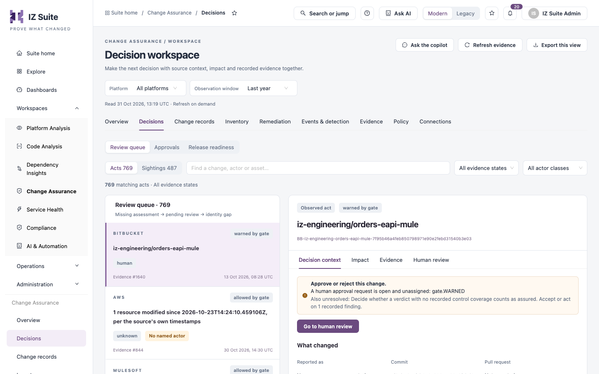
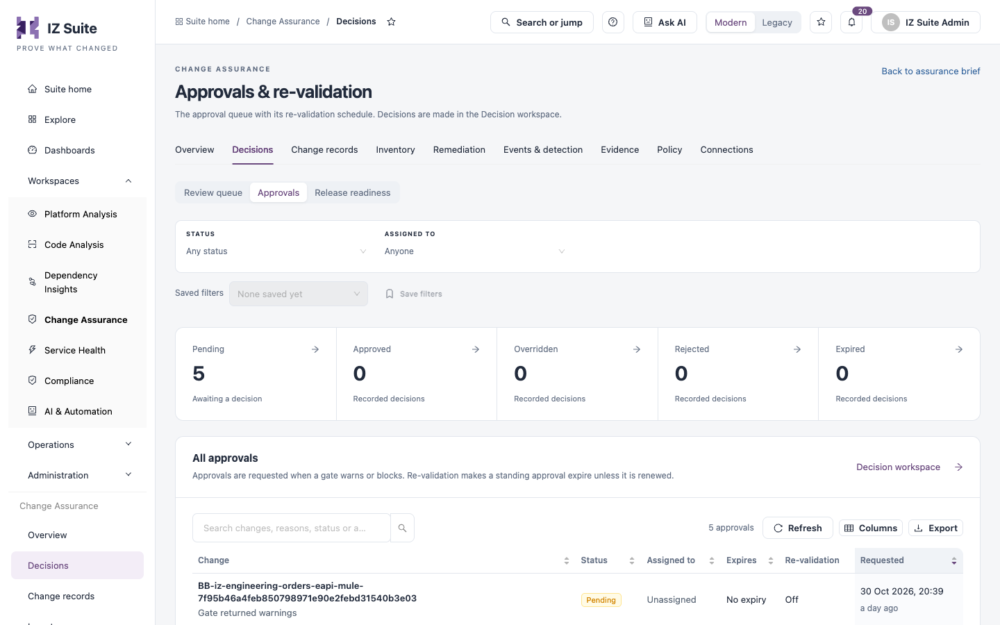
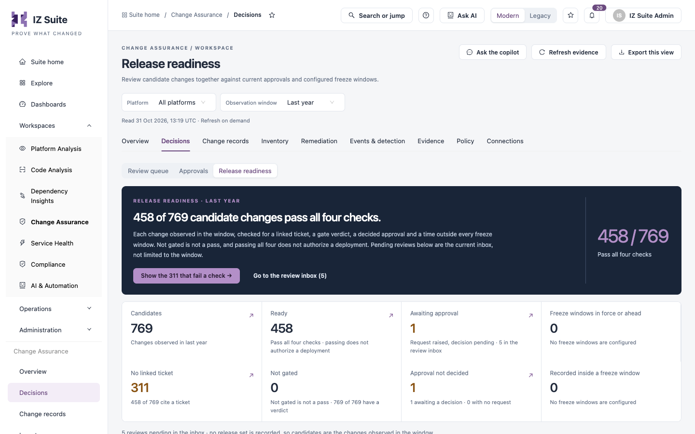

# Decisions

Decisions is where change approvers and release managers act. The **Review queue** puts a change's source, impact and evidence side by side, **Approvals** lists every approval request, and **Release readiness** checks candidate changes against tickets, verdicts, approvals and freeze windows.

Open it from **Workspaces** → **Change Assurance** → **Decisions** in the sidebar, then pick a tab in the switcher.


Requires the **Change Assurance** licence. **Review queue** and **Release readiness** need a role that can view the Change Assurance dashboard; **Approvals** needs a role that can view or manage approvals.


## Review queue

The decision workspace. The left column lists changes, ordered so that missing assessments come first, then pending reviews, then identity gaps. The right panel shows the selected change.

<figure><figcaption>
Review queue
</figcaption></figure>

### Filters

| Control                  | Description                                                                                           |
| ------------------------ | ----------------------------------------------------------------------------------------------------- |
| **Acts** / **Sightings** | **Acts** are observed changes. **Sightings** are inventory observations, kept separate from activity. |
| Search                   | Finds a change, actor or asset.                                                                       |
| **All evidence states**  | Limits the queue by evidence state.                                                                   |
| **All actor classes**    | Limits the queue by who acted (for example human or unknown).                                         |

Each card shows the platform, the gate result (for example **warned by gate**), the actor class, the evidence record number and the time.

### Selected change

The panel header shows the change name, its identifier and its gate result. If the change waits for a person, a notice says what is unresolved and offers **Go to human review**.

| Tab                  | What it shows                                                                                                                                                                                                                                                                                                                                                                    |
| -------------------- | -------------------------------------------------------------------------------------------------------------------------------------------------------------------------------------------------------------------------------------------------------------------------------------------------------------------------------------------------------------------------------- |
| **Decision context** | **What changed** (reported summary, commit, pull request), **Platforms** and **Assets touched**, **What the gate recorded** (severity and each finding), **Actor identity**, **Reviewer assignment** and the **Observed sequence**: when the source reported the activity, when Change Assurance received it, when the assessment was recorded and when the evidence was stored. |
| **Impact**           | The assets the change touched, with platform and operation, and the current relationships that touch those assets with their trust labels. Reach is context, not proof of business impact.                                                                                                                                                                                       |
| **Evidence**         | The latest evidence record for the change: gate phase, when it was recorded, the control keys recorded and whether a signature is stored. **The ledger for this change** opens its records.                                                                                                                                                                                      |
| **Human review**     | The open approval request: status, **Assigned to**, **Expires**, **Decided by** and **Decided at**, and which approval rule governs it.                                                                                                                                                                                                                                          |

Buttons at the bottom of the panel:

* **Request a fresh assessment** runs the gate again. It records a new verdict and never changes the source.
* **Export record** downloads the selected change's record.


When no approval rule governs a request, a built-in default applies: one approval, from anyone permitted to record a decision, with no deadline. **Review the approval policy for this organization** opens [Approval rules](policy.md).


### Record a human decision


You need a role that can manage approvals. A decision is real and audited. It does not change the machine verdict.


1. Select the change in the queue.
2. Open the **Human review** tab.
3. Optionally click **Assign to me**.
4. Click **Record human decision**.
5. Fill in the form and click **Confirm and record decision**.

| Field                                                       | Description                                   |
| ----------------------------------------------------------- | --------------------------------------------- |
| **Decision**                                                | **Approved**, **Overridden** or **Rejected**. |
| **Justification**                                           | Why you decided this way.                     |
| **I have reviewed the source, impact and evidence limits.** | Confirm before recording.                     |

## Approvals

The approval queue with its re-validation schedule. Approvals are requested when a gate warns or blocks. Re-validation makes a standing approval expire unless it is renewed. Decisions are made in the review queue; **Decision workspace** opens it.

<figure><figcaption>
Approvals
</figcaption></figure>

Filters: **STATUS** and **ASSIGNED TO**.

| Tile           | Description                                                  |
| -------------- | ------------------------------------------------------------ |
| **Pending**    | Awaiting a decision.                                         |
| **Approved**   | Recorded decisions that approved the change.                 |
| **Overridden** | Recorded decisions that accepted the change past the policy. |
| **Rejected**   | Recorded decisions that rejected the change.                 |
| **Expired**    | Approvals that passed their deadline.                        |

| Column            | Description                                                                                                        |
| ----------------- | ------------------------------------------------------------------------------------------------------------------ |
| **Change**        | The change and why approval was requested (for example **Gate returned warnings** or **Gate blocked the change**). |
| **Status**        | Pending, approved, overridden, rejected or expired.                                                                |
| **Assigned to**   | The reviewer, or **Unassigned**.                                                                                   |
| **Expires**       | The decision deadline, or **No expiry**.                                                                           |
| **Re-validation** | Whether the approval must be renewed.                                                                              |
| **Requested**     | When the gate raised the request.                                                                                  |

## Release readiness

Review candidate changes together against current approvals and configured freeze windows. Each change in the window is checked for four things: a linked ticket, a gate verdict, a decided approval and a time outside every freeze window.


A change that is not gated does not pass. Passing all four checks does not authorize a deployment.


<figure><figcaption>
Release readiness
</figcaption></figure>

| Tile                                 | Description                                       |
| ------------------------------------ | ------------------------------------------------- |
| **Candidates**                       | Changes observed in the window.                   |
| **Ready**                            | Changes that pass all four checks.                |
| **Awaiting approval**                | A request was raised and the decision is pending. |
| **Freeze windows in force or ahead** | Freeze windows that apply now or later.           |
| **No linked ticket**                 | Changes that cite no ticket.                      |
| **Not gated**                        | Changes with no gate verdict.                     |
| **Approval not decided**             | Changes awaiting a decision, or with no request.  |
| **Recorded inside a freeze window**  | Changes made during a freeze.                     |

**Show the&#x20;**_**n**_**&#x20;that fail a check** filters the list to failing changes. **Go to the review inbox** opens the pending reviews.

### Cross-check candidate changes together

Select changes in the candidate list to see what is outstanding across them before they ship together.

| Control                     | Description                                                                                                              |
| --------------------------- | ------------------------------------------------------------------------------------------------------------------------ |
| **Proposed date and time**  | Optional. Checks the selection against configured freeze windows at that moment. It states intent; it is not a schedule. |
| **CHECK**                   | Filters candidates by the check they fail.                                                                               |
| **Record this cross-check** | Writes the selection to the signed evidence ledger.                                                                      |
| **Export candidate review** | Downloads the selection and its checks.                                                                                  |

The candidate list shows **Observed act**, **Ticket**, **Checks it fails**, **Recorded activity** and **Gate verdict**.

### Human review inbox

Pending human reviews, with **Change**, **Review reason**, **Assigned to**, **Expires** and **Status**. A machine verdict does not replace a human decision.

### Configured freeze windows

The freeze windows for the organization, with **Window**, **Environment scope**, **Starts**, **Ends**, **Effect**, **Reason** and **State**. **Manage freeze windows** opens [Calendar & freezes](change-records.md).

## Next steps

* [Change Records](change-records.md): declare freeze windows and browse every change.
* [Policy](policy.md): set who must approve and by when.
* [Evidence](evidence.md): export and verify the evidence behind decisions.
