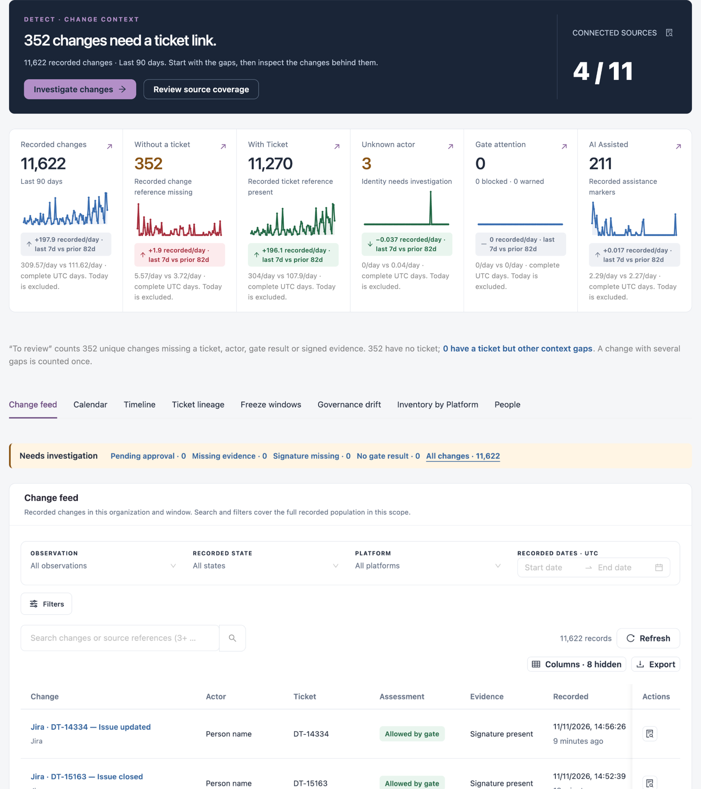
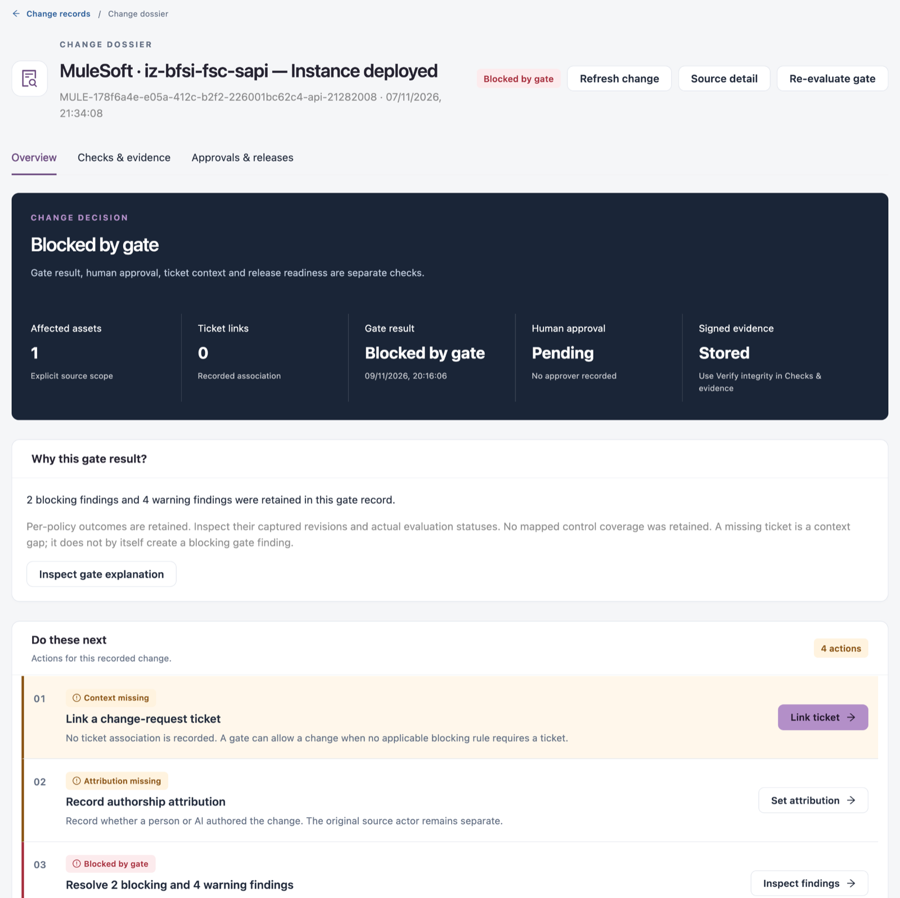

# Detect

**Detect** answers "What changed, and what needs investigation?". It holds every change your connections recorded, by day, ticket and author, with the gaps in each change's trail: no ticket, no named actor, no gate result or no signed evidence. Use it to find changes that bypassed the process and to declare freeze windows.

Open it from **Workspaces** → **Change Assurance** → **Detect** in the sidebar.


Requires the **Change Assurance** licence. You need a role that can view changes. **Inventory by Platform** needs a role that can view assets, and **People** a role that can manage changes.


<figure><figcaption></figcaption></figure>

## Change Context

The top of the page states the main gap (for example "352 changes need a ticket link") for the selected **Period**, with **Investigate changes** and **Review source coverage**. **Connected sources** shows how many of the supported sources are connected.

| Tile                 | What it counts                              |
| -------------------- | ------------------------------------------- |
| **Recorded changes** | Changes recorded in the period.             |
| **Without a ticket** | Changes with no recorded ticket reference.  |
| **With Ticket**      | Changes with a recorded ticket reference.   |
| **Unknown actor**    | Changes whose actor needs investigation.    |
| **Gate attention**   | Changes the gate blocked or warned about.   |
| **AI Assisted**      | Changes that carry an AI assistance marker. |

Each tile also shows the trend: changes recorded per day in the last 7 days against the days before, on complete UTC days. Select a tile (↗) to open its changes.

"To review" counts each change missing a ticket, actor, gate result or signed evidence once, however many gaps it has.

## Views

| View                      | Use it to                                              |
| ------------------------- | ------------------------------------------------------ |
| **Change feed**           | Search every recorded change.                          |
| **Calendar**              | See recorded change by day.                            |
| **Timeline**              | Count changes per day by gate verdict.                 |
| **Ticket lineage**        | See which changes cite a ticket.                       |
| **Freeze windows**        | Declare and review freeze windows.                     |
| **Governance drift**      | Review configuration and runtime drift findings.       |
| **Inventory by Platform** | Review the assets each platform reported.              |
| **People**                | Join the names one person uses on different platforms. |

## Change Feed

The quick filters under **Needs investigation** narrow the feed: **Pending approval**, **Missing evidence**, **Signature missing**, **No gate result** and **All changes**, each with its count.

Filters: **OBSERVATION**, **RECORDED STATE**, **PLATFORM** and **RECORDED DATES · UTC**; **Filters** holds more. Search and filters cover every recorded change in the scope.

| Column         | Description                                       |
| -------------- | ------------------------------------------------- |
| **Change**     | The platform and what changed.                    |
| **Actor**      | Who made the change.                              |
| **Ticket**     | The tickets the change cites.                     |
| **Assessment** | The gate result, for example **Allowed by gate**. |
| **Evidence**   | Whether a signature is present.                   |
| **Recorded**   | When the change happened.                         |
| **Actions**    | **Inspect change** opens the change dossier.      |

**Columns** shows more columns.

### Change Dossier

<figure><figcaption></figcaption></figure>

The dossier header names the change, its source reference and time, and its gate result.

| Button               | Description                                                                                                                           |
| -------------------- | ------------------------------------------------------------------------------------------------------------------------------------- |
| **Refresh change**   | Reads the change's latest records again.                                                                                              |
| **Source detail**    | Opens **Source and change model**: the source events behind the change and how they were read.                                        |
| **Re-evaluate gate** | Opens **Re-evaluate this change**; **Run gate evaluation** runs the gate again and keeps the new result. It never changes the source. |

| Tab                      | What it shows                                                                                                                                                                                                                                                                                                                                                                                                                  |
| ------------------------ | ------------------------------------------------------------------------------------------------------------------------------------------------------------------------------------------------------------------------------------------------------------------------------------------------------------------------------------------------------------------------------------------------------------------------------ |
| **Overview**             | **Change decision**: affected assets, ticket links, gate result, human approval and signed evidence, which are separate checks. **Why this gate result?** with **Inspect gate explanation**. **Do these next** for any gap. **Change context**: named actor, authorship, AI assistance, commit, pull request and source reference, with **Link ticket** and **Edit attribution**. Then the linked tickets and affected assets. |
| **Checks & evidence**    | Why the gate allowed or stopped the change: every policy and control retained in the signed gate record, with its recorded outcome, evaluations and severity.                                                                                                                                                                                                                                                                  |
| **Approvals & releases** | **Who approves this change?**: the approval request, its reviewer and **Assign or decide approval**. **Release membership**: the releases that include the change, and **Attach change to release**.                                                                                                                                                                                                                           |

To link a ticket, click **Link ticket**, choose the **System**, enter the **Ticket key** (for example `PROJ-123` or `CHG0012345`) and optionally the **Ticket URL (optional)**, then click **Link ticket**. **Edit attribution** sets who made the change (a person, an AI agent or unknown); it overrides the attribution worked out from connector events.


**Re-evaluate gate** needs a role that can manage assets. Linking tickets and editing attribution need a role that can manage changes.


## Calendar

A month-by-month calendar of recorded change. Days are UTC and follow the source system's own time. An empty day means no change was recorded, not proof that nothing happened.

| Tile                          | Description                                                |
| ----------------------------- | ---------------------------------------------------------- |
| **Days with recorded change** | Days in the period that have at least one change.          |
| **Busiest day**               | The day with the most changes. Select it to open that day. |
| **Days under a freeze**       | Days covered by enabled freeze windows.                    |
| **Recorded change acts**      | Changes in the period.                                     |

Each day shows a mark for its worst result: **✕** blocked by the gate, **?** no assessment recorded, **!** allowed with a warning, **✓** all allowed, **❄** under a freeze window. Select a day to see its changes.

## Timeline

Days with recorded change, newest first, with the number of changes per gate verdict.

| Tile                                   | Description                                                |
| -------------------------------------- | ---------------------------------------------------------- |
| **Changes**                            | All changes, by source time.                               |
| **Allowed** / **Warned** / **Blocked** | Changes per gate verdict.                                  |
| **Not gated**                          | Changes with no verdict recorded. Not gated is not a pass. |

Columns: **Date**, **Changes by verdict**, **Total**, **Blocked**, **Warned**, **Not gated**. Select a date to open its changes. **Change calendar** opens **Calendar**.

## Ticket Lineage

**Changes citing a ticket (90 days)** lists each source with **Changes**, **Citing a ticket** and **Without a ticket**. Only commits, pull requests and pipeline runs can carry a ticket key:

* **Missing a ticket**: the change has a message where a key could be cited, and cites none.
* **No place for a ticket**: the change has no message that could carry a key (for example a console change), so only rules or approvals can link it.

Select a count to see its changes. A linked ticket's own status is not read, so linked does not mean approved.

**Tickets referenced by governed changes** lists tickets, most-linked first. Select a ticket to open its record: the stages recorded from request to deployment (**Requested**, **Built**, **Checked**, **Governed**, **Deployed**, **Verified**), each naming the system that recorded it, and every change citing the ticket. A stage with no record says so and is never shown as done.

## Freeze Windows

Configured restriction periods and what each does to a production change's verdict. A freeze is a statement of intent; it does not by itself prove nothing changed. The list shows **Name**, **Window**, **Environments**, **Effect on a production change**, **State** and **Actions**. **Review release readiness against these windows** opens [Assure](assure.md).

### Declare a Freeze Window


You need a role that can manage changes. A freeze window is a real restriction: while it is active and enabled, a production change inside it adds its effect to the gate verdict.


1. Click **Declare a freeze window**.
2. Fill in the fields below.
3. Click **Declare window**.

| Field                             | Description                                                                                   |
| --------------------------------- | --------------------------------------------------------------------------------------------- |
| **Name**                          | **Required.** The window's name.                                                              |
| **Window (UTC)**                  | **Required.** Start and end of the window.                                                    |
| **Environment scope**             | Leave empty for all environments, or enter a name or pattern such as `Production` or `prod*`. |
| **Effect on a production change** | **Block — the gate refuses the change** or **Warn — recorded, not refused**.                  |
| **Reason**                        | Why the freeze applies.                                                                       |
| **Enabled**                       | Whether the window is in force.                                                               |

## Governance Drift

Configuration changes and runtime drift against each asset's approved baseline. Drift findings keep their own scope, independent of the period.

* **Configure drift rules** chooses which properties must stay stable; **Configure anomaly rules** sets the conditions recorded activity is tested against. Both open [Policy](policy.md).
* Filter: **SEVERITY**. Columns: **Detected**, **Affected node**, **Source**, **Rule**, **Finding**, **Severity**, **Status** and **Actions**.
* **Compare finding** shows the stored expected and observed values. A detected difference stays on record until someone authorized resolves it.

A match with the baseline does not establish approval.

## Inventory by Platform

The master record of every asset your connectors collected, by platform. Counts cover the whole organization.

| Tile            | Description                              |
| --------------- | ---------------------------------------- |
| **Assets**      | Assets on every platform.                |
| **AI Assisted** | Assets changed with AI in the last year. |
| **Platforms**   | Platforms with assets.                   |
| **At risk**     | Assets failing a policy or gate.         |
| **Unowned**     | Assets with no owner.                    |

Filters: **PLATFORM**, **ASSETS IN STATE** and **SHOW**. One row per platform with **Assets**, **At risk**, **Unowned**, **AI Assisted**, **With ticket**, **Cross-platform**, **Lifecycle complete** and **Last collected**; expand a row for its asset types. Select a count to see its assets, or a platform to open its page.

## People

Joins the names a change's author goes by on different platforms (Git authors, emails, AWS roles, Jira users) into one person, so their changes, approvals and AI-assisted work count once. Nothing is joined until someone confirms it.

| Tile             | Description                                                               |
| ---------------- | ------------------------------------------------------------------------- |
| **Same person?** | Groups of names awaiting a decision.                                      |
| **People**       | Confirmed people, with all their names.                                   |
| **Names read**   | Distinct change authors; those not in a person are under **Not matched**. |
| **AI-assisted**  | Share of attributed changes that are AI-assisted.                         |
| **Platforms**    | Platforms with named authors.                                             |

| Tab                   | What it shows                                                                                                                                                                                                             |
| --------------------- | ------------------------------------------------------------------------------------------------------------------------------------------------------------------------------------------------------------------------- |
| **Same person?**      | Proposed groups. Each name says why it matched (same email, same name, or the name part of an email). Use **Same person** or **Not the same person** on each group. A group that shares only a name needs checking first. |
| **People**            | Confirmed people and their names.                                                                                                                                                                                         |
| **Not matched**       | Every name outside a confirmed person, busiest first.                                                                                                                                                                     |
| **Platform accounts** | Every account a connector records as the one who acted. Bitbucket and Jira record a display name, not an account id.                                                                                                      |

## Next Steps

* [Assure](assure.md): decide on changes the gate held.
* [Prove](prove.md): the signed evidence behind each change.
* [Connections](connections.md): connect more sources.
