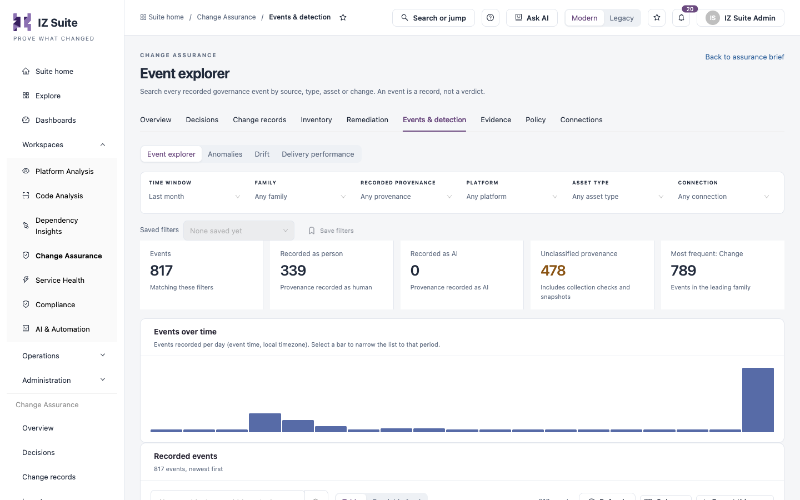
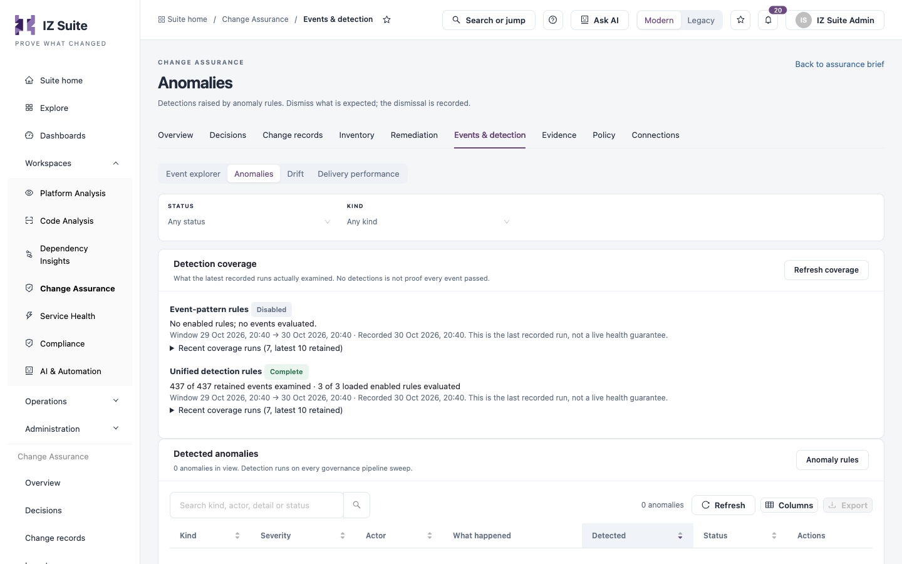

# Events & Detection

Events & Detection shows the raw events behind every change and what automatic detection found in them. Security reviewers use it to investigate unusual activity; platform owners use it to catch configuration that drifted from its approved baseline.

Open it from **Workspaces** → **Change Assurance** → **Events & detection** in the sidebar, then pick a tab in the switcher.


Requires the **Change Assurance** licence. **Anomalies** needs a role that can view anomalies; the other tabs need a role that can view events.


## Event explorer

Every event your connections recorded, newest first.

<figure><figcaption>
Event explorer
</figcaption></figure>

Filters: **TIME WINDOW**, **FAMILY**, **RECORDED PROVENANCE**, **PLATFORM**, **ASSET TYPE** and **CONNECTION**.

| Tile                        | Description                                                           |
| --------------------------- | --------------------------------------------------------------------- |
| **Events**                  | Events matching the filters.                                          |
| **Recorded as person**      | Events whose provenance is recorded as human.                         |
| **Recorded as AI**          | Events whose provenance is recorded as AI.                            |
| **Unclassified provenance** | Events with no provenance, including collection checks and snapshots. |
| **Most frequent**           | The leading event family and its count.                               |

**Events over time** charts events per day in your local time zone. Select a bar to narrow the list to that day.

**Recorded events** shows the list as a **Table** or a **Readable feed**. Columns: **Time**, **Event** (family and event type), **Asset / subject**, **Changed by**, **Source** (the connection), **Change** and **Actions**.

## Anomalies

Anomalies are detections that match an [anomaly rule](policy.md), such as bulk permission grants or off-hours admin changes.

<figure><figcaption>
Anomalies
</figcaption></figure>

Filters: **STATUS** and **KIND**.

**Detection coverage** shows what the latest recorded detection runs examined: the rules evaluated, the events examined and the time window of each run. **Refresh coverage** reads it again.

**Detected anomalies** lists **Kind**, **Severity**, **Actor**, **What happened**, **Detected**, **Status** and **Actions**. **Anomaly rules** opens the rules in Policy.


No detections is not proof that nothing unusual happened. Check **Detection coverage** to see which rules ran.


## Drift

Configuration changes and runtime drift against each asset's approved baseline. Drift rules in [Policy](policy.md) decide which properties are watched.

Filter: **SEVERITY**.

Columns: **Detected**, **Affected node**, **Source**, **Rule**, **Finding**, **Severity**, **Status** and **Actions**.

Runtime checks compare what was observed with a gated prediction, including blocked or pending changes. A match does not establish approval, and missing telemetry cannot confirm a match.

## Delivery performance

Delivery metrics from production deployments.

| Tile                      | Description                                                        |
| ------------------------- | ------------------------------------------------------------------ |
| **Deployment frequency**  | How often production deployments happen.                           |
| **Lead time for changes** | Time from change to production deployment.                         |
| **Change failure rate**   | Share of production deployments linked to an incident or rollback. |

**Production deployments per week** charts the last 12 weeks; the dashed line is the mean of complete weeks.

**How production is decided** lists each connection with its **Production branches**. A pipeline run counts as a production deployment when its branch matches the connection's production branches. A deployment counts once per commit, the first time it succeeds on a production branch. Only connections that send deployment events (for example Bitbucket Pipelines) use this rule. Time to restore is not shown.

## Next steps

* [Policy](policy.md): turn anomaly and drift rules on or off.
* [Remediation](remediation.md): act on what detection found.
* [Connections](connections.md): see which connection reported each event.
