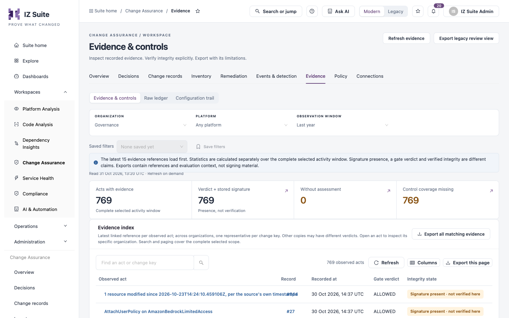
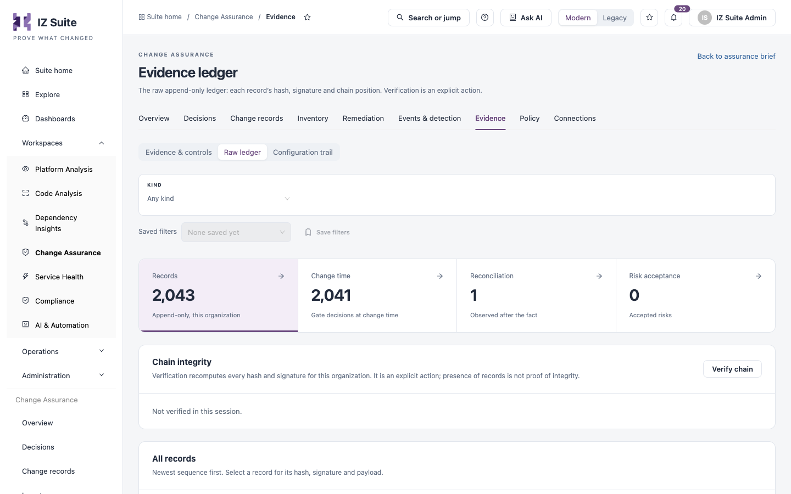

# Evidence

Evidence is what you hand to an auditor. **Evidence & controls** indexes the evidence for every change, **Raw ledger** shows the append-only, signed records themselves, and **Configuration trail** records who changed Change Assurance setup.

Open it from **Workspaces** → **Change Assurance** → **Evidence** in the sidebar, then pick a tab in the switcher.


Requires the **Change Assurance** licence. **Evidence & controls** needs a role that can view the Change Assurance dashboard; **Raw ledger** needs a role that can view evidence; **Configuration trail** needs a role that can view assets.


## Evidence & controls

<figure><figcaption>
Evidence &#x26; controls
</figcaption></figure>

Filters: **ORGANIZATION**, **PLATFORM** and **OBSERVATION WINDOW**. The latest 15 evidence references load first; the tiles count the complete window.

| Tile                           | Description                                                                        |
| ------------------------------ | ---------------------------------------------------------------------------------- |
| **Acts with evidence**         | Changes in the window with an evidence record.                                     |
| **Verdict + stored signature** | Records with a verdict and a stored signature. This is presence, not verification. |
| **Without assessment**         | Changes with no gate assessment.                                                   |
| **Control coverage missing**   | Records with no control recorded against them.                                     |

**Evidence index** lists the latest evidence reference per change, with **Observed act**, **Record**, **Recorded at**, **Gate verdict** and **Integrity state**. Across organizations it shows one representative record per change; open a change to inspect its own organization's copy.

| Button                           | Description                                                                                                                                                |
| -------------------------------- | ---------------------------------------------------------------------------------------------------------------------------------------------------------- |
| **Export all matching evidence** | Downloads every matching record. If the evidence changes during the export or the export grows past its 32 MB safety limit, no partial file is downloaded. |
| **Verify evidence integrity**    | Checks linkage, hashes and signatures for the whole organization, not only this window. It runs only when you ask; refreshing clears the result.           |

**Recorded governance acts** lists the latest 25 recorded decisions and reviews, including acts that cover several changes, with **Record**, **Act**, **What it covers**, **By** and **Recorded**.


A stored signature, a gate verdict and verified integrity are three different claims. Only **Verify evidence integrity** or **Verify chain** checks integrity.


## Raw ledger

The append-only record of every gate decision for the organization, newest sequence first.

<figure><figcaption>
Raw ledger
</figcaption></figure>

Filter: **KIND**.

| Tile                | Description                              |
| ------------------- | ---------------------------------------- |
| **Records**         | All ledger records for the organization. |
| **Change time**     | Gate decisions made at change time.      |
| **Reconciliation**  | Records observed after the fact.         |
| **Risk acceptance** | Accepted risks.                          |

**Chain integrity** → **Verify chain** recomputes every hash and signature for the organization. The presence of records is not proof of integrity.

Columns: **Seq**, **Kind**, **Gate**, **Hash**, **Signed** and **Occurred**. Select a record to see its hash, signature and payload.

## Configuration trail

Every change people made to Change Assurance setup: connections, rules, stages, links and more. Automated agent activity is recorded elsewhere.

Filters: **ENTITY TYPE** and **ACTOR**.

Columns: **When**, **Actor**, **Entity**, **Action** and **Summary**. Select a row to see the change.

## Next steps

* [Decisions](decisions.md): the human decisions recorded in the ledger.
* [Change Records](change-records.md): the changes the evidence covers.
* [Policy](policy.md): the controls the gate records against each change.
