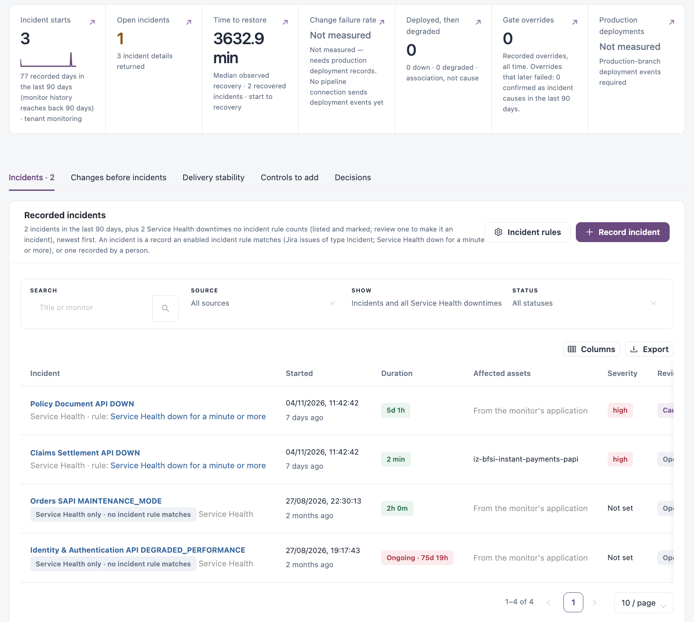
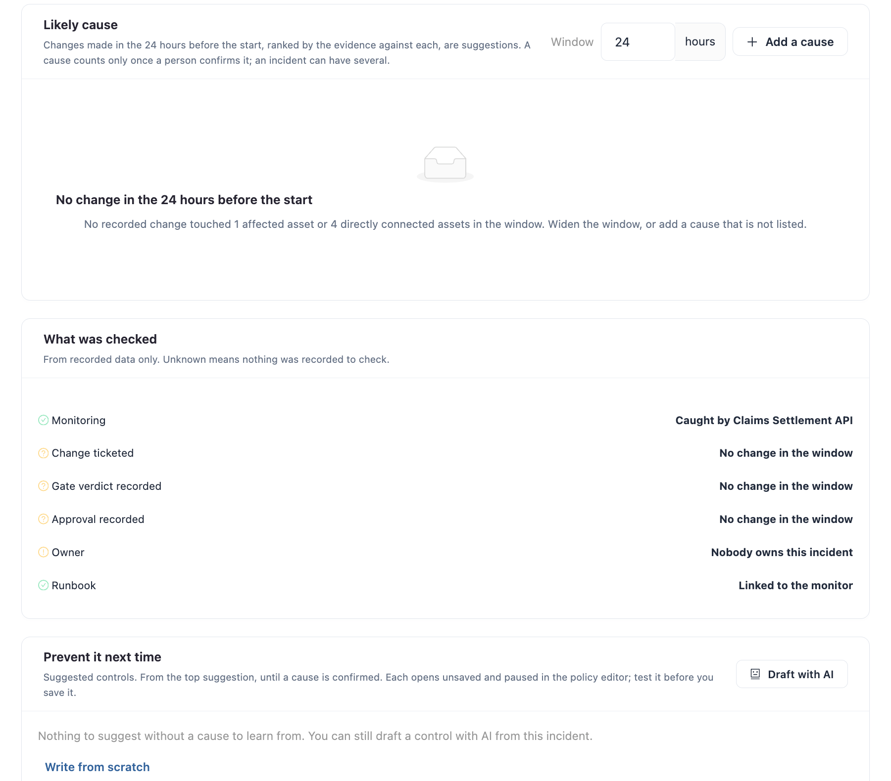

# Improve

**Improve** answers "What did changes do to production, and what do we change next?". It brings together recorded incidents and recovery, the deployments around them, the decisions that let changes through, and the controls that would prevent a repeat. Incidents are observations: a change is named as a cause only when a person confirms it in an incident review.

Open it from **Workspaces** → **Change Assurance** → **Improve** in the sidebar. The tab shows how many incidents are waiting for review.


Requires the **Change Assurance** licence. You need a role that can view the Change Assurance dashboard. **Controls to add** needs a role that can view gate policies.


<figure><figcaption>
Improve
</figcaption></figure>

## Do These Next

Up to six actions, for example incidents still open, incidents with no confirmed cause, gate overrides, deployments that read degraded afterwards, gate templates that are not active yet, and production deployment evidence that is not connected yet. Each has a button that opens the matching records.

## Tiles

| Tile                        | Description                                                                                      |
| --------------------------- | ------------------------------------------------------------------------------------------------ |
| **Incident starts**         | Incidents that started in the period, and how many days of monitoring history the figure covers. |
| **Open incidents**          | Incidents not resolved yet.                                                                      |
| **Time to restore**         | Median time from start to recovery for recovered incidents.                                      |
| **Change failure rate**     | Needs production deployment records; otherwise **Not measured**.                                 |
| **Deployed, then degraded** | Deployments after which Service Health read down or degraded. An association, not a cause.       |
| **Gate overrides**          | Recorded overrides, and how many later failed (confirmed as an incident cause).                  |
| **Production deployments**  | Needs production-branch deployment events; otherwise **Not measured**.                           |

## Views

| View                         | Use it to                                                                                 |
| ---------------------------- | ----------------------------------------------------------------------------------------- |
| **Incidents**                | Review recorded incidents and confirm their causes.                                       |
| **Changes before incidents** | Compare a change or ticket with the deployments and Service Health observations after it. |
| **Delivery stability**       | Measure production deployments. Needs a pipeline connection that sends deployment events. |
| **Controls to add**          | Activate gate templates that would catch a repeat.                                        |
| **Decisions**                | Review the human decisions recorded on gated changes.                                     |

## Incidents

**Recorded incidents** lists incidents in the period, newest first. An incident is a record an enabled incident rule matches (for example Jira issues of type Incident, or Service Health down for a minute or more), or one recorded by a person. Service Health downtimes that no incident rule counts can be listed too and are marked; review one to make it an incident.

* **Incident rules** opens the incident rules in [Policy](policy.md).
* **Record incident** records an outage no monitor or ticket caught (below).

Filters: **SEARCH**, **SOURCE**, **SHOW** (incidents only, or incidents and all Service Health downtimes) and **STATUS**.

| Column              | Description                                       |
| ------------------- | ------------------------------------------------- |
| **Incident**        | The incident and the rule that matched it.        |
| **Started**         | When it started.                                  |
| **Duration**        | How long it lasted, or **Ongoing**.               |
| **Affected assets** | The assets affected.                              |
| **Severity**        | The incident's severity.                          |
| **Review**          | For example **Open** or **Cause confirmed**.      |
| **Owner**           | Who owns the review, or **Nobody**.               |
| **Actions**         | **Open incident dossier** and **Open full page**. |

**Incident to investigate** shows the most recent incident's start and recovery, with **Review incident**. A chart shows **Recorded incident activity** over the period.

### Record an Incident

1. Click **Record incident**.
2. Fill in **Title**, **Severity**, **Started** and **Ended (leave empty while it is ongoing)**.
3. Click **Add assets** to add up to 20 affected assets.
4. Describe **What happened**.
5. Click **Record incident**. A recorded incident is listed whatever the incident rules say.

### Incident Dossier

<figure><figcaption>
Incident dossier
</figcaption></figure>

The dossier header shows the source, severity, matched rule and start time, with **Refresh**, **Affected assets** and **Close review**. Its tabs are **Review**, **Timeline**, **Affected assets**, **Downtimes**, **Changes**, **Related incidents**, **Decisions log** and **Evidence**.

**Review** shows:

* what is down, how long it lasted, the severity and the owner (**Assign owner**: a person or team who will see the review through);
* **Do these next**, most urgent first;
* **Likely cause**: changes made in the hours before the start (24 by default; change the **Window**), ranked by the evidence against each. They are suggestions: use **Confirm as cause** or **Not the cause** on each, or **Add a cause** that is not listed. An incident can have several causes;
* **What was checked**: monitoring, whether the change was ticketed, gated and approved, the owner and the runbook, from recorded data only. **Unknown** means nothing was recorded to check;
* **Prevent it next time**: suggested controls, each opening unsaved and paused in the policy editor to test before you save it. **Draft with AI** drafts a control from the incident; **Write from scratch** starts an empty one;
* **Follow-ups**: tasks in Assigned Work linked back to the review. **Add follow-up** creates one with a title, owner, due date and stage.


Confirming a cause and assigning an owner need a role that can manage changes; adding follow-ups needs a role that can manage assets. Confirmed causes feed **Overrides that later failed** and the change failure figures.


## Changes Before Incidents

Pick a change or ticket to see the deployments that cite it, the targets they reached and the Service Health observations after them. **Open ticket investigation** opens the ticket; **Review prevention policies** opens the gate policies. The list below has the changes available for investigation, with **Change**, **Actor**, **Ticket**, **Assessment**, **Evidence** and **Recorded**.

## Delivery Stability

**Deployment performance**: production deployment frequency, change failure rate and time to restore. It needs a pipeline connection that sends deployment events; until then **Review deployment sources** opens [Connections](connections.md).

## Controls to Add

Supplied gate templates that are not active in your organization yet, as candidates for a new control. Activate one in warn mode first, then tighten it.

Filter: **DOMAIN**. Columns: **Template**, **Domain**, **Recommended** (for example warn), **Controls**, **State** and **Actions**. **New gate policy**, **New control** and **Template catalog** open the policy editors in [Policy](policy.md).

## Decisions

Human decisions recorded on gated changes. An override let a warned or blocked change proceed: compare overrides with incidents to decide which gates to tighten. **Overridden** filters to overrides.

Columns: **Change**, **Decision**, **Justification**, **Gate reason**, **Reviewer**, **Recorded** and **Actions**. Release sign-offs stay in [Assure](assure.md) → **Release planning**.

## Next Steps

* [Policy](policy.md): tighten the gates and incident rules.
* [Monitors](../service-health/monitors.md): the monitors behind Service Health incidents.
* [Assure](assure.md): the decisions that let changes through.
