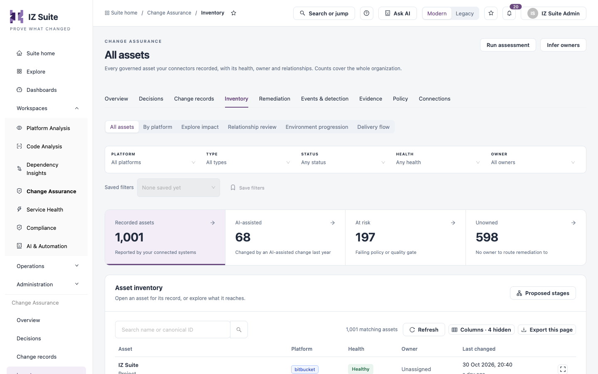
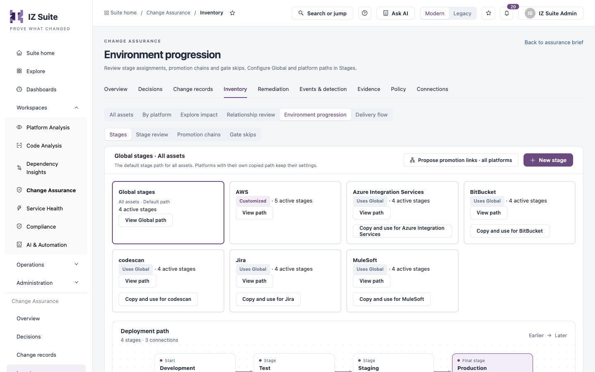

# Inventory

Inventory lists every asset your connected systems report: repositories, projects, cloud resources, APIs, tickets and more. Platform owners use it to find unowned or at-risk assets, review the relationships between assets, and map assets to environment stages and delivery paths.

Open it from **Workspaces** → **Change Assurance** → **Inventory** in the sidebar, then pick a tab in the switcher.


Requires the **Change Assurance** licence. You need a role that can view assets.


## All assets

<figure><figcaption>
All assets
</figcaption></figure>

Filters: **PLATFORM**, **TYPE**, **STATUS**, **HEALTH** and **OWNER**.

| Tile                | Description                                               |
| ------------------- | --------------------------------------------------------- |
| **Recorded assets** | Assets reported by your connected systems.                |
| **AI-assisted**     | Assets changed by an AI-assisted change in the last year. |
| **At risk**         | Assets failing a policy or quality gate.                  |
| **Unowned**         | Assets with no owner to route remediation to.             |

Columns: **Asset** (name and type), **Platform**, **Health**, **Owner** and **Last changed**. More columns are available from **Columns**.

| Button              | Description                                                                                                                                  |
| ------------------- | -------------------------------------------------------------------------------------------------------------------------------------------- |
| **Run assessment**  | Re-evaluates every applicable policy for every asset in the organization and replaces their verdicts. Nothing changes in the source systems. |
| **Infer owners**    | Assigns owners from version-control history where an asset has none. Manual owners are never replaced.                                       |
| **Proposed stages** | Lists unstaged assets with the stage their evidence proposes, so you can accept one or many.                                                 |

### Asset record

Select an asset to open its record.

| Tile                 | Description                                                |
| -------------------- | ---------------------------------------------------------- |
| **Changes**          | Changes recorded against the asset.                        |
| **Tickets**          | Tickets that track it.                                     |
| **Relationships**    | Outgoing and incoming links.                               |
| **Failing policies** | Asset checks it fails, or **Healthy**.                     |
| **Open tasks**       | Remediation not yet resolved.                              |
| **Owner**            | The owner, or **Unassigned**.                              |
| **Stage**            | The environment stage it holds.                            |
| **Last seen**        | When a connection last saw it, and when it was first seen. |

**About this asset** shows its identifier, what it is, its record status, the connection that collected it and the properties that connection recorded. **Raw metadata** shows the properties exactly as the connector recorded them. The record's tabs are **Changes**, **Tickets**, **Relationships**, **Lifecycle**, **Events**, **Findings**, **Baseline** and **Ownership**.

## By platform

One row per platform with **Assets**, **At risk**, **Healthy**, **Not assessed**, **Unowned**, **Lifecycle** and **Last collected**. The lifecycle columns split assets into **Complete**, **Confirmed**, **Suggested**, **No signal**, **Not stageable**, **In chain** and **In production**.

| Lifecycle state | Meaning                                                                                   |
| --------------- | ----------------------------------------------------------------------------------------- |
| **Complete**    | A confirmed stage, and in a confirmed promotion chain or confirmed in a production stage. |
| **Confirmed**   | A person confirmed its lifecycle stage.                                                   |
| **Suggested**   | No confirmed stage; its tags or names suggest one, awaiting a decision.                   |

Select a count to see its assets. Select a platform to open its page, which groups the platform's assets by service and type with counts and the last collection time.

## Explore impact

Explore current recorded relationships from one asset. Choose an asset from the list (best connected first) or filter by **Asset type**. Reach is not business impact: links keep their trust labels, and relationships are never followed across organizations.

## Relationship review

Every recorded link between two assets. Review links that were inferred and confirm or remove them.

Filters: **RELATIONSHIP**, **FROM PLATFORM**, **TO PLATFORM**, **LINK TYPE** and **ORIGIN**.

| Tile                  | Description                     |
| --------------------- | ------------------------------- |
| **Awaiting review**   | Inferred and not yet confirmed. |
| **Confirmed**         | Counted as confirmed links.     |
| **Unlinked**          | Excluded from impact analysis.  |
| **All relationships** | Every recorded link.            |

Columns: **From**, **Relationship**, **To**, **Origin**, **Status**, **Confidence**, **Last seen** and **Actions**. Row actions include **Unlink** and **Copy id**.

### Link two assets

1. Click **Link assets**.
2. Choose the kind of link: **Related**, **Same as** or **Supplement**.
3. Search for the **First asset** and the **Second asset**.
4. Choose **How do they relate?**.
5. Click **LINK ASSETS**.

Manual links are created as confirmed and are never overwritten by connector syncs.

## Environment progression

Maps assets to environment stages (for example Development → Test → Staging → Production) and checks how changes move between them. The switcher has four views: **Stages**, **Stage review**, **Promotion chains** and **Gate skips**.

<figure><figcaption>
Environment progression
</figcaption></figure>

**Stages** shows the **Global stages** path that applies to all assets, and one card per platform. A platform either **Uses Global** or is **Customized** with its own copy. **View path** opens a platform's path; **Copy and use for** _platform_ gives that platform its own copy. **Deployment path** draws the stages from left to right; select a stage to trace its connections. **Propose promotion links · all platforms** proposes promotion links between assets in different stages.

The stage list shows **Order**, **Stage**, **Settings**, **Environments**, **Promotion path**, **While pending**, **Enabled** and **Actions** (disable, edit, delete).

### Add a stage

1. Click **New stage**.
2. Fill in the form.
3. Click **Save changes**.

| Field                                            | Description                                                                                                                                                                      |
| ------------------------------------------------ | -------------------------------------------------------------------------------------------------------------------------------------------------------------------------------- |
| **Stage name**                                   | The stage's name. **Advanced** sets its identifier and display order.                                                                                                            |
| **Prerequisites**                                | The stages a change must pass first, or **Follow stage order**.                                                                                                                  |
| **Environment names**                            | Exact environment names that belong to the stage, for example `UAT`. Press Enter after each.                                                                                     |
| **Name patterns**                                | Patterns with `*` as a wildcard, for example `prod*`.                                                                                                                            |
| **Also match environments marked as production** | Makes this a production stage.                                                                                                                                                   |
| **Environments**                                 | Platform Analysis environments whose default stage this is.                                                                                                                      |
| **Pending policy**                               | What happens while a change's assessment is pending: hold counts the change as not assured until it is assessed; **Proceed, flagged** marks it assessed on the previous version. |
| **Assessment due within (minutes)**              | Empty for no due time. Past it, the assessment is overdue.                                                                                                                       |
| **Optional stage**                               | Changes may skip this stage; skipping it is not a gate skip.                                                                                                                     |
| **Enabled**                                      | Whether the stage is in force.                                                                                                                                                   |

## Delivery flow

Connected toolchains, largest first, from upstream to downstream. Each asset is named by the step it plays on its delivery path (for example Ticket → Source → Pipeline → Quality gate → Runtime → Monitor). Delivery paths are set in [Policy](policy.md).

| Control                                                              | Description                                         |
| -------------------------------------------------------------------- | --------------------------------------------------- |
| **All lineage** / **Confirmed only**                                 | Show every link, or only confirmed ones.            |
| **Derive lineage now**                                               | Builds the toolchains again from the current links. |
| **Choose a toolchain**                                               | Pick the toolchain to explore.                      |
| **Focused explorer** / **End-to-end graph** / **Relationship table** | Three ways to view the selected toolchain.          |
| **Confirm link** / **Unlink**                                        | Confirm or remove a link on the path.               |
| **+ upstream** / **+ downstream**                                    | Link an asset on either side of a node.             |
| **Explore from here**                                                | Re-centre on another asset.                         |
| **Open asset record**                                                | Open the selected asset's record.                   |

## Next steps

* [Remediation](remediation.md): assign follow-up work for at-risk assets.
* [Policy](policy.md): set linking rules and delivery paths.
* [Connections](connections.md): see which connection collected each asset.
