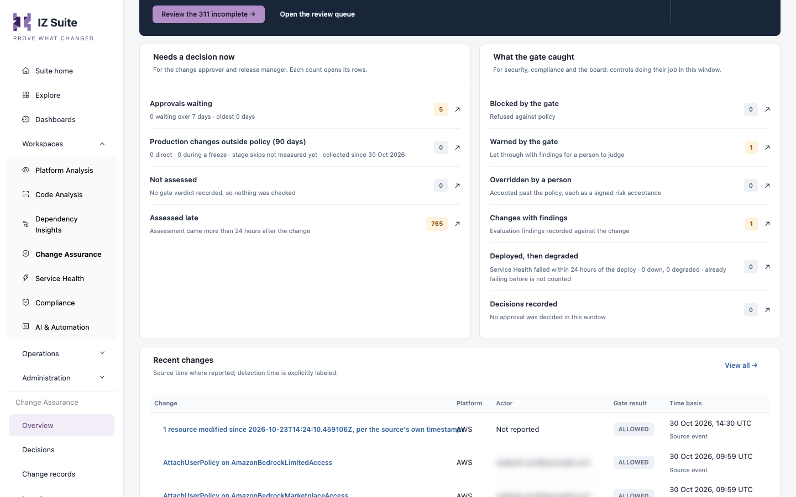

# Overview

The **Assurance brief** answers one question: is every change assessed, attributed, ticketed and signed, and what needs a decision now? Change approvers and release managers start here; security and compliance reviewers use it to see what the gate caught.

Open it from **Workspaces** → **Change Assurance** → **Overview** in the sidebar.


Requires the **Change Assurance** licence. You need a role that can view the Change Assurance dashboard.


## Assurance brief

The page header shows the **Platform** and **Observation window** filters, **Ask the copilot** and **Refresh evidence**. A note under the tabs says when the selected history was last read.

### Coverage tiles

Each tile shows a share of the changes in the window. Select a tile to open the matching changes.

| Tile                            | What it counts                                                            |
| ------------------------------- | ------------------------------------------------------------------------- |
| **Assessed by the gate**        | Changes with a gate verdict, and how many have none.                      |
| **Attributed to a named actor** | Changes with a named person or account, and how many have no named actor. |
| **Linked to a ticket**          | Changes that cite a ticket, and how many have no linked ticket.           |
| **Signed evidence**             | Changes with a signed verdict in the evidence ledger.                     |
| **AI-assisted changes**         | Changes that carry an AI co-author or tool signature, by tool.            |

### What the records prove

A summary of how many changes have a complete trail (assessed, attributed, ticketed and signed) and what is missing, by platform. Whether every kind of change needs a ticket is a policy choice.

* **Review the&#x20;**_**n**_**&#x20;incomplete** opens the changes that miss part of the trail.
* **Open the review queue** opens the [Decisions](decisions.md) review queue.

<figure><figcaption>
Needs a decision now and What the gate caught
</figcaption></figure>

### Needs a decision now

For the change approver and release manager. Each count opens its rows.

| Row                                             | What it counts                                                           |
| ----------------------------------------------- | ------------------------------------------------------------------------ |
| **Approvals waiting**                           | Open approval requests, how many have waited over 7 days and the oldest. |
| **Production changes outside policy (90 days)** | Direct production changes and changes made during a freeze.              |
| **Not assessed**                                | Changes with no gate verdict, so nothing was checked.                    |
| **Assessed late**                               | Changes assessed more than 24 hours after they happened.                 |

### What the gate caught

For security, compliance and the board: controls doing their job in the window.

| Row                         | What it counts                                                                                                    |
| --------------------------- | ----------------------------------------------------------------------------------------------------------------- |
| **Blocked by the gate**     | Changes refused against policy.                                                                                   |
| **Warned by the gate**      | Changes let through with findings for a person to judge.                                                          |
| **Overridden by a person**  | Changes accepted past the policy, each as a signed risk acceptance.                                               |
| **Changes with findings**   | Changes with evaluation findings recorded against them.                                                           |
| **Deployed, then degraded** | Deployments after which Service Health failed within 24 hours. A monitor that was already failing is not counted. |
| **Decisions recorded**      | Approvals decided in the window.                                                                                  |

### Recent changes

The latest changes with **Change**, **Platform**, **Actor**, **Gate result** and **Time basis**. The time is the source system's own time where it reports one; detection time is labelled. Select a change to open it, or **View all** to open [All changes](change-records.md).


The brief reports what the records show. It does not infer a safety or compliance score.


## Next steps

* [Decisions](decisions.md): act on approvals waiting and review changes.
* [Change Records](change-records.md): browse every recorded change.
* [Change Assurance](./): how the areas fit together.
