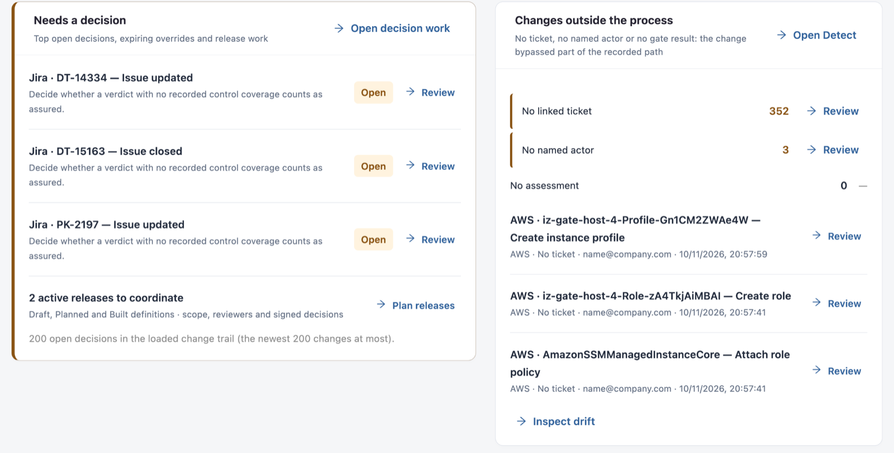

# Overview

**Overview** answers "Every change, with its context": how many changes you detected, what waits for a decision, whether you can show the auditor and whether changes caused failures. Change approvers, release managers and auditors start here; every figure opens the records behind it.

Open it from **Workspaces** → **Change Assurance** → **Overview** in the sidebar.


Requires the **Change Assurance** licence. You need a role that can view the Change Assurance dashboard.


## Stage Cards

Four cards, one per stage, for the selected **Period**. Select a card's link to open that stage.

| Card            | Question                              | What it shows                                                                                                                              |
| --------------- | ------------------------------------- | ------------------------------------------------------------------------------------------------------------------------------------------ |
| **1 · Detect**  | Did we see every change?              | Recorded changes and how many sources they came from, and how many changes are **to review** (for example without a ticket).               |
| **2 · Assure**  | Was each change checked and approved? | Approval requests waiting for a decision and the active releases.                                                                          |
| **3 · Prove**   | Can we show the auditor?              | The share of changes with a stored signature, and whether evidence integrity was verified in this session.                                 |
| **4 · Improve** | Did changes cause failures?           | The change failure rate (or **Not measured** when no production deployment records are connected) and incidents without a confirmed cause. |

<figure><figcaption></figcaption></figure>

## Needs a Decision

The top open decisions, overrides about to expire and release work.

* **Open decision work** opens [Assure](assure.md) → **Decision work**. Each listed change has **Review**.
* **Plan releases** opens [Assure](assure.md) → **Release planning** with the active releases (Draft, Planned and Built).

## Changes Outside the Process

Changes that bypassed part of the recorded path: no linked ticket, no named actor or no gate result.

| Row                  | What it counts                           |
| -------------------- | ---------------------------------------- |
| **No linked ticket** | Changes that cite no ticket.             |
| **No named actor**   | Changes with no named person or account. |
| **No assessment**    | Changes with no gate result.             |

Each count has **Review**. The latest such changes are listed below, each with **Review**. **Open Detect** opens [Detect](detect.md); **Inspect drift** opens **Governance drift**.

## Audit Readiness

Exceptions, evidence integrity and evidence coverage for the period. **Open Prove** opens [Prove](prove.md).

| Row                                      | What it shows                                                                                                                              |
| ---------------------------------------- | ------------------------------------------------------------------------------------------------------------------------------------------ |
| _n_ **exceptions open before the audit** | Exceptions in force, requested, expiring and lapsed. Each needs a reason, a decision and an expiry.                                        |
| **Evidence integrity**                   | Whether the signed evidence was verified in this session. Opening the page verifies nothing: **Verify on Prove** runs the read-only check. |
| **Evidence record on** _n_% **changes**  | Changes in the period that have an evidence record.                                                                                        |
| **No signed verdict**                    | Changes without a signed gate verdict.                                                                                                     |
| **No recorded control coverage**         | Changes whose evidence maps no control, so no control can be shown as tested.                                                              |

## Changes That Caused Incidents

Incidents in the period, confirmed causes first. A change is named as a cause only when a person confirms it in an incident review. **Open Improve** opens [Improve](improve.md).

| Figure                          | Description                                                                                |
| ------------------------------- | ------------------------------------------------------------------------------------------ |
| **Change failure rate**         | Needs production deployment records; otherwise **Not measured**.                           |
| **Without a confirmed cause**   | Incidents no one has tied to a change yet.                                                 |
| **Overrides that later failed** | Warned or blocked changes that were approved and later confirmed as an incident cause.     |
| **Deployed, then degraded**     | Deployments after which Service Health read down or degraded. An association, not a cause. |

## Change Sources

The current inventory, independent of the period: **Recorded assets**, assets **Read by this IZ Suite** and assets with **No reproducible source**. Each connected source shows its state, asset count and last collection, with **Inspect source**. **Connect** buttons list the sources not connected yet. **View coverage** opens collection coverage in [Connections](connections.md).

## Remediation Follow-Up

Current remediation work: **Open tasks**, **Overdue** and **Blocking severity**, with the next tasks and their owners and due dates. **Review work** opens the work list; **Review remediation policy** opens the remediation settings.

## Charts

* **Recorded gate decisions**: changes **Allowed by gate**, with a **Warning recorded**, **Blocked by gate** and with **No assessment**.
* **Where the evidence trail is incomplete**: changes with no assessment, no linked ticket, no named actor, no signed verdict or no recorded control coverage. One change can appear in several bars.

Select a bar for the records behind it, or **Show data table** for the numbers.


Overview reports what the records show. It does not infer a safety or compliance score.


## Next Steps

* [Detect](detect.md): investigate the changes behind the gaps.
* [Assure](assure.md): act on approvals waiting and plan releases.
* [Change Assurance](./): how the stages fit together.
