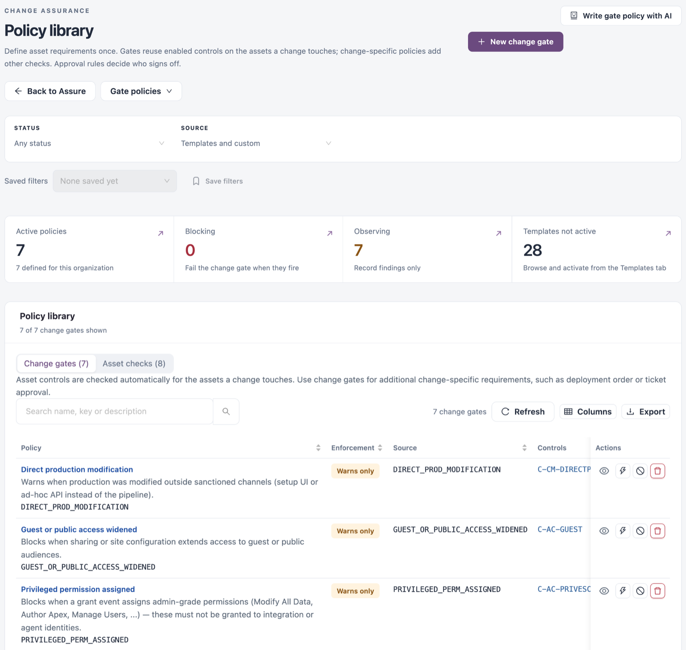
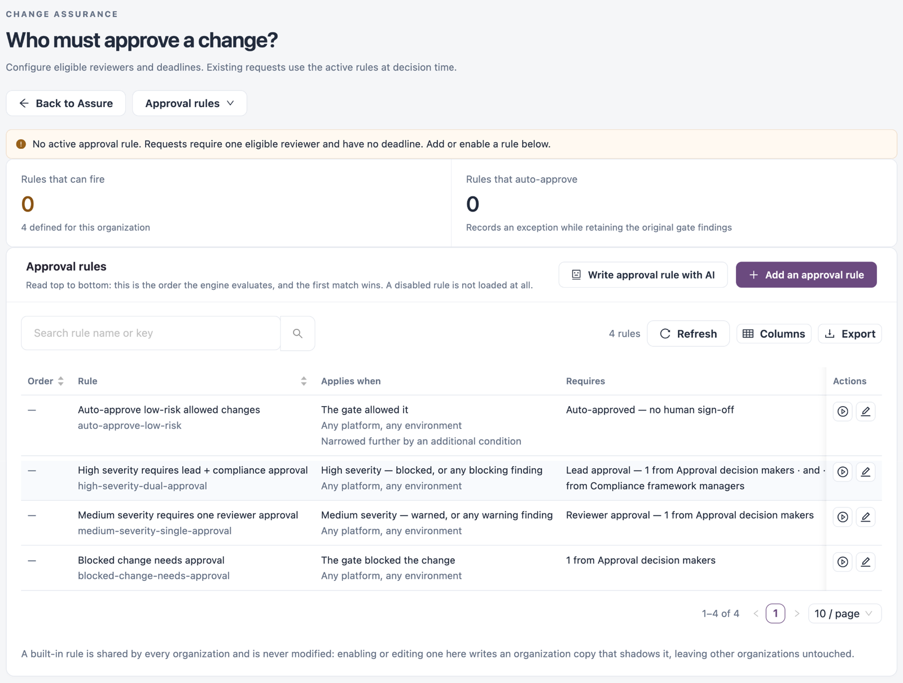

# Policy

Policy holds the rules Change Assurance applies. **Gate policies** decide which changes need a human; **Approval rules** decide who signs off and by when. The other tabs set how assets are linked, how changes are delivered, and what counts as AI-assisted, anomalous or drift.

Open it from **Workspaces** → **Change Assurance** → **Policy** in the sidebar, or from the **Policies** menu at the top right of the Change Assurance stages. The menu groups the pages:

* **Policies**: **Gate policies**, **Approval rules**, **Templates**.
* **Delivery**: **Linking rules**, **Lifecycle roles**, **Delivery path**.
* **Detection**: **AI-assisted rules**, **Anomaly rules**, **Drift rules**, **Incident rules**.
* **Remediation, stages & releases**: **Remediation settings**, **Stage configuration**, **Review stages & promotion links** and **Release sign-off templates**.

Each policy page has **Back to Assure** and a switcher that opens any of the other pages. **Write … with AI** (for example **Write gate policy with AI**) drafts a rule from a description, for you to review.


Requires the **Change Assurance** licence. **Gate policies** and **Templates** need a role that can view policies; **Lifecycle roles** needs a role that can view connections; the other pages need a role that can view rules.


## Gate Policies

The checks the gate runs, on the **Policy library** page. The list has two views: **Change gates**, checked for each change, and **Asset checks**, checked automatically for the assets a change touches. Use change gates for change-specific requirements such as deployment order or ticket approval.

<figure><figcaption></figcaption></figure>

Filters: **STATUS** and **SOURCE**. **Save filters** keeps the current filters under a name; **Saved filters** brings them back.

| Tile                     | Description                                        |
| ------------------------ | -------------------------------------------------- |
| **Active policies**      | Policies defined for this organization.            |
| **Blocking**             | Policies that fail the change gate when they fire. |
| **Observing**            | Policies that record findings only.                |
| **Templates not active** | Templates you can activate from **Templates**.     |

Columns: **Policy**, **Enforcement** (for example **Warns only**), **Source**, **Controls**, **Reference**, **Version**, **Enabled** and **Actions**.

| Row action                                         | Description                                                                                                                        |
| -------------------------------------------------- | ---------------------------------------------------------------------------------------------------------------------------------- |
| **Enabled** switch                                 | Turns the policy on or off (in the **Enabled** column).                                                                            |
| **View implementation** (eye icon)                 | Opens the policy's definition.                                                                                                     |
| **Simulate impact** (lightning icon)               | A read-only what-if: runs the policy over the current assets and recent changes and shows the difference from the current posture. |
| **Upgrade to block**                               | Changes the policy from warning to blocking.                                                                                       |
| **Add org doc link** (in the **Reference** column) | Links your organization's own document to the policy (**Edit org doc link** once set).                                             |
| **Delete policy** (bin icon)                       | Removes the policy.                                                                                                                |


Deleting a policy cannot be undone.


### Create or Edit a Change Gate

1. Click **New change gate** (the **Create a change check** page opens), or select a policy to edit it.
2. Under **1. Choose what to check**, enter a **Rule name** and build the check: **Build conditions**, **Use a starter** or **Advanced logic**.
3. Under **Change events to check**, choose the recorded activity the rule applies to, for example **Deployment completed** or **Issue closed**.
4. Under **When the check finds an issue**, choose **Warn only** or **Block the change**. Start by observing findings without blocking. **Advanced** sets the name, triggers and custom logic.
5. Under **2. Test your rule**, choose **All matching changes** or **One change**, pick **History to test** and click **Test matching changes**. Testing saves and enables nothing.
6. Click **Save draft** to come back later, or **Save and enable** (**Save changes** when editing). **All gate policies** leaves without saving.

## Approval Rules

Once a change needs sign-off, who must give it and by when, on the **Who must approve a change?** page. Rules are evaluated top to bottom and the first match wins. A disabled rule is not loaded. While no rule is enabled, a notice says so.

<figure><figcaption></figcaption></figure>

| Tile                        | Description                                                              |
| --------------------------- | ------------------------------------------------------------------------ |
| **Rules that can fire**     | Enabled rules, out of those defined for the organization.                |
| **Rules that auto-approve** | Rules that record an exception while keeping the original gate findings. |

Columns: **Order**, **Rule**, **Applies when**, **Requires**, **Deadline**, **Defined by**, **State** and **Actions** (test, edit). Pending requests themselves are in [Assure](assure.md).


When no approval rule is enabled, every request falls back to a built-in default: one approval, from anyone permitted to record a decision, with no deadline. Built-in rules are shared by every organization; enabling or editing one writes a copy for your organization only.



A rule change applies to new requests and to requests still awaiting a decision. A request's deadline is fixed when the gate raises it.


### Create an Approval Rule

1. Click **Add an approval rule** (or **Write approval rule with AI**).
2. Under **1. Choose when it applies**, fill in the fields below.
3. Under **2. Choose who signs off**, fill in the fields below.
4. Under **3. Test your rule**, test on **Recent recorded changes** or **One recorded change**. Testing is read-only.
5. Click **Save draft**. The rule is created disabled; enable it from the list after testing. **Back to approval rules** leaves without saving.

| Field                                                             | Description                                                                                                                                                                    |
| ----------------------------------------------------------------- | ------------------------------------------------------------------------------------------------------------------------------------------------------------------------------ |
| **Rule name**                                                     | Optional. A name is generated from your choices if you leave it empty.                                                                                                         |
| **When should this apply?**                                       | The trigger, for example **High severity — blocked, or any blocking finding**.                                                                                                 |
| **Conditions**                                                    | Extra conditions, built as **All** / **Any** groups (**Build conditions**), as a trigger only, or as **Advanced logic**. Only recorded gate and verified ticket facts qualify. |
| **Optional scope filters**                                        | Limit the rule to an activity, platform or environment.                                                                                                                        |
| **Approval outcome**                                              | **Ask reviewers** or **Accept automatically**.                                                                                                                                 |
| **Who can approve?**                                              | Extra permissions a reviewer must hold through their roles, on top of being allowed to approve. Empty means anyone permitted to approve.                                       |
| **People needed**                                                 | How many approvals are needed.                                                                                                                                                 |
| **Group name and custom eligibility** / **Require another group** | Name the group, or add a second group that must also approve.                                                                                                                  |
| **Decision deadline (hours)**                                     | Optional. Leave empty for no expiry.                                                                                                                                           |

## Templates

Built-in change gates to start from; **View gate policies** opens the ones you activated. Templates are grouped by domain: **Access**, **AI Provenance**, **API Posture**, **Audit**, **Change Management**, **Data Protection**, **Egress** and **Secrets**. Each domain shows how many of its templates are active.

Each template shows its key, what it checks, its default mode (warn or block) and the framework controls it maps to (for example SOC 2, ISO 27001, NIST 800-53). **Activate** turns a template on for this organization; **View policy** opens an active one. **Activate all** and **Deactivate all** act on a whole domain; bulk activation starts in warn mode.

## Linking Rules

Rules that propose relationships between assets. They run top to bottom; every rule that is on runs, and a relationship one rule already proposed is not proposed again.

Columns: **Order**, **Rule**, **How it links**, **What it links**, **Defined by**, **On** and **Actions** (**Test rule**, **Edit rule**).

| How it links                | Description                                                                                                                       |
| --------------------------- | --------------------------------------------------------------------------------------------------------------------------------- |
| **Field on an asset**       | Reads a field off each matching asset and links it to the asset that field names, for example a callout to the endpoint it calls. |
| **Events close in time**    | Links assets whose events happen within a set time of each other, for example a deployment and the runtime change it caused.      |
| **Same app through stages** | Links the same application across environments, for example dev → test → uat → prod.                                              |

To add one, click **New rule** (or **Write linking rule with AI**), choose how assets are connected, set **Platform**, **Asset type**, the field or match to use and **Link them as**, then test it with **Test rule**. New rules save disabled.

## Lifecycle Roles

The role each connection plays in delivery. Columns: **Connection**, **Platform**, **Roles**, **Set by** and **Actions**.

| Role        | Description                                                                                                                                                         |
| ----------- | ------------------------------------------------------------------------------------------------------------------------------------------------------------------- |
| **Request** | Its tickets are the work items changes cite. [Ticket lineage](detect.md) counts a change as traceable only when it cites a ticket from a connection with this role. |
| **Code**    | Label for commits and pull requests.                                                                                                                                |
| **Build**   | Label for the system that records builds.                                                                                                                           |
| **Deploy**  | Label for the system that records deployments.                                                                                                                      |
| **Verify**  | Label for the system that records checks.                                                                                                                           |

Code, Build, Deploy and Verify are descriptive labels; they do not start jobs or move assets between stages. To change them, click **Edit roles** on a connection, choose the roles or **Use the default** for its platform, and click **Save**.

## Delivery Path

The ordered steps an asset goes through. Each path lists the steps it expects, for example **Ticket → Source → Pipeline → Quality gate → Runtime → Monitor**. Ticket always leads; tickets come from the connections playing **Request**.

An asset takes the first path that applies to it. **Everything else** is always last. Columns: **#**, **Path**, **Applies to**, **Steps** and **Actions** (**Edit path**, **Move up**, **Move down**).

To add one, click **Add a path**, set what it **Applies to** (platforms and asset types), choose the asset types for each step, use **Add a step** as needed, and click **Save path**.

## AI-Assisted Rules

Rules that mark a change as AI-assisted. Filter: **CONNECTOR** (with **Save filters**). A rule marks the change its event belongs to. When two rules match the same change, the one listed first names the tool.

Columns: **Rule**, **Connector**, **When**, **AI tool**, **Changes** and **Actions**. A built-in rule is always on: it reads commit and pull request text for a co-author or assisted-by trailer, a generated-with line, or an AI bot as the author.

To add one, click **Add rule** (or **Write rule with AI**):

| Field                     | Description                                                                                             |
| ------------------------- | ------------------------------------------------------------------------------------------------------- |
| **Rule name**             | The rule's name.                                                                                        |
| **Connector**             | Which connector's events it reads.                                                                      |
| **Event type (optional)** | Matches event types starting with this value. Empty includes every event.                               |
| Conditions                | **Field**, **Compare** and **Value**. All conditions must match; values compare as text, ignoring case. |
| **AI tool (optional)**    | The tool shown on matching changes.                                                                     |

**Test current draft** checks recorded events from the last year without marking anything.

## Anomaly Rules

Behavioural rules that run over recent events on every change. They are separate from gate policies and approval rules.

Filter: **ENABLED** (with **Save filters**). The **Anomaly Detection** tile counts the enabled rules. Columns: **Rule**, **Origin**, **Status**, **Priority**, **Enabled** and **Actions** (**Open builder**). **New anomaly rule** creates one.

Supplied rules include **Bulk Permission Grant**, **Impossible Travel**, **Mass record export**, **Off-Hours Admin Change**, **Out-of-hours deployment**, **Deployment without an approver**, **Gate-bypass deployment**, **Scan regression** and **Orphan asset**.

## Drift Rules

Which collected properties must not change without an approved change. Each asset's baseline is its values at its last approved change (one a person approved, that records an approver, or that cites a change ticket), else as first observed; a sync that records anything else since is drift. Findings appear in [Detect](detect.md) → **Governance drift**. Default rules apply until you save your own; adding, changing or turning off a rule saves the set as yours.

Columns: **Rule**, **Applies to**, **Watched properties**, **Assets carrying them**, **Severity**, **On** and **Actions**. A property several rules watch takes the strictest severity. A property the connector has not collected is never judged.

**Presets** lists ready-made rules built from the properties each connector collects; **Use preset** adds one.

To add a rule, click **Add rule** (or **Write drift rule with AI**), set **Rule name**, **Platform**, **Asset types** and **Watched properties**, choose the severity, test it with **Test current draft**, and click **Save draft**. New rules start off; **Enable after saving** turns one on.

## Incident Rules

What counts as an incident in [Improve](improve.md) → **Incidents**: conditions on records from any incident source (Service Health monitors, Jira and other trackers that send issue events). The first enabled rule that matches, lowest priority first, sets the incident's severity and title. Incidents a person records are always incidents.

Columns: **Rule**, **Severity**, **Source**, **Priority**, **Version**, **Enabled** and **Actions**. Supplied rules include **Jira issues of type Incident** and **Highest or High priority Jira bugs**; they apply as supplied until you change one, which saves your organization's copy (**Remove your copy** restores the supplied rule).

To add one, click **New incident rule** (or **Write incident rule with AI**):

1. Under **1. Name the rule**, enter a **Name** and **Description**.
2. Under **2. When is a record an incident?**, choose **Build conditions (All / Any)** or **Advanced logic (JSON)**. Values compare exactly, including case.
3. Under **3. What the incident gets**, set **Severity**, **Title** (record fields in double braces fill it in) and **Evaluation priority** (lower runs first).
4. Under **4. Test your rule**, test it on recent records.
5. Click **Save draft**. New rules start off; enable one in the list after testing. **Back to incident rules** leaves without saving.

## Next Steps

* [Assure](assure.md): where approval requests land.
* [Detect](detect.md): review what drift rules found under **Governance drift**.
* [Improve](improve.md): incidents your incident rules match.
* [Connections](connections.md): the sources the rules read.
