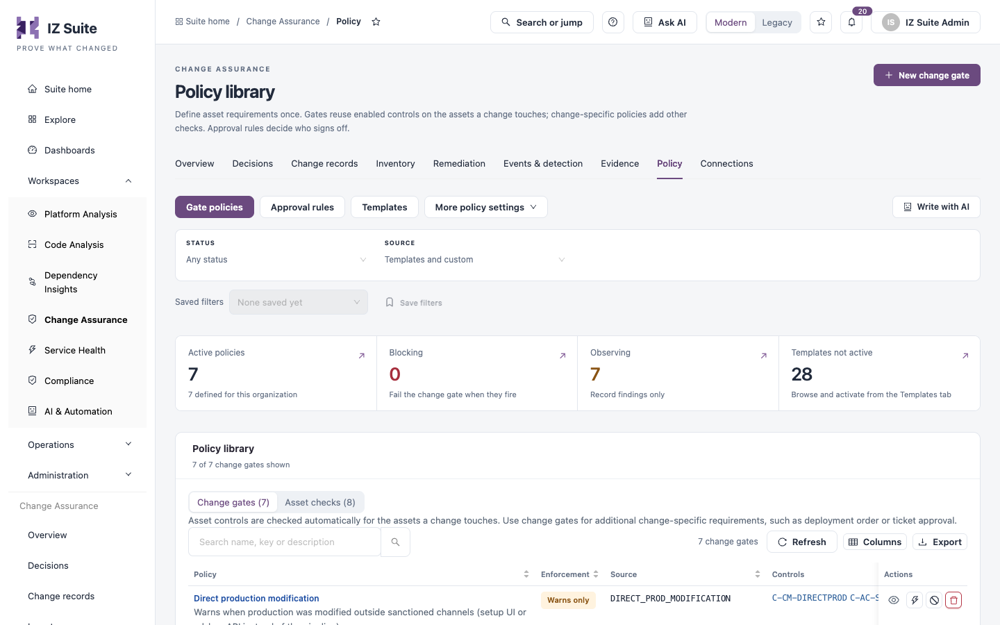
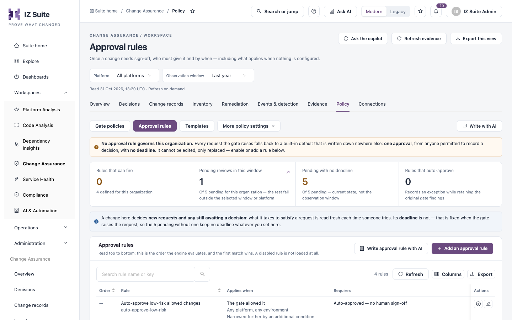

# Policy

Policy holds the rules Change Assurance applies. **Gate policies** decide which changes need a human; **Approval rules** decide who signs off and by when. The other tabs set how assets are linked, how changes are delivered, and what counts as AI-assisted, anomalous or drift.

Open it from **Workspaces** → **Change Assurance** → **Policy** in the sidebar. The switcher shows **Gate policies**, **Approval rules** and **Templates**; **More policy settings** opens the other tabs:

* **Delivery**: **Linking rules**, **Lifecycle roles**, **Delivery path**.
* **Detection**: **AI-assisted rules**, **Anomaly rules**, **Drift rules**.

**Write with AI** drafts a rule from a description, for you to review.


Requires the **Change Assurance** licence. **Gate policies** and **Templates** need a role that can view policies; **Lifecycle roles** needs a role that can view connections; the other tabs need a role that can view rules.


## Gate policies

The checks the gate runs. The list has two views: **Change gates**, checked for each change, and **Asset checks**, checked automatically for the assets a change touches. Use change gates for change-specific requirements such as deployment order or ticket approval.

<figure><figcaption>
Gate policies
</figcaption></figure>

Filters: **STATUS** and **SOURCE**.

| Tile                     | Description                                        |
| ------------------------ | -------------------------------------------------- |
| **Active policies**      | Policies defined for this organization.            |
| **Blocking**             | Policies that fail the change gate when they fire. |
| **Observing**            | Policies that record findings only.                |
| **Templates not active** | Templates you can activate from **Templates**.     |

Columns: **Policy**, **Enforcement** (for example **Warns only**), **Source**, **Controls**, **Reference**, **Version**, **Enabled** and **Actions**.

| Row action              | Description                                                                                                                        |
| ----------------------- | ---------------------------------------------------------------------------------------------------------------------------------- |
| **Enabled** switch      | Turns the policy on or off.                                                                                                        |
| **View implementation** | Opens the policy's definition.                                                                                                     |
| **Simulate impact**     | A read-only what-if: runs the policy over the current assets and recent changes and shows the difference from the current posture. |
| **Upgrade to block**    | Changes the policy from warning to blocking.                                                                                       |
| **Add org doc link**    | Links your organization's own document to the policy (**Edit org doc link** once set).                                             |
| **Delete policy**       | Removes the policy.                                                                                                                |


Deleting a policy cannot be undone.


### Create or edit a change gate

1. Click **New change gate**, or select a policy to edit it.
2. Under **1. Choose what to check**, enter a **Rule name** and build the check: **Build conditions**, **Use a starter** or **Advanced logic**.
3. Review **Recommended settings** for the check, and **Adjust recommended settings** if needed.
4. Under **When the check finds an issue**, choose **Warn only** or **Block the change**. Start by observing findings without blocking.
5. Set **Enabled**. **Advanced** sets the name, triggers and custom logic.
6. Under **2. Test your rule**, choose **All matching changes** or **One change**, pick **History to test** and click **Test matching changes**. Testing saves and enables nothing.
7. Click **Save changes**.

## Approval rules

Once a change needs sign-off, who must give it and by when. Rules are evaluated top to bottom and the first match wins. A disabled rule is not loaded.

<figure><figcaption>
Approval rules
</figcaption></figure>

| Tile                               | Description                                                              |
| ---------------------------------- | ------------------------------------------------------------------------ |
| **Rules that can fire**            | Enabled rules, out of those defined for the organization.                |
| **Pending reviews in this window** | Pending requests in the selected window and platform.                    |
| **Pending with no deadline**       | Pending requests with no expiry.                                         |
| **Rules that auto-approve**        | Rules that record an exception while keeping the original gate findings. |

Columns: **Order**, **Rule**, **Applies when**, **Requires**, **Deadline**, **Defined by**, **State** and **Actions** (enable, edit).


When no approval rule is enabled, every request falls back to a built-in default: one approval, from anyone permitted to record a decision, with no deadline. Built-in rules are shared by every organization; enabling or editing one writes a copy for your organization only.



A rule change applies to new requests and to requests still awaiting a decision. A request's deadline is fixed when the gate raises it.


### Create an approval rule

1. Click **Add an approval rule** (or **Write approval rule with AI**).
2. Under **1. Choose when it applies**, fill in the fields below.
3. Under **2. Choose who signs off**, fill in the fields below.
4. Under **3. Test your rule**, test on **Recent recorded changes** or **One recorded change**. Testing is read-only.
5. Click **Save draft**. The rule is created disabled; enable it from the list after testing.

| Field                                                             | Description                                                                                                                                                                    |
| ----------------------------------------------------------------- | ------------------------------------------------------------------------------------------------------------------------------------------------------------------------------ |
| **Rule name**                                                     | Optional. A name is generated from your choices if you leave it empty.                                                                                                         |
| **When should this apply?**                                       | The trigger, for example **High severity — blocked, or any blocking finding**.                                                                                                 |
| **Conditions**                                                    | Extra conditions, built as **All** / **Any** groups (**Build conditions**), as a trigger only, or as **Advanced logic**. Only recorded gate and verified ticket facts qualify. |
| **Optional scope filters**                                        | Limit the rule to an activity, platform or environment.                                                                                                                        |
| **Approval outcome**                                              | **Ask reviewers** or **Accept automatically**.                                                                                                                                 |
| **Who can approve?**                                              | Extra permissions a reviewer must hold through their roles, on top of being allowed to approve. Empty means anyone permitted to approve.                                       |
| **People needed**                                                 | How many approvals are needed.                                                                                                                                                 |
| **Group name and custom eligibility** / **Require another group** | Name the group, or add a second group that must also approve.                                                                                                                  |
| **Decision deadline (hours)**                                     | Optional. Leave empty for no expiry.                                                                                                                                           |

## Templates

Built-in policy templates grouped by domain: **Access**, **AI Provenance**, **API Posture**, **Audit**, **Change Management**, **Data Protection**, **Egress** and **Secrets**. Each domain shows how many of its templates are active.

Each template shows its key, what it checks, its default mode (warn or block) and the framework controls it maps to (for example SOC 2, ISO 27001, NIST 800-53). **Activate** turns a template on for this organization; **View policy** opens an active one. **Activate all** and **Deactivate all** act on a whole domain; bulk activation starts in warn mode.

## Linking rules

Rules that propose relationships between assets. They run top to bottom; every rule that is on runs, and a relationship one rule already proposed is not proposed again. Proposed relationships appear in [Relationship review](inventory.md).

Columns: **Order**, **Rule**, **How it links**, **What it links**, **Defined by**, **On** and **Actions** (**Test rule**, **Edit rule**).

| How it links                | Description                                                                                                                       |
| --------------------------- | --------------------------------------------------------------------------------------------------------------------------------- |
| **Field on an asset**       | Reads a field off each matching asset and links it to the asset that field names, for example a callout to the endpoint it calls. |
| **Events close in time**    | Links assets whose events happen within a set time of each other, for example a deployment and the runtime change it caused.      |
| **Same app through stages** | Links the same application across environments, for example dev → test → uat → prod.                                              |

To add one, click **New rule** (or **Write linking rule with AI**), choose how assets are connected, set **Platform**, **Asset type**, the field or match to use and **Link them as**, then test it with **Test rule**. New rules save disabled.

## Lifecycle roles

The role each connection plays in delivery. Columns: **Connection**, **Platform**, **Roles**, **Set by** and **Actions**.

| Role        | Description                                                                                                                                                                 |
| ----------- | --------------------------------------------------------------------------------------------------------------------------------------------------------------------------- |
| **Request** | Its tickets are the work items changes cite. [Ticket lineage](change-records.md) counts a change as traceable only when it cites a ticket from a connection with this role. |
| **Code**    | Label for commits and pull requests.                                                                                                                                        |
| **Build**   | Label for the system that records builds.                                                                                                                                   |
| **Deploy**  | Label for the system that records deployments.                                                                                                                              |
| **Verify**  | Label for the system that records checks.                                                                                                                                   |

Code, Build, Deploy and Verify are descriptive labels; they do not start jobs or move assets between stages. To change them, click **Edit roles** on a connection, choose the roles or **Use the default** for its platform, and click **Save**.

## Delivery path

The ordered steps an asset goes through, used by [Delivery flow](inventory.md). Each path lists the steps it expects, for example **Ticket → Source → Pipeline → Quality gate → Runtime → Monitor**. Ticket always leads; tickets come from the connections playing **Request**.

An asset takes the first path that applies to it. **Everything else** is always last. Columns: **#**, **Path**, **Applies to**, **Steps** and **Actions** (**Edit path**, **Move up**, **Move down**).

To add one, click **Add a path**, set what it **Applies to** (platforms and asset types), choose the asset types for each step, use **Add a step** as needed, and click **Save path**.

## AI-assisted rules

Rules that mark a change as AI-assisted. Filter: **CONNECTOR**. When two rules match the same change, the one listed first names the tool.

Columns: **Rule**, **Connector**, **When**, **AI tool**, **Changes** and **Actions**. A built-in rule is always on: it reads commit and pull request text for a co-author or assisted-by trailer, a generated-with line, or an AI bot as the author.

To add one, click **Add rule** (or **Write rule with AI**):

| Field                     | Description                                                                                             |
| ------------------------- | ------------------------------------------------------------------------------------------------------- |
| **Rule name**             | The rule's name.                                                                                        |
| **Connector**             | Which connector's events it reads.                                                                      |
| **Event type (optional)** | Matches event types starting with this value. Empty includes every event.                               |
| Conditions                | **Field**, **Compare** and **Value**. All conditions must match; values compare as text, ignoring case. |
| **AI tool (optional)**    | The tool shown on matching changes.                                                                     |

**Test current draft** checks recorded events from the last year without marking anything.

## Anomaly rules

Behavioural rules that run over recent events on every change and raise [Anomalies](/broken/pages/9dd1c5e817ddef48356d2329928c7f94c8f0a10c). They are separate from gate policies and approval rules.

Filter: **ENABLED**. Columns: **Rule**, **Origin**, **Status**, **Priority**, **Enabled** and **Actions** (**Open builder**). **New anomaly rule** creates one.

Supplied rules include **Bulk Permission Grant**, **Impossible Travel**, **Mass record export**, **Off-Hours Admin Change**, **Out-of-hours deployment**, **Deployment without an approver**, **Gate-bypass deployment**, **Scan regression** and **Orphan asset**.

## Drift rules

Which collected properties must not change without an approved change. Findings appear in [Drift](/broken/pages/9dd1c5e817ddef48356d2329928c7f94c8f0a10c). Default rules apply until you save your own; adding, changing or turning off a rule saves the set as yours.

Columns: **Rule**, **Applies to**, **Watched properties**, **Assets carrying them**, **Severity**, **On** and **Actions**. A property several rules watch takes the strictest severity. A property the connector has not collected is never judged.

**Presets** lists ready-made rules built from the properties each connector collects; **Use preset** adds one.

To add a rule, click **Add rule** (or **Write drift rule with AI**), set **Rule name**, **Platform**, **Asset types** and **Watched properties**, choose the severity, test it with **Test current draft**, and click **Save draft**. New rules start off; **Enable after saving** turns one on.

## Next steps

* [Decisions](decisions.md): where approval requests land.
* [Events & Detection](/broken/pages/9dd1c5e817ddef48356d2329928c7f94c8f0a10c): see what anomaly and drift rules found.
* [Inventory](inventory.md): review links that linking rules proposed.
