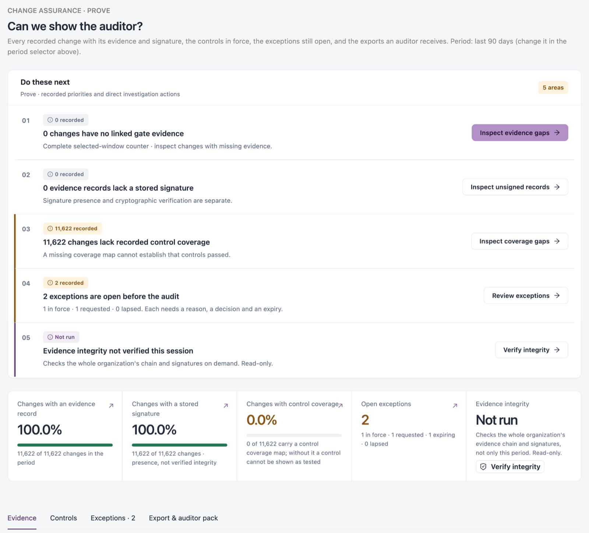

# Prove

**Prove** answers "Can we show the auditor?". It lists every recorded change with its evidence and signature, the controls in force, the exceptions still open before an audit, and the exports an auditor receives.

Open it from **Workspaces** → **Change Assurance** → **Prove** in the sidebar.


Requires the **Change Assurance** licence. You need a role that can view the Change Assurance dashboard. Generating an evidence package needs a role that can manage Change Assurance reports.


<figure><figcaption></figcaption></figure>

## Do These Next

Up to five actions for the selected **Period**, each with a count and a button:

* changes with no linked gate evidence (**Inspect evidence gaps**);
* evidence records without a stored signature (**Inspect unsigned records**);
* changes without recorded control coverage (**Inspect coverage gaps**): without a coverage map a control cannot be shown as passed;
* exceptions open before the audit (**Review exceptions**);
* evidence integrity not verified in this session (**Verify integrity**).

## Tiles

| Tile                                | Description                                                                         |
| ----------------------------------- | ----------------------------------------------------------------------------------- |
| **Changes with an evidence record** | Share of changes in the period that have an evidence record.                        |
| **Changes with a stored signature** | Share of changes with a stored signature. This is presence, not verified integrity. |
| **Changes with control coverage**   | Share of changes that carry a control coverage map.                                 |
| **Open exceptions**                 | Exceptions in force, requested, expiring and lapsed.                                |
| **Evidence integrity**              | **Not run** until you verify.                                                       |

## Verify Evidence Integrity

Click **Verify integrity**. The check reads the whole organization's evidence chain and signatures, not only the period, and changes nothing. Integrity is verified only when you run the check; opening the page verifies nothing.


Evidence presence, the assessment result, signature presence and verified integrity are separate claims. Only **Verify integrity** establishes integrity.


## Evidence

**Recorded evidence** lists the changes with their stored evidence, newest first. Detail is read for up to 200 changes; the tiles above count the whole period. **Open current evidence** opens the full evidence list.

| Column              | Description                                  |
| ------------------- | -------------------------------------------- |
| **Change**          | The platform and what changed.               |
| **Evidence record** | The record's number in the evidence chain.   |
| **Signature**       | For example **Present · not verified here**. |
| **Assessment**      | The gate result.                             |
| **Recorded**        | When the evidence was recorded.              |
| **Actions**         | Open the change and its evidence record.     |

Two charts follow: **What the recorded evidence can establish** (verdict recorded, evidence record present, signature stored, control coverage recorded) and **Recorded policy findings** by severity. No findings recorded is not proof that every control passed.

## Controls

**Controls in force** lists every control, enabled or not. A control proves something only when a policy maps it and changes record its coverage.

Filter: **STATE**. **Open control library** opens the full library.

| Column              | Description                             |
| ------------------- | --------------------------------------- |
| **Control**         | The control's name and key.             |
| **Package**         | The control package it belongs to.      |
| **Assessments**     | How many assessments recorded it.       |
| **Mapped policies** | How many gate policies map it.          |
| **Status**          | For example **Not mapped to a policy**. |

## Exceptions

**Exceptions to resolve before the audit** lists the finding exceptions across products, in their current state (not limited by the period). Each exception needs a reason, a decision and an expiry; "expiring" means within the next 90 days.

Columns: **Exception**, **Kind** (for example false positive or accepted risk), **Reason**, **Owner**, **Decided by**, **Due / expiry** and **Stage** (for example requested or approved).

## Export & Auditor Pack

**Evidence package** exports the changes in a period, each with its signed evidence and a way to verify it. Calendar periods use UTC dates. The package holds:

* change records with author, ticket and gate verdict (one CSV row per change);
* approvals and recorded release sign-offs and decisions;
* finding exceptions with reason, owner and expiry;
* control results per framework, from each framework's latest compliance report;
* integrity proof for every record: the signed evidence, the public keys, a verification script and a manifest of file hashes.

To export:

1. Choose the period: the **Page period** or a **Custom period**.
2. Click **Export package** for the whole period, or **Draw auditor sample** for a random sample of changes (25 by default) with their full evidence. The sample's seed is recorded, so the same draw can be shown again.
3. Download it from **Generated packages** when it is ready.

Framework-centric packs (one framework's requirements and controls) are in Compliance → **Reports and auditor packs**. **Other evidence views** links to the evidence index and exports, integrity verification, reports and auditor packs, and assigned remediation.

## Next Steps

* [Detect](detect.md): the changes behind the evidence.
* [Assure](assure.md): the approvals and sign-offs an auditor sees.
* [Improve](improve.md): what changes did to production.
