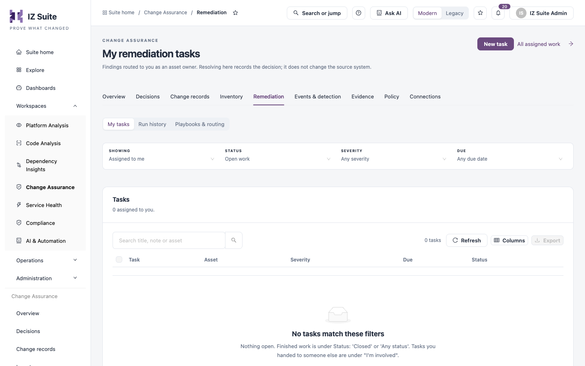
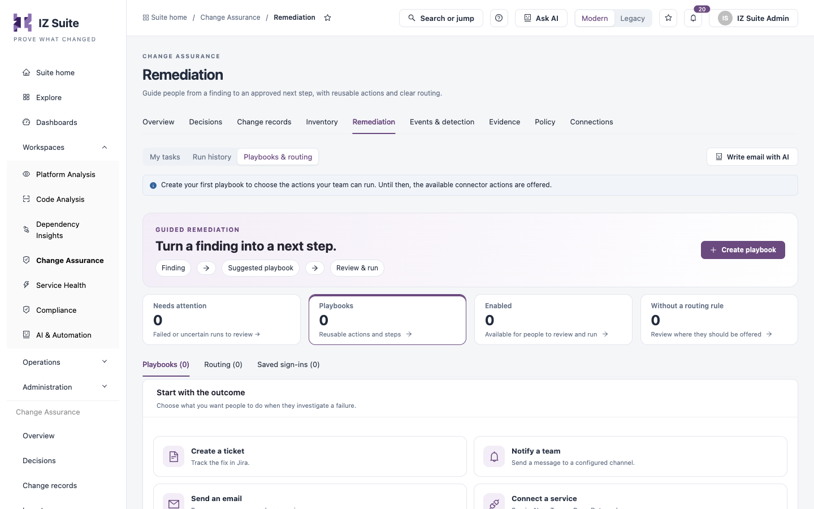

# Remediation

Remediation turns a finding into a next step. **My tasks** holds the work assigned to you, **Run history** records every remediation action that ran, and **Playbooks & routing** defines the actions people can run and where they are offered.

Open it from **Workspaces** → **Change Assurance** → **Remediation** in the sidebar, then pick a tab in the switcher.


Requires the **Change Assurance** licence. **My tasks** needs a role that can view assets; **Run history** needs a role that can view assets or rules; **Playbooks & routing** needs a role that can view rules.


## My tasks

<figure><figcaption>
My tasks
</figcaption></figure>

Filters:

| Filter       | Description                                                                                     |
| ------------ | ----------------------------------------------------------------------------------------------- |
| **SHOWING**  | **Assigned to me**, or tasks you are involved in (for example ones you handed to someone else). |
| **STATUS**   | **Open work** by default. Finished work is under **Closed** or **Any status**.                  |
| **SEVERITY** | Limits the list by severity.                                                                    |
| **DUE**      | Limits the list by due date.                                                                    |

Columns: **Task**, **Asset**, **Severity**, **Due** and **Status**.

**Upgrade work assigned to you** lists applications in active upgrade waves, with **Application**, **Target version**, **Wave**, **Wave due** and **Status**. Record progress in the wave itself.

### Create a task

1. Click **New task**.
2. Fill in the form.
3. Click **Create task**.

| Field                     | Description                                                                                                          |
| ------------------------- | -------------------------------------------------------------------------------------------------------------------- |
| **Title**                 | The task's title.                                                                                                    |
| **Details and checklist** | Lines starting `- [ ]` become steps that can be ticked off.                                                          |
| **Assigned to**           | The owner, or **Unassigned**.                                                                                        |
| **Due date**              | Left empty, the task is due in 7 days.                                                                               |
| **Repeat**                | **Does not repeat**, or a repeat interval. Resolving a repeating task opens the next one with the checklist cleared. |
| **Severity**              | The task's severity, or **None**.                                                                                    |

A task created here covers the whole organization; it is not tied to one asset.

## Run history

Every tracked remediation run, newest first, with start times in your local time zone. Filter by name with **Search**, by outcome (**All outcomes**), by person (**Anyone**) and by period (**All time**).


An action completing does not verify that the finding is resolved. Activity from before run tracking started remains in the [Configuration trail](evidence.md).


## Playbooks & routing

Playbooks are reusable actions and steps people can review and run when they investigate a failure. Until you create a playbook, the available connector actions are offered.

<figure><figcaption>
Playbooks &#x26; routing
</figcaption></figure>

| Tile                       | Description                                       |
| -------------------------- | ------------------------------------------------- |
| **Needs attention**        | Failed or uncertain runs to review.               |
| **Playbooks**              | Reusable actions and steps.                       |
| **Enabled**                | Playbooks available for people to review and run. |
| **Without a routing rule** | Playbooks not yet offered anywhere.               |

The tabs **Playbooks**, **Routing** and **Saved sign-ins** list playbooks, the rules that decide where each is offered, and the saved sign-ins playbooks use to reach other services. **Add from a preset** starts from a ready-made playbook. **Write email with AI** drafts an email for a person to review.

### Create a playbook

1. Click **Create playbook**, or pick an outcome under **Start with the outcome**.
2. **Outcome**: choose what should happen next.
3. **Configure**: set up the outcome and any follow-up steps.
4. **When to offer**: choose where the playbook is offered.
5. **Review**: check the playbook and save it.

| Outcome                    | Description                                  |
| -------------------------- | -------------------------------------------- |
| **Create a ticket**        | Track the fix in Jira.                       |
| **Notify a team**          | Send a message to a configured channel.      |
| **Send an email**          | Prepare a message people can review.         |
| **Connect a service**      | ServiceNow, Teams, PagerDuty and more.       |
| **Run a connector action** | Change the source system, with confirmation. |
| **Draft a fix with AI**    | Suggest a plan for a person to review.       |

Each run and its outcome are tracked on the affected asset. Setup changes appear in the [Configuration trail](evidence.md).

## Next steps

* [Inventory](inventory.md): find at-risk and unowned assets.
* [Events & Detection](/broken/pages/9dd1c5e817ddef48356d2329928c7f94c8f0a10c): the anomalies and drift that lead to remediation.
* [Evidence](evidence.md): see setup changes in the configuration trail.
