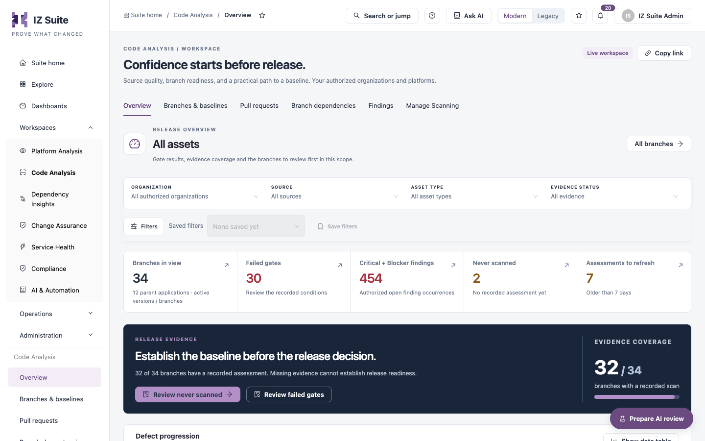

# Code Analysis

Code Analysis shows the source quality of your repositories: the quality gate and findings of each branch and pull request, the baseline each repository is measured against, and which repositories are scanned. Use it to decide whether a branch is ready to release and what to fix first.

Open it from **Workspaces** → **Code Analysis** in the sidebar.


Requires the **Code Analysis** licence.



You need a role that can view Code Analysis applications. The workspace shows only the organizations and sources your role covers.


<figure><figcaption>
Code Analysis workspace
</figcaption></figure>

## Tabs

| Tab                                                                            | Use it to                                                                                  |
| ------------------------------------------------------------------------------ | ------------------------------------------------------------------------------------------ |
| [Overview](overview.md)                                                        | See gate results, evidence coverage, pull request health and the branches to review first. |
| [Branches & Baselines](/broken/pages/17ad10a1c076f78622cc3983f77319b907d59a1f) | List repositories and their branches, open a branch's dossier and manage it.               |
| [Pull Requests](pull-requests.md)                                              | Review the gate and new findings of each pull request.                                     |
| [Branch Dependencies](branch-dependencies.md)                                  | Explore the recorded dependencies between your applications.                               |
| [Findings](findings.md)                                                        | Investigate open findings, estimate the time to fix them and review exceptions.            |
| [Manage Scanning](manage-scanning.md)                                          | Choose which Bitbucket, GitHub and Design Center repositories and projects are scanned.    |

## Where the branches come from

Branches and pull requests reach Code Analysis from:

* **Bitbucket** and **GitHub** repositories that IZ Suite discovers and scans on a schedule ([Manage Scanning](manage-scanning.md)).
* **Design Center** projects, scanned on a schedule.
* Your CI/CD pipeline or a command line, through the CLI (**CLI / upload** in the lists). See [Branches & Baselines](/broken/pages/17ad10a1c076f78622cc3983f77319b907d59a1f#scan-a-branch-from-your-pipeline).

## Header actions

| Action                | Description                                                                                                                                                                  |
| --------------------- | ---------------------------------------------------------------------------------------------------------------------------------------------------------------------------- |
| **Copy link**         | Copies the address of the current tab and filters.                                                                                                                           |
| **Prepare AI review** | Opens the **AI review · connected evidence** drawer to prepare an AI review. Works as described in Platform Analysis Overview. Shown only when your role can run AI reviews. |

The filters, saved filters and table tools work as described in Workspaces.

## Next steps

* [Overview](overview.md): see which branches need a review.
* [Branches & Baselines](/broken/pages/17ad10a1c076f78622cc3983f77319b907d59a1f): open a branch's dossier.
* [Manage Scanning](manage-scanning.md): choose the repositories to scan.
