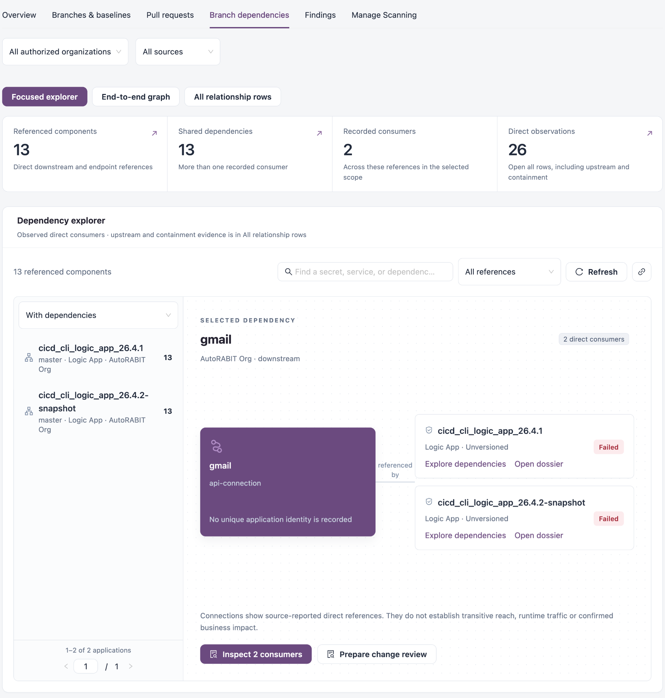

# Branch Dependencies

The **Branch dependencies** tab of Code Analysis shows the dependencies recorded for your applications: the components, services and endpoints they reference, and which applications consume each one. Use it before changing a shared component to see what the change could reach.

Open it from **Workspaces** → **Code Analysis** → **Branch dependencies** in the sidebar.


Requires the **Code Analysis** licence.


<figure><figcaption>
Branch dependencies
</figcaption></figure>

## Scope and views

Choose the **Organization** (or **All authorized organizations**) and the **Source** (or **All sources**) at the top. Then pick a view:

| View                      | Description                                                                                                                                                |
| ------------------------- | ---------------------------------------------------------------------------------------------------------------------------------------------------------- |
| **Focused explorer**      | One application or reference at a time, with its direct dependencies or consumers.                                                                         |
| **End-to-end graph**      | The recorded dependencies and consumers of the focused application across several hops. Available once an application or reference is in focus.            |
| **All relationship rows** | **Every recorded relationship**, including upstream and containment rows: **Source application**, **Direction**, **Reference**, **Kind** and **Navigate**. |

## Metric tiles

| Tile                      | Description                                                                                 |
| ------------------------- | ------------------------------------------------------------------------------------------- |
| **Referenced components** | Direct downstream and endpoint references in scope.                                         |
| **Shared dependencies**   | References with more than one recorded consumer.                                            |
| **Recorded consumers**    | Applications that consume these references.                                                 |
| **Direct observations**   | All relationship rows, including upstream and containment. Opens **All relationship rows**. |

## Explore an application's dependencies

1. In **Dependency explorer**, choose **With dependencies** or **All applications** in the list on the left, or **Referenced components** to start from a component.
2. Click an application. It becomes the focus of the graph.
3. To narrow the references, type in **Find a secret, service, or dependency…** or choose **Multiple consumers** instead of **All references**.
4. Select a reference to see the applications that consume it.
5. Use **Explore dependencies** on a consumer to make it the focus, or **Open dossier** to open its dossier.
6. Click **Inspect N consumers** to list every consumer, or **Prepare change review** to prepare a review of a change to that reference.

The breadcrumb above the graph (**All dependencies** / application / reference) takes you back a level. **Open application dossier** opens the focused application. The link icon copies a link to the focused dependency, and **Reset reference filters** clears the search and filters.


Connections show the direct references the source reported. They do not prove transitive reach, runtime traffic or business impact, and a missing relationship is a gap in the evidence, not proof of isolation. Links that a person declared in the dossier (**Link applications**) are shown as declared, and scans never change them.


## Next Steps

* [Dependency Insights](../dependency-insights/): plan versions, risks and actions across connected applications.
* [Branches & Baselines](branches-and-baselines.md): open a repository's dossier.
* [Code Analysis](./): back to the workspace.
