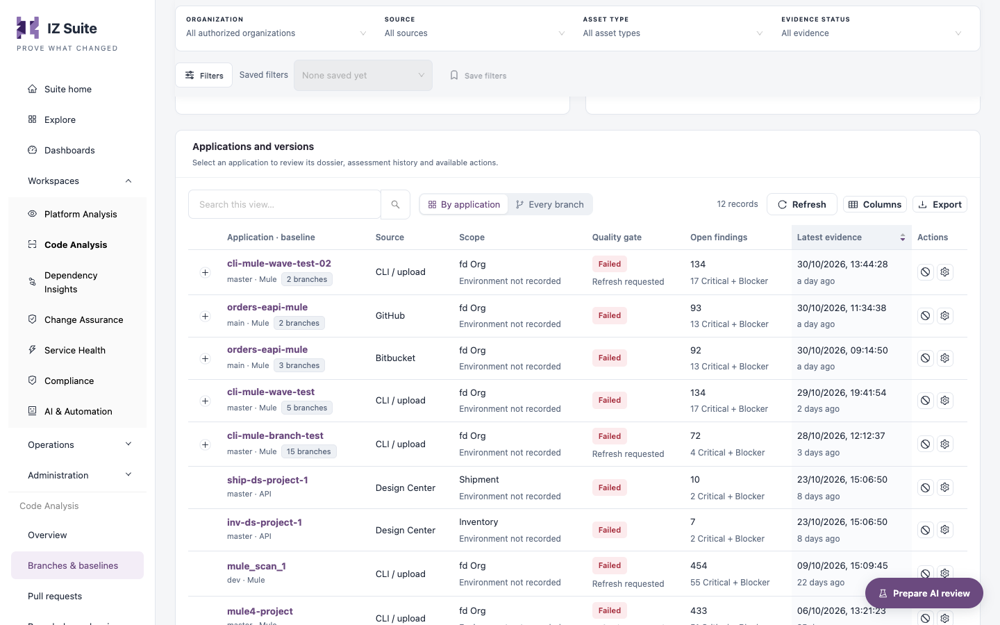
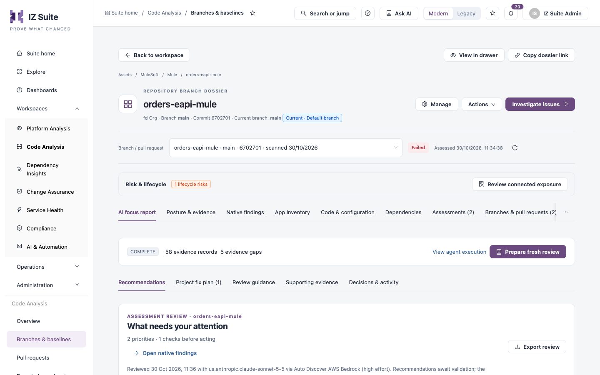

# Branches & Baselines

The **Branches & baselines** tab of Code Analysis lists your repositories with their baseline branch, and every branch and pull request under them, with the latest quality gate and open findings. From a row you open the branch's dossier.

Open it from **Workspaces** → **Code Analysis** → **Branches & baselines** in the sidebar.


Requires the **Code Analysis** licence.


<figure><figcaption><p>Branches and baselines</p></figcaption></figure>

## Filters, tiles and charts

The filter bar, **Filters** panel and metric tiles are the same as on the [Overview](overview.md#filters) tab. While no asset type is selected, **Assets by type and quality gate** and **Top rules behind Critical + Blocker findings** sit above the list.

When you choose the Mule or API asset type and your role can use AI assistance, **Code with AI** opens the AI-assisted generation of a new application.

## Applications and versions

| Control            | Description                                                                                                     |
| ------------------ | --------------------------------------------------------------------------------------------------------------- |
| **By application** | One row per repository, showing its baseline branch. Expand a row to list its other branches and pull requests. |
| **Every branch**   | One row per branch or pull request.                                                                             |

Search, **Refresh**, **Columns** and **Export** work as described in Workspaces.

| Column                     | Description                                                                                                                          |
| -------------------------- | ------------------------------------------------------------------------------------------------------------------------------------ |
| **Application · baseline** | Repository name, baseline branch and asset type. A tag shows the number of branches. Click the name to open the dossier.             |
| **Source**                 | **Bitbucket**, **GitHub**, **Design Center** or **CLI / upload**.                                                                    |
| **Scope**                  | Organization and environment.                                                                                                        |
| **Quality gate**           | **Passed**, **Failed**, **Not evaluated** or **No scan**. **Refresh requested** means a new assessment was requested.                |
| **Open findings**          | Open findings in the latest assessment, with the Critical + Blocker count.                                                           |
| **Latest evidence**        | When the latest assessment was recorded. Sortable; newest first by default.                                                          |
| **Actions**                | **Deprecate application** (when your role can manage deprecations) and **Manage application** (opens the dossier on **Management**). |

The baseline is the repository's default branch: the branch the repository list shows and its reports count. It is set from the first scan or the repository's default branch, and you can choose another in the dossier's **Management** panel.

## Branch dossier

Click a repository or branch name to open its dossier as a full page. **View in drawer**, **Copy dossier link** and **Back to workspace** sit at the top.

<figure><figcaption><p>Repository branch dossier</p></figcaption></figure>

### Header

| Item                      | Description                                                                                                                                        |
| ------------------------- | -------------------------------------------------------------------------------------------------------------------------------------------------- |
| Subtitle                  | Organization, branch (or pull request with source and target), commit and current branch.                                                          |
| **Manage**                | Opens the **Management** panel.                                                                                                                    |
| **Actions**               | **Link applications**, **Deprecate application**, **Review this application** (AI review) and **Exceptions**. Items you cannot use are not listed. |
| **Investigate issues**    | Opens the findings of this branch.                                                                                                                 |
| **Branch / pull request** | Switches to another branch or pull request of the same repository. Shows the gate and assessment date.                                             |

The metric tiles show **Open finding occurrences**, **Critical + Blocker occurrences**, **Branches & pull requests** and **Recorded assessments**.

### Panels

| Panel                                         | Description                                                                                                                                                                                      |
| --------------------------------------------- | ------------------------------------------------------------------------------------------------------------------------------------------------------------------------------------------------ |
| **AI focus report**                           | The latest AI review of this assessment, or how to request one.                                                                                                                                  |
| **Posture & evidence**                        | The change decision against the baseline, why the gate failed, the findings that need a decision, where the findings are concentrated and the assessment surfaces.                               |
| **Native findings** (**Findings** without AI) | The findings of this branch, as on the [Findings](findings.md) tab.                                                                                                                              |
| **App Inventory**                             | The latest values the metric rules recorded.                                                                                                                                                     |
| **Code & configuration**                      | Files with findings and their history.                                                                                                                                                           |
| **Dependencies** and **Risk & lifecycle**     | Recorded dependencies and lifecycle risks. Shown with Dependency Insights.                                                                                                                       |
| **Assessments**                               | Assessment progression, comparison of two assessments and the assessment history.                                                                                                                |
| **Branches & pull requests**                  | **Branch comparison**: every branch and pull request of the repository with its gate. Use **Mark as the current branch** to choose the current branch manually; click the mark again to undo it. |
| **Management**                                | Settings for this branch, below.                                                                                                                                                                 |

### Management

The **Management** panel works as for Platform Analysis applications, worded for branches: **Default branch**, **Request fresh evidence**, **Reports for this branch**, **Assessment settings** (**This branch** or **All branches and pull requests (application default)**) and **Update subscriptions**. Code Analysis adds:

| Action                                          | Description                                                                                |
| ----------------------------------------------- | ------------------------------------------------------------------------------------------ |
| **Review branches**                             | Opens **Branches & pull requests**.                                                        |
| **Migrate Organization**                        | Moves the repository to another organization.                                              |
| **Merge Application**                           | Merges this repository with another application.                                           |
| **Delete this branch** / **Delete application** | Permanently deletes the branch, or the repository with all its branches and pull requests. |


Deleting a branch or an application cannot be undone. The delete buttons are shown only when your role can delete applications of this type.


## Scan a branch from your pipeline

Branches with the **CLI / upload** source come from the CLI, run in your CI/CD pipeline or on a workstation. The CLI reads a security token that you generate in Security Credentials; keep it in a masked CI secret.

```bash
export IZ_CLI_VERSION=<CLI version>
export IZ_ACCESS_TOKEN=<token generated in IZ Suite>
curl -fsSLo iz.zip "https://iz-releases.s3.amazonaws.com/iz-scan-cli/$IZ_CLI_VERSION/iz-scan-cli-$IZ_CLI_VERSION-linux.zip" && unzip -oq iz.zip
./iz-scan-cli-$IZ_CLI_VERSION-linux/bin/iz-scan-cli -serviceHost "https://izsuite.example.com" -authToken "$IZ_ACCESS_TOKEN" -applicationKey "orders-eapi" -source . -scmBranchName "main" > iz-scan.log 2>&1 || true
cat iz-scan.log
grep -q "QUALITY GATE STATUS:: PASSED" iz-scan.log
```

| Option            | Description                                                              |
| ----------------- | ------------------------------------------------------------------------ |
| `-serviceHost`    | The address of your IZ Suite.                                            |
| `-authToken`      | The security token.                                                      |
| `-applicationKey` | The unique key of the application; the repository name is a good choice. |
| `-source`         | The project folder. Defaults to the current folder.                      |
| `-scmBranchName`  | The branch being analyzed.                                               |

The last line fails the pipeline step when the quality gate did not pass. **Setup** → **Scan in your CI/CD pipeline** generates the complete step for Bitbucket Pipelines, GitHub Actions, GitLab CI, Jenkins and Maven; see Setup. The full list of CLI options is in the [CLI guide](https://knowledgebase.autorabit.com/product-guides/integral-zone/iz-suite-legacy/iz-scan/ci-cd-integration/using-iz-scan-cli).

## Next steps

* [Pull Requests](pull-requests.md): review the gate of each pull request.
* [Findings](findings.md): investigate findings across branches.
* [Manage Scanning](manage-scanning.md): choose the repositories to scan.
* [Code Analysis](./): back to the workspace.
