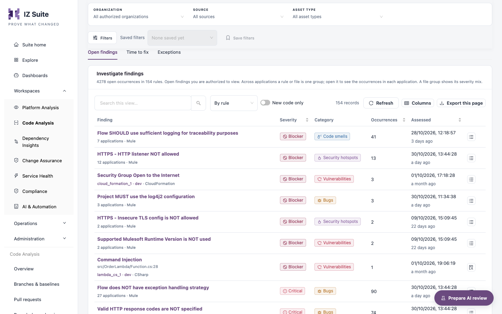

# Findings

The **Findings** tab of Code Analysis lists the open findings in the latest assessment of each branch you can see, grouped by rule or file. It also estimates the effort to fix them and keeps the register of exceptions.

Open it from **Workspaces** → **Code Analysis** → **Findings** in the sidebar.


Requires the **Code Analysis** licence.


<figure><figcaption>
Open findings
</figcaption></figure>

## Filters and tiles

The filter bar has **Organization**, **Source** and **Asset type**; the **Filters** panel adds **Severity**, **Category**, **Rule** and **Security standard**. The metric tiles are the same as on the [Overview](overview.md#metric-tiles) tab.

## Open findings

| Control           | Description                                                                                                                                                |
| ----------------- | ---------------------------------------------------------------------------------------------------------------------------------------------------------- |
| Grouping          | **By rule**, **By file** (one row per file, with its severity mix) or **Occurrences** (one row per finding).                                               |
| **New code only** | Only findings the change introduced: for a pull request, findings not open on its target branch; for a branch, findings new since its previous assessment. |

| Column          | Description                                                                                           |
| --------------- | ----------------------------------------------------------------------------------------------------- |
| **Finding**     | Rule name, the number of applications and the asset type; for a single occurrence, the file and line. |
| **Severity**    | Blocker, Critical, Major, Minor or Info. Sortable.                                                    |
| **Category**    | Vulnerabilities, Bugs, Security hotspots or Code smells.                                              |
| **Occurrences** | Open occurrences in the group. Sortable.                                                              |
| **Assessed**    | When the assessment was recorded. Sortable.                                                           |

Click **Inspect occurrences** on a group to list its occurrences (**Location**, **Application**, **Status on branch**, **Assessed**), and **Back to groups** to return. **Status on branch** is **New**, **Reopened**, **Already open**, or shows an exception request.

## Finding detail

Click **Read finding** to open the detail: severity and category, **What was found** (application, location, change), the affected code when the assessment retained the files, **How to fix**, **About the rule** with **Open this rule in Quality Control**, and **Technical details**. The layout is the same as in Platform Analysis.

### Mark a finding as a false positive or accepted risk

1. In the finding detail, click **Mark as false positive / accept risk**.
2. Choose the **Kind**: **False positive** or **Accepted risk**.
3. Enter the **Reason** (required, at least 10 characters).
4. Set **Expires after (days)**: 90 unless you choose otherwise, at most 365.
5. Click **Request exception**.

Another person with edit access to the application decides the request. An approved exception stops the finding counting towards the quality gate and the open-finding counts on every branch of the application until it expires.

## Time to fix

The **Time to fix** sub-tab estimates the work to fix the open findings: **By severity and category**, **By rule** (with **Per finding** effort and an **Auto-fix** tag) and **By application**. Choose a **Severity** to estimate only that severity. See Platform Analysis Findings for the columns.

## Exceptions

The **Exceptions** sub-tab shows the **In force**, **Expire in 30 days**, **Lapsed**, **Awaiting a decision** and **Revoked** tiles and the **Exception register** (**Application**, **Finding**, **Kind**, **Requested by**, **Decided by**, **Status**, **Expires**). Use **Approve exception**, **Reject exception** or **Revoke exception** on a row.


Deciding or revoking an exception needs edit access to the application. The person who requested an exception cannot decide it.


## Next steps

* [Branches & Baselines](/broken/pages/17ad10a1c076f78622cc3983f77319b907d59a1f): open the dossier of an affected branch.
* [Pull Requests](pull-requests.md): see the findings each pull request introduced.
* Quality Rules: review the rules behind the findings.
* [Code Analysis](./): back to the workspace.
