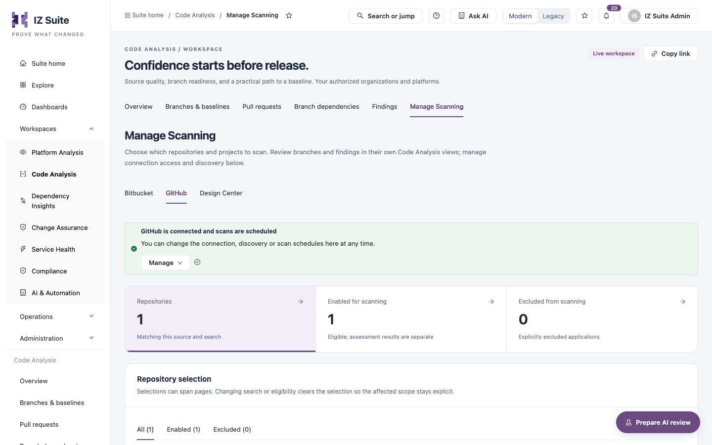

# Manage Scanning

The **Manage Scanning** tab of Code Analysis is where you choose which repositories and projects are scanned, and where you reach their connection, discovery, schedule and pull-request settings. Review the resulting branches and findings in the other Code Analysis tabs.

Open it from **Workspaces** → **Code Analysis** → **Manage Scanning** in the sidebar.


Requires the **Code Analysis** licence.


<figure><figcaption>
Manage Scanning
</figcaption></figure>

## Sources

Choose the source tab: **Bitbucket**, **GitHub** or **Design Center**. Each tab has the same layout.

## Setup status

The panel at the top shows the next setup step for the source, or that it is complete (for example **GitHub is connected and scans are scheduled**). Its button opens the step, for example:

| Step                                                     | Button                                                                                         |
| -------------------------------------------------------- | ---------------------------------------------------------------------------------------------- |
| The source is not turned on                              | **Turn on Bitbucket** / **Turn on GitHub**                                                     |
| The OAuth app is not registered, or the last sync failed | **Configure Bitbucket access** / **Configure GitHub access**                                   |
| Access is not authorized, or was revoked                 | **Authorize Bitbucket access** / **Authorize GitHub access** (the provider opens in a new tab) |
| Repositories are in but no scan is scheduled             | **Configure scan schedules**                                                                   |
| Design Center needs its organizations or connection      | **Configure Anypoint connection** / **Configure Design Center connection**                     |

The **Manage** (or **More**) menu opens the other settings of the source:

* **Bitbucket connection & discovery** / **GitHub connection & discovery**, or **Design Center connection**.
* **Scan schedules**.
* **Pull-request scanning** (Bitbucket only).

These open the same drawers as Setup.

## Repository tiles

| Tile                       | Description                                                                                |
| -------------------------- | ------------------------------------------------------------------------------------------ |
| **Repositories**           | Repositories matching this source and the search.                                          |
| **Enabled for scanning**   | Repositories eligible for scanning. Eligibility does not mean an assessment has completed. |
| **Excluded from scanning** | Repositories explicitly excluded.                                                          |

Click a tile to filter the list.

## Automatic repository scanning

On the **Bitbucket** tab, **Automatic repository scanning** uses your existing Bitbucket connection. Turn on **Automatically scan all repositories** to scan all current and future repositories of the connection, or leave it off to keep a selected list. The panel shows the connection, the organization and whether **All-repository scanning is active** or **All-repository scanning is off**.


You need a role that can manage connections and configure jobs to change automatic scanning.


## Repository selection

| Item                                 | Description                                                                   |
| ------------------------------------ | ----------------------------------------------------------------------------- |
| **All** / **Enabled** / **Excluded** | Filters the list by eligibility, with counts.                                 |
| Search                               | **Search repositories** by name.                                              |
| **Export**                           | Downloads this page of repositories as CSV.                                   |
| **Repository**                       | Name. **Open application dossier** opens the dossier of a scanned repository. |
| **Scan eligibility**                 | **Enabled** or **Excluded**.                                                  |
| **Organization / environment**       | The organization the repository belongs to and its environment.               |
| **Updated**                          | When the record last changed.                                                 |

### Enable or exclude repositories

1. Tick the repositories. Selections can span pages; changing the search or eligibility clears them.
2. Click **Enable selected** or **Exclude selected**.
3. To enable: choose the **Organization for selected applications**. Optionally turn on a one-time scan (with a connection) or a repository scan schedule.
4. Click **Confirm scan eligibility** (or **Confirm exclusion**).

Click **Clear selection** to untick everything. Excluding a repository stops future scans of it and its branches; its existing assessment evidence is kept.


You need a role that can configure jobs to select, enable or exclude repositories.


## Next steps

* [Branches & Baselines](/broken/pages/17ad10a1c076f78622cc3983f77319b907d59a1f): review the branches of the scanned repositories.
* [Pull Requests](pull-requests.md): review scanned pull requests.
* Schedules: follow the scans that run.
* [Code Analysis](./): back to the workspace.
