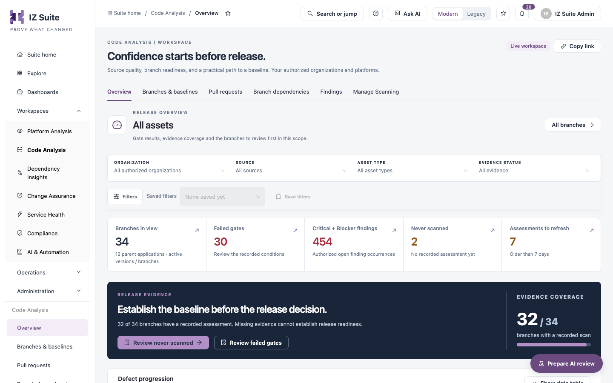

# Overview

The **Overview** tab of Code Analysis summarizes the branches in your scope: how many have a recorded assessment, how many failed their quality gate, how pull requests are doing, and which branches to review first.

Open it from **Workspaces** → **Code Analysis** → **Overview** in the sidebar.


Requires the **Code Analysis** licence.


<figure><figcaption>
Code Analysis overview
</figcaption></figure>

## Filters

| Filter              | Description                                                                                                           |
| ------------------- | --------------------------------------------------------------------------------------------------------------------- |
| **Organization**    | One organization, or **All authorized organizations**.                                                                |
| **Source**          | **Bitbucket**, **GitHub**, **Design Center** or **CLI**, or **All sources**.                                          |
| **Asset type**      | One asset type (for example Mule or API), or **All asset types**.                                                     |
| **Evidence status** | **All evidence**, **Failed gates**, **Passed gates**, **No gate result**, **Never scanned** or **Older than N days**. |
| **Filters** panel   | **Severity**, **Category**, **Rule** and **Security standard**: keep branches with open findings that match.          |

**All branches** at the top right opens the [Branches & Baselines](/broken/pages/17ad10a1c076f78622cc3983f77319b907d59a1f) tab with the same scope.

## Metric tiles

Each tile opens the records it counts.

| Tile                            | Description                                                                                          |
| ------------------------------- | ---------------------------------------------------------------------------------------------------- |
| **Branches in view**            | Branches in scope, with the number of parent applications.                                           |
| **Failed gates**                | Branches whose latest recorded quality gate failed.                                                  |
| **Critical + Blocker findings** | Open Critical and Blocker finding occurrences you are authorized to see. Opens them in **Findings**. |
| **Never scanned**               | Branches with no recorded assessment yet.                                                            |
| **Assessments to refresh**      | Branches whose latest assessment is older than the configured number of days.                        |

## Release evidence

The dark banner states how many branches have a recorded assessment (**Evidence coverage**). Missing evidence cannot establish release readiness.

* **Review never scanned** lists the branches without an assessment.
* **Review failed gates** lists the branches whose gate failed.

## Charts and lists

| Section                                          | Description                                                                                                                                                                                                                                             |
| ------------------------------------------------ | ------------------------------------------------------------------------------------------------------------------------------------------------------------------------------------------------------------------------------------------------------- |
| **Defect progression**                           | The latest recorded assessment of each application per day. Choose **Total & high severity**, **Severity breakdown**, **Defect types** or **Gates & assessment coverage**.                                                                              |
| **Security standards**                           | How many open findings map to CWE, OWASP and the other security standards. Select a bar to list its findings.                                                                                                                                           |
| **Assets by type and quality gate**              | Failed, passed and not assessed records per asset type. Select a segment to list those records.                                                                                                                                                         |
| **Top rules behind Critical + Blocker findings** | The rules with the most Critical and Blocker occurrences. Select a bar to list the applications with that rule's findings.                                                                                                                              |
| **Pull requests (30 days)**                      | **Open pull requests**, **First-time pass rate**, **Median new findings** and **Pull requests assessed**. See [Pull Requests](pull-requests.md).                                                                                                        |
| **Branches to review first**                     | Branches with the most high-severity occurrences, then a failed gate, then the most recorded findings: **Branch**, **Gate evidence**, **Critical / Blocker**, **Last assessment** and **Review** (opens the dossier). **View all** opens the full list. |

Every chart has **Show data table**.

## Next steps

* [Branches & Baselines](/broken/pages/17ad10a1c076f78622cc3983f77319b907d59a1f): open a branch's dossier.
* [Pull Requests](pull-requests.md): review the gate of each pull request.
* [Findings](findings.md): investigate the findings behind a failed gate.
* [Code Analysis](./): back to the workspace.
