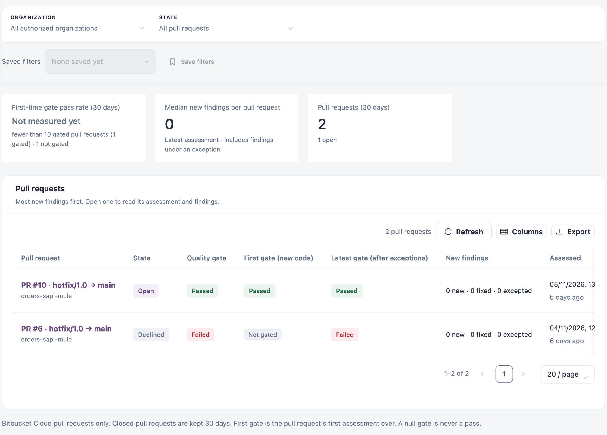

# Pull Requests

The **Pull requests** tab of Code Analysis lists the pull requests assessed in the last 30 days, with the quality gate of their first and latest assessment and the findings they introduce. Use it to see whether changes pass the gate the first time and which pull requests bring new findings.

Open it from **Workspaces** → **Code Analysis** → **Pull requests** in the sidebar.


Requires the **Code Analysis** licence.


<figure><figcaption><p>Pull requests</p></figcaption></figure>

## Filters

| Filter           | Description                                            |
| ---------------- | ------------------------------------------------------ |
| **Organization** | One organization, or **All authorized organizations**. |
| **State**        | **All pull requests** or **Open only**.                |

Saved filters work as described in Workspaces.

## Metric tiles

| Tile                                     | Description                                                                                                                                                                                        |
| ---------------------------------------- | -------------------------------------------------------------------------------------------------------------------------------------------------------------------------------------------------- |
| **First-time gate pass rate (30 days)**  | The share of gated pull requests whose first assessment passed the gate. Shows **Not measured yet** until enough pull requests are gated; the detail says how many are gated and how many are not. |
| **Median new findings per pull request** | From each pull request's latest assessment, including findings under an exception.                                                                                                                 |
| **Pull requests (30 days)**              | Pull requests assessed in the last 30 days, with the number still open.                                                                                                                            |

## Pull request list

The list shows the most new findings first. Click a pull request to open its dossier.

| Column                             | Description                                                                                             |
| ---------------------------------- | ------------------------------------------------------------------------------------------------------- |
| **Pull request**                   | Number, source branch → target branch, and repository.                                                  |
| **State**                          | The pull request's state, for example **Open** or **Declined**, or **Not recorded**.                    |
| **Quality gate**                   | The gate of the latest assessment.                                                                      |
| **First gate (new code)**          | The gate of the pull request's first assessment, on new code. **Not gated** when no gate was evaluated. |
| **Latest gate (after exceptions)** | The gate of the latest assessment after approved exceptions.                                            |
| **New findings**                   | New, fixed and excepted findings compared with the target branch.                                       |
| **Assessed**                       | When the latest assessment was recorded.                                                                |

Search, **Refresh**, **Columns** and **Export** work as described in Workspaces.


As the note under the list says, closed pull requests are kept for 30 days, and a pull request without a gate result never counts as a pass.


## Pull request dossier

The dossier of a pull request has the same layout as a [branch dossier](branches-and-baselines.md). Its subtitle shows the pull request number, source and target branches, state and commit. The **Posture & evidence** panel compares the pull request with its target branch, and **New code only** in its findings keeps only findings that are not open on the target branch.

## Scan pull requests

Pull requests reach this list in two ways:

| Source                  | How to set it up                                                                                                                                                                                                                                           |
| ----------------------- | ---------------------------------------------------------------------------------------------------------------------------------------------------------------------------------------------------------------------------------------------------------- |
| **Bitbucket webhook**   | In Setup, turn on **Scan pull requests from Bitbucket**, then add the webhook it shows (URL and secret) to each Bitbucket repository, with the pull request created and updated triggers. A pull request is then scanned whenever it is opened or updated. |
| **Your CI/CD pipeline** | Run the CLI with `-pullRequestId` instead of `-scmBranchName`, and pass the branch the pull request merges into with `-pullRequestTargetBranch`.                                                                                                           |

```bash
./iz-scan-cli-$IZ_CLI_VERSION-linux/bin/iz-scan-cli -serviceHost "https://izsuite.example.com" -authToken "$IZ_ACCESS_TOKEN" -applicationKey "orders-eapi" -source . -pullRequestId "$BITBUCKET_PR_ID" -pullRequestTargetBranch "$BITBUCKET_PR_DESTINATION_BRANCH" > iz-scan.log 2>&1 || true
```

See [Branches & Baselines](branches-and-baselines.md) for the full pipeline step.

## How a pull request is assessed

The target branch's latest scan is the pull request's baseline.

* **Target branch already scanned**: the pull request is assessed on **new code** only, the findings it adds compared with the target branch.
* **Target branch not scanned yet**: every issue in the pull request is assessed.


Scan your main branches first, so pull requests are judged only on the code they change.


## Next Steps

* [Branches & Baselines](branches-and-baselines.md): open the target branch's dossier.
* [Findings](findings.md): investigate the findings a pull request introduced.
* [Manage Scanning](manage-scanning.md): turn on pull-request scanning.
* [Code Analysis](./): back to the workspace.
