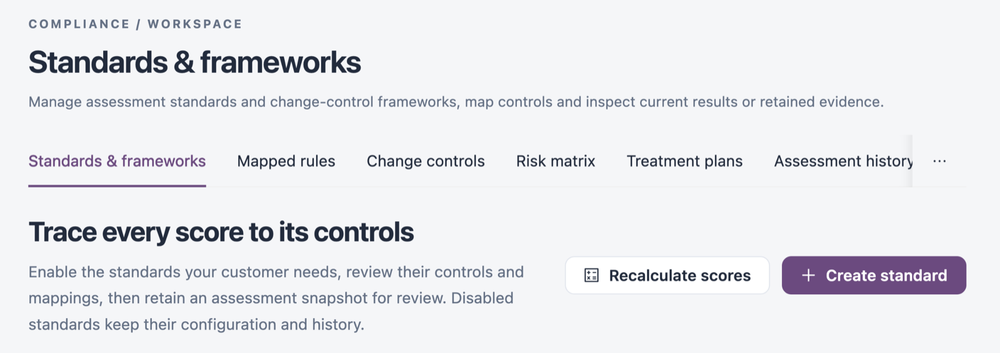

# Compliance

Compliance connects your applications' assessment results to compliance standards such as SOC 2, ISO/IEC 27001 and NIST. Use it to see how each standard scores, which rules and change controls support its controls, which risks need a decision, and to retain snapshots for auditors.

Open it from **Workspaces** → **Compliance** in the sidebar. It opens on **Standards & frameworks**.


You need a role that can view compliance standards. Creating or changing standards, rule mappings, risk ratings and treatment plans needs a role that can create, edit or delete compliance standards. **Change controls** belongs to Change Assurance: it needs the **Change Assurance** licence and a role that can view governance controls.


<figure><figcaption>
Compliance
</figcaption></figure>

## Screens

| Screen                                                                           | What it is for                                                                                        |
| -------------------------------------------------------------------------------- | ----------------------------------------------------------------------------------------------------- |
| [Standards & Frameworks](/broken/pages/2ded2e2e308bc0fe50fc7a95b55dad213487f979) | The standards library: enable standards, see scores, open the control hierarchy and retain snapshots. |
| [Mapped Rules](mapped-rules.md)                                                  | The rules that count towards a standard, with their impact and likelihood.                            |
| [Change Controls](change-controls.md)                                            | The controls a change must satisfy, and the policy templates behind them.                             |
| [Risk Matrix](risk-matrix.md)                                                    | Risks by likelihood and impact, the risk register and risk decisions.                                 |
| [Treatment Plans](treatment-plans.md)                                            | Shared plans that treat or accept a risk for every affected application.                              |
| [Assessment History](assessment-history.md)                                      | Retained snapshots of a standard's score and evidence.                                                |
| [Scoring Settings](scoring-settings.md)                                          | The impact and likelihood levels and the vocabularies used for scoring.                               |


A compliance score is calculated from configured rules. An application with no recorded validation is not evaluated; that does not make it compliant.


## Next Steps

* [Standards & Frameworks](/broken/pages/2ded2e2e308bc0fe50fc7a95b55dad213487f979): enable the standards you need.
* [Risk Matrix](risk-matrix.md): find the risks that need a decision.
* [Assessment History](assessment-history.md): review a retained snapshot.
