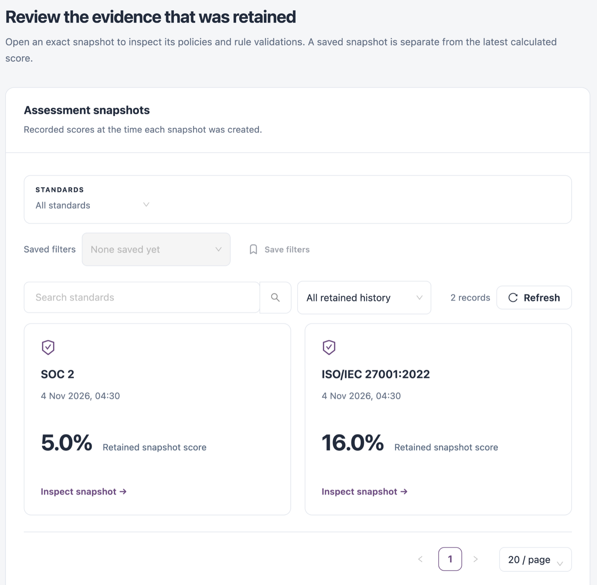
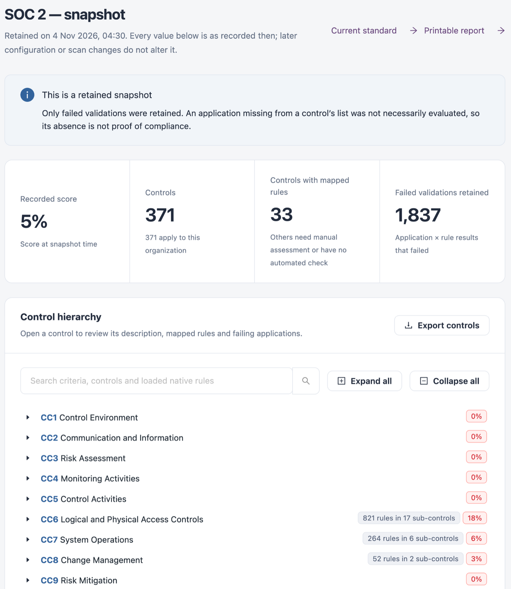

# Assessment History

**Assessment history** lists the assessment snapshots retained for your standards. Open a snapshot to inspect its controls and rule validations exactly as they were recorded. A snapshot is separate from the latest calculated score.

Open it from **Workspaces** → **Compliance** → **Assessment history** in the sidebar.


You need a role that can view compliance standards.


<figure><figcaption>
Assessment history
</figcaption></figure>

## Assessment Snapshots

Each snapshot shows the standard, when it was retained and the **Retained snapshot score**.

| Filter        | Description                                         |
| ------------- | --------------------------------------------------- |
| **Standards** | One or more standards, or **All standards**.        |
| Time range    | **All retained history**, or a snapshot time range. |

**Save filters** stores the filters under a name. To create a snapshot, use **Create assessment snapshot** or **Retain snapshot** in [Standards & Frameworks](/broken/pages/2ded2e2e308bc0fe50fc7a95b55dad213487f979).

## Inspect a Snapshot

Select **Inspect snapshot →** to open it.

<figure><figcaption>
Retained snapshot
</figcaption></figure>

| Tile                            | Description                                                                           |
| ------------------------------- | ------------------------------------------------------------------------------------- |
| **Recorded score**              | The score at snapshot time.                                                           |
| **Controls**                    | Controls in the standard and how many apply to this organization.                     |
| **Controls with mapped rules**  | Controls with mapped rules. Others need manual assessment or have no automated check. |
| **Failed validations retained** | Application and rule results that failed.                                             |

**Control hierarchy** lists the criteria and controls with their recorded scores. Open a control to see its description, mapped rules and failing applications. Use **Expand all** and **Collapse all** to navigate, **Export controls** to download the hierarchy, and **Printable report** for a printable copy. **Current standard** opens the standard as it is now.


Every value in a snapshot is as recorded at the time. Only failed validations are retained, so an application missing from a control's list was not necessarily evaluated; its absence is not proof of compliance.


## Next Steps

* [Standards & Frameworks](/broken/pages/2ded2e2e308bc0fe50fc7a95b55dad213487f979): retain a new snapshot.
* [Treatment Plans](treatment-plans.md): follow the plans for failing risks.
* [Compliance](./): see all Compliance screens.
