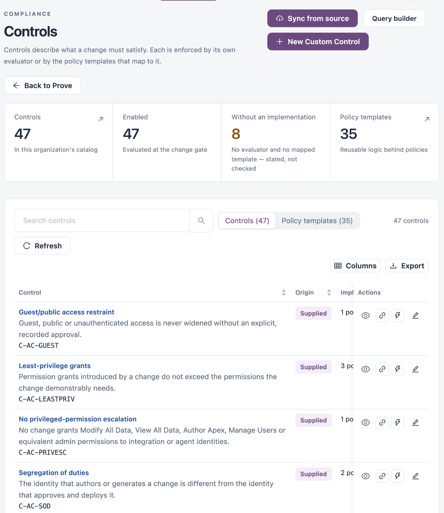
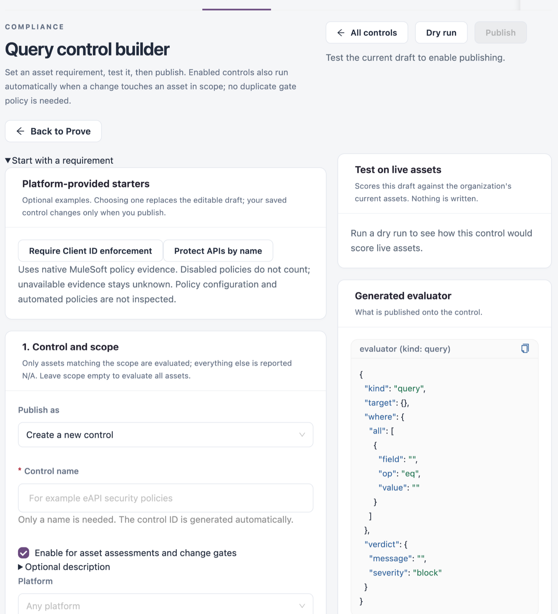

# Change Controls

**Change controls** lists the controls a change must satisfy. Each control is enforced by its own evaluator or by the policy templates that map to it. Change controls can be mapped to standards in [Standards & Frameworks](/broken/pages/2ded2e2e308bc0fe50fc7a95b55dad213487f979), where they show as change-control mappings.

Open it from **Workspaces** → **Compliance** → **Change controls** in the sidebar.


Requires the **Change Assurance** licence.



You need a role that can view governance controls. Creating, editing and simulating controls needs a role that can manage them.


<figure><figcaption><p>Change controls</p></figcaption></figure>

## Summary Tiles

| Tile                          | Description                                                             |
| ----------------------------- | ----------------------------------------------------------------------- |
| **Controls**                  | Controls in this organization's catalog. Select it to list them.        |
| **Enabled**                   | Controls evaluated at the change gate.                                  |
| **Without an implementation** | Controls with no evaluator and no mapped template: stated, not checked. |
| **Policy templates**          | Reusable logic behind policies. Select it to list them.                 |

## Controls

The **Controls** tab lists every control.

| Column             | Description                                                                 |
| ------------------ | --------------------------------------------------------------------------- |
| **Control**        | Name, description and key.                                                  |
| **Origin**         | **Supplied** or created by your organization.                               |
| **Implemented by** | **Own evaluator**, the number of policy templates, or **Not implemented**.  |
| **Status**         | **Enabled** or disabled.                                                    |
| **Version**        | The control version.                                                        |
| **Reference**      | Links to the authoritative reference and your organization's documentation. |
| **Actions**        | See below.                                                                  |

| Action                  | Description                                                                                                                                           |
| ----------------------- | ----------------------------------------------------------------------------------------------------------------------------------------------------- |
| **View implementation** | Shows the control's key, name, origin, version, status, description, and its evaluator or the policies that enforce it.                               |
| **Add org doc link**    | Links your organization's documentation to the control.                                                                                               |
| **Simulate impact**     | Scores the control against live assets in scope and shows how many would be flagged, how many fail today and how many would pass. Nothing is written. |
| **Edit Control**        | Edits the control.                                                                                                                                    |


Supplied controls are read-only. Editing one saves a copy for your organization with your changes; the supplied definition is never modified.


## Policy Templates

The **Policy templates** tab lists the reusable logic behind policies.

| Column          | Description                            |
| --------------- | -------------------------------------- |
| **Template**    | Name, description and key.             |
| **Group**       | For example `access`.                  |
| **Recommended** | **Blocks the gate** or **Warns only**. |
| **Version**     | The template version.                  |
| **Status**      | **Enabled** or disabled.               |
| **Reference**   | Reference links.                       |

Activate templates as organization policies in the gate policies of Change Assurance. Editing a supplied template's metadata saves a copy for your organization.

## Build a Query Control

**Query builder** creates a control from an asset requirement without writing rule logic.

<figure><figcaption><p>Query control builder</p></figcaption></figure>

1. Select **Query builder**.
2. Optionally choose one of the **Platform-provided starters**. It replaces the draft.
3. Under **1. Control and scope**, enter the **Control name**, choose whether to **Enable for asset assessments and change gates**, and optionally add a description. Narrow the scope with **Platform**, **Type**, **Asset class**, **Environment**, **Business group** and **Name contains**. Assets outside the scope are reported as N/A; an empty scope evaluates all assets.
4. Under **2. Failing condition**, choose a field, a comparison and a value. Use **Condition** and **Group** to add more, and choose how they combine, for example **AND — all must match**. An asset fails when the condition matches.
5. Under **3. Verdict**, enter the **Message shown on failing assets** and choose the **Enforcement**, for example **Block — fail the gate**.
6. Select **Dry run** to test the draft on live assets. Nothing is written.
7. Select **Publish**.

Enabled controls also run when a change touches an asset in scope. You do not need a separate gate policy. Blocking fails the IZ Suite gate; stopping an external deployment needs an enforcement integration.

## Create a Custom Control

**New Custom Control** creates a control from rule logic.

| Field                                                   | Description                                                                                                                       |
| ------------------------------------------------------- | --------------------------------------------------------------------------------------------------------------------------------- |
| **Key**                                                 | The control identifier.                                                                                                           |
| **Name**                                                | The control name.                                                                                                                 |
| **Description**                                         | What the control requires.                                                                                                        |
| **Evaluator (rule logic)**                              | JSONLogic with governance operators. It runs per applicable asset: a true result means the condition matched and the asset fails. |
| **Params (optional JSON — e.g. { severity, applies })** | Set `severity` to block or warn, and optionally `applies` to scope the control by platform, type or asset class.                  |

```json
{ "==": [ { "var": "metadata.usesHttp" }, true ] }
```

The example fails any asset whose metadata records plaintext HTTP.

## Sync from Source

**Sync from source** pulls a versioned bundle of policy templates, controls and frameworks, updates them by key with a new version, and re-assesses posture straight away. Leave the URL blank to apply the bundled default content.

## Next Steps

* [Standards & Frameworks](/broken/pages/2ded2e2e308bc0fe50fc7a95b55dad213487f979): see which standards your change controls map to.
* [Risk Matrix](risk-matrix.md): review platform and change control risks.
* [Change Assurance](../change-assurance/): see how controls are applied to changes.
