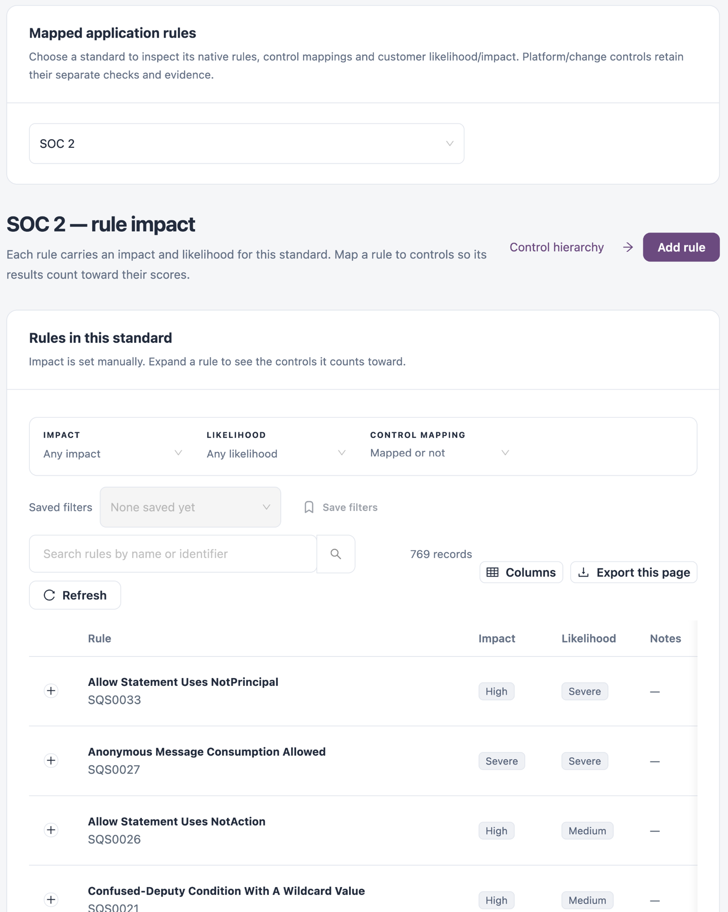

# Mapped Rules

**Mapped rules** lists the native application rules of one standard, the controls each rule counts towards, and the customer impact and likelihood of each rule. Impact and likelihood give each rule its risk score in the [Risk Matrix](risk-matrix.md). Platform and change controls keep their own checks and evidence in [Change Controls](change-controls.md).

Open it from **Workspaces** → **Compliance** → **Mapped rules** in the sidebar.


You need a role that can view compliance standards. Adding rules needs a role that can create compliance standards and view quality rules; changing or removing them needs a role that can edit or delete compliance standards.


## Choose a Standard

Select a standard in **Choose a standard**. Its rules appear below. You can also open this screen from a standard's **Rule impact** link in [Standards & Frameworks](/broken/pages/2ded2e2e308bc0fe50fc7a95b55dad213487f979).

<figure><figcaption>
Mapped rules
</figcaption></figure>

**Control hierarchy** opens the standard's control hierarchy.

## Rules in This Standard

| Filter              | Description                                                                 |
| ------------------- | --------------------------------------------------------------------------- |
| **Impact**          | One impact level, or **Any impact**.                                        |
| **Likelihood**      | One likelihood level, or **Any likelihood**.                                |
| **Control mapping** | **Mapped to a control**, **Not mapped to a control**, or **Mapped or not**. |
| Search              | **Search rules by name or identifier**.                                     |

| Column         | Description                                                |
| -------------- | ---------------------------------------------------------- |
| **Rule**       | The rule. Expand it to see the controls it counts towards. |
| **Impact**     | The rule's impact level for this standard.                 |
| **Likelihood** | The rule's likelihood level.                               |
| **Notes**      | Notes recorded with the rule.                              |
| **Manage**     | **Edit impact** and **Remove rule**.                       |

**Export rules on this page** downloads the rules on the current page.

## Add a Rule

A rule can be added to a standard once.

1. Select **Add rule**.
2. Search for the **Rule** by name or identifier. **Required.**
3. Choose the impact:
   * If the standard sets impact manually, choose the **Overall impact**. **Required.**
   * If the standard derives impact from its impact measures, choose an impact for each measure. **Overall impact** is set to the highest one.
4. Choose the **Likelihood**. **Required.**
5. Optionally add **Notes**.
6. Save the rule.

To change a rule's ratings, select **Edit impact** on its row. The levels you can choose are listed in [Scoring Settings](scoring-settings.md).


**Remove rule** removes the rule and its control mappings from the standard, so its results stop counting towards any control.


## Next Steps

* [Risk Matrix](risk-matrix.md): see where each rule's rating places it.
* [Scoring Settings](scoring-settings.md): read what each impact and likelihood level means.
* [Standards & Frameworks](/broken/pages/2ded2e2e308bc0fe50fc7a95b55dad213487f979): return to the standards library.
