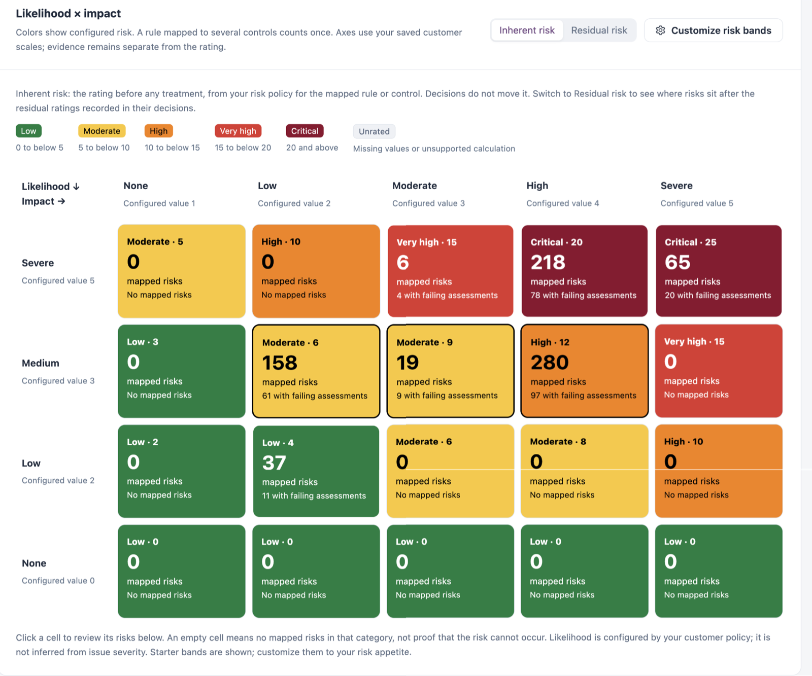
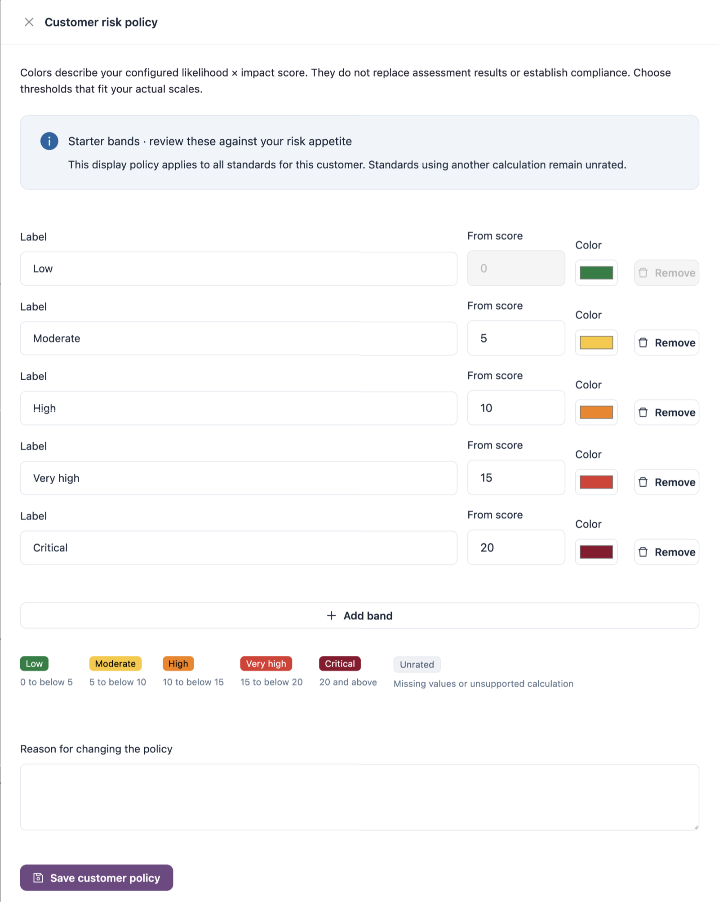

# Risk Matrix

**Risk matrix** connects your risk ratings to application checks, evidence, consequences and treatment decisions. Each risk is a rule with its configured likelihood and impact, listed once however many controls it is mapped to.

Open it from **Workspaces** → **Compliance** → **Risk matrix** in the sidebar.


You need a role that can view compliance standards. Changing the risk bands or recording decisions needs a role that can edit compliance standards.


## Summary Tiles

| Tile                     | Description                                                     |
| ------------------------ | --------------------------------------------------------------- |
| **Risks**                | Distinct risks, and the number of control mappings behind them. |
| **Need attention**       | Risks where at least one current application check fails.       |
| **Not evaluated**        | Risks with no current validation in your application scope.     |
| **Recorded checks pass** | Risks whose mapped checks pass in the assessed applications.    |

Select a tile to filter the register. Application evidence is limited to the applications and findings you can access. No current validation means not evaluated; it does not mean compliant.

## Filters

| Filter                                | Description                                                                                                               |
| ------------------------------------- | ------------------------------------------------------------------------------------------------------------------------- |
| **Status**                            | **All assessment states**, **Failing assessments**, **Not evaluated** or **Recorded checks pass**.                        |
| **Standard**                          | A standard, or **All standards**.                                                                                         |
| **Platform**                          | The applications' platform, or **Not evaluated** for risks no application in scope has assessed (application risks only). |
| **Asset type**                        | One asset type of the chosen platform (application risks only).                                                           |
| **Applicability** (under **Filters**) | **Applicable controls**, **All configured controls** or **Excluded / disabled controls**.                                 |

## Likelihood × Impact

<figure><figcaption>
Likelihood × impact
</figcaption></figure>

The grid places each risk by its likelihood (rows) and impact (columns), using the levels in [Scoring Settings](scoring-settings.md). The score is likelihood × impact, and the colour shows the band the score falls in. Each cell shows the band and score, the number of mapped risks, and how many have failing assessments.

* Choose **Inherent risk** to see ratings before any treatment. Decisions do not move them.
* Choose **Residual risk** to see where risks sit after the residual ratings recorded in their decisions. A risk moves once every applicable control has a residual rating (the highest is used); otherwise it stays in its inherent cell.

Select a cell to list its risks in the register below. An empty cell means no mapped risks in that category, not that the risk cannot occur.

### Customize Risk Bands

The bands are a display policy for all standards. Starter bands are **Low** (0 to below 5), **Moderate** (5 to below 10), **High** (10 to below 15), **Very high** (15 to below 20) and **Critical** (20 and above). Risks with missing values are **Unrated**.

1. Select **Customize risk bands**.
2. Change each band's **Label**, **From score** and **Color**, or use **Add band** and **Remove**. You can have up to six bands.
3. Enter the **Reason for changing the policy**.
4. Select **Save customer policy**.

<figure><figcaption>
Customer risk policy
</figcaption></figure>

## Risk Register

The register lists the risks that match the filters and the selected cell.

| Column                  | Description                                                                                                                               |
| ----------------------- | ----------------------------------------------------------------------------------------------------------------------------------------- |
| **Risk / controls**     | The rule, the standards and number of mapped controls, and the potential consequence. Expand a row to see each control mapping.           |
| **Likelihood / impact** | The ratings and the resulting band and score.                                                                                             |
| **Current evidence**    | For example **Failing assessments**, with failing and assessed application counts.                                                        |
| **Treatment**           | The decision, for example **Treat** or **Tolerate: Residual risk**, how many controls are decided, and alerts such as **Review overdue**. |
| **Review**              | **Open risk**.                                                                                                                            |

**Export this page** downloads the rows on the current page.

### Open a Risk

**Open risk** shows the failing and assessed applications, the standard and control, likelihood, impact, configured score, risk type, treatment, review status and latest included assessment. It also shows:

* Every control the risk is mapped to, with its applicability and decision. One treatment plan covers all of them.
* **Shared treatment plans** for this risk, and **Plan treatment for all occurrences** to create one. See [Treatment Plans](treatment-plans.md).
* **Owner, treatment and review**: the recorded decision, residual rating, review and expiry dates, and **Decision history**.
* **Consequence and treatment**: the potential consequence, remediation and review notes.
* **Review control & treatment** and **Review likelihood & impact**.
* **Current application evidence**: validations from each application's latest assessment.

When a treatment plan can cover a risk, the decision is made through the plan. For other risks, record the decision on the risk itself: the accountable person or team, decision status, treatment approach, next review, treatment plan and target date, residual likelihood and impact, acceptance expiry, verification evidence and the decision rationale.

## Next Steps

* [Treatment Plans](treatment-plans.md): follow the plans that treat or accept these risks.
* [Mapped Rules](mapped-rules.md): change a rule's likelihood or impact.
* [Scoring Settings](scoring-settings.md): read the levels used on each axis.
