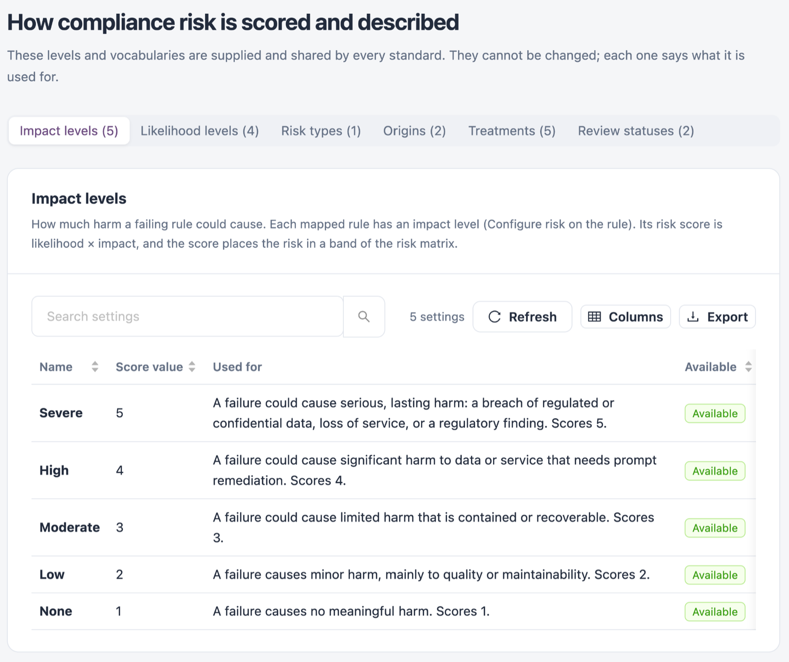

# Scoring Settings

**Scoring settings** shows how compliance risk is scored and described. These levels and vocabularies are supplied and shared by every standard. They cannot be changed; each one says what it is used for.

Open it from **Workspaces** → **Compliance** → **Scoring settings** in the sidebar.


You need a role that can view compliance standards.


<figure><figcaption>
Scoring settings
</figcaption></figure>

Each tab lists its settings with **Name**, **Score value** (for levels), **Used for** and **Available**. **Export all settings** downloads every setting and **Refresh** reloads the list.

## Impact Levels

How much harm a failing rule could cause. Each mapped rule has an impact level. Its risk score is likelihood × impact, and the score places the risk in a band of the [Risk Matrix](risk-matrix.md).

| Name         | Score | Used for                                                                                                                           |
| ------------ | ----- | ---------------------------------------------------------------------------------------------------------------------------------- |
| **Severe**   | 5     | A failure could cause serious, lasting harm: a breach of regulated or confidential data, loss of service, or a regulatory finding. |
| **High**     | 4     | A failure could cause significant harm to data or service that needs prompt remediation.                                           |
| **Moderate** | 3     | A failure could cause limited harm that is contained or recoverable.                                                               |
| **Low**      | 2     | A failure causes minor harm, mainly to quality or maintainability.                                                                 |
| **None**     | 1     | A failure causes no meaningful harm.                                                                                               |

## Likelihood Levels

How likely a failing rule is to lead to that harm. It is multiplied with the impact level to give the rule's risk score.

| Name       | Score | Used for                                                                                                            |
| ---------- | ----- | ------------------------------------------------------------------------------------------------------------------- |
| **Severe** | 5     | A failure is very likely to be exploited or to cause the impact, for example an exposed secret or an open endpoint. |
| **Medium** | 3     | A failure could be exploited or cause the impact under realistic conditions.                                        |
| **Low**    | 2     | A failure needs unusual conditions or other weaknesses before it causes the impact.                                 |
| **None**   | 0     | A failure is not expected to cause the impact. The risk score is 0.                                                 |

## Risk Types

How the risk on a rule-to-control mapping is classified. Shown in the risk register; it does not change the score.

| Name       | Used for                                                                             |
| ---------- | ------------------------------------------------------------------------------------ |
| **Threat** | A failing rule is a weakness a threat could exploit to harm the control's objective. |

## Origins

Where the risk on a rule-to-control mapping comes from. Recorded with the mapping; it does not change the score.

| Name         | Used for                                                                            |
| ------------ | ----------------------------------------------------------------------------------- |
| **External** | The risk comes from a third party: a supplier, a dependency or an external service. |
| **Internal** | The risk comes from your own code, configuration or processes.                      |

## Treatments

How the risk on a rule-to-control mapping is treated. Chosen when a risk decision or [treatment plan](treatment-plans.md) is recorded.

| Name                        | Used for                                                                          |
| --------------------------- | --------------------------------------------------------------------------------- |
| **Combination of actions**  | Use more than one treatment, for example partly fix and accept the rest.          |
| **Monitor**                 | Keep the risk under observation and review it again later.                        |
| **Tolerate: Residual risk** | Accept the remaining (residual) risk with a recorded justification.               |
| **Transfer**                | Transfer the risk to another party, for example a supplier contract or insurance. |
| **Treat**                   | Fix the cause: remediate the failing rule so the control is met.                  |

## Review Statuses

Whether a rule-to-control mapping applies to you.

| Name               | Used for                                                                                                                                         |
| ------------------ | ------------------------------------------------------------------------------------------------------------------------------------------------ |
| **Applicable**     | The mapping applies to you and is listed in the risk register.                                                                                   |
| **Not Applicable** | The mapping does not apply to you. It is left out of the risk register, but its rule still counts in the control score. Record why in its notes. |

## Next Steps

* [Mapped Rules](mapped-rules.md): set the impact and likelihood of a rule.
* [Risk Matrix](risk-matrix.md): see where the scores place each risk.
* [Treatment Plans](treatment-plans.md): choose a treatment for a risk.
