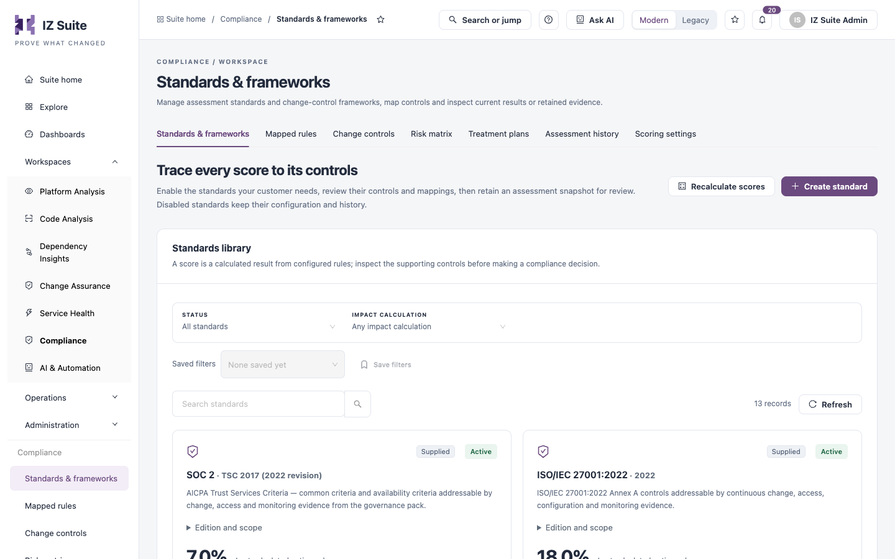
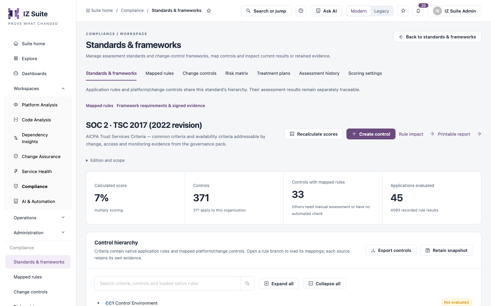

# Standards & Frameworks

**Standards & frameworks** is the standards library. Enable the standards your customers need, review their controls and mappings, then retain an assessment snapshot for review. Disabled standards keep their configuration and history.

Open it from **Workspaces** → **Compliance** → **Standards & frameworks** in the sidebar.


You need a role that can view compliance standards. Creating, editing, enabling and disabling standards needs a role that can create or edit them.


<figure><figcaption>
Standards &#x26; frameworks
</figcaption></figure>

## Standards library

| Filter                 | Description                                                 |
| ---------------------- | ----------------------------------------------------------- |
| **Status**             | **All standards**, **Enabled**, **Custom** or **Disabled**. |
| **Impact calculation** | **Maximum of all measures** or **Manual selection**.        |
| **Search standards**   | Find a standard by name.                                    |

**Save filters** stores the filters under a name.

Each standard is a card:

| Item                      | Description                                                                                                                                                                       |
| ------------------------- | --------------------------------------------------------------------------------------------------------------------------------------------------------------------------------- |
| **Supplied** / **Custom** | Whether the standard comes with IZ Suite or was created by your organization.                                                                                                     |
| **Active** / disabled     | Whether the standard is enabled.                                                                                                                                                  |
| **Edition and scope**     | The edition and what the standard covers.                                                                                                                                         |
| Score                     | The **Last calculated native-rule score**. It needs application validation results; change-control assessments do not add to it.                                                  |
| Coverage                  | Standard controls and how many are linked to native rules; native rules mapped and how many have validation records; change controls mapped, enabled and with assessment records. |

The change-control count shows evidence coverage, not a pass rate.

Card actions:

| Action                                     | Description                                                                                                                                                                                                        |
| ------------------------------------------ | ------------------------------------------------------------------------------------------------------------------------------------------------------------------------------------------------------------------ |
| **Review control policies →**              | Opens the standard's control hierarchy.                                                                                                                                                                            |
| **Disable standard** / **Enable standard** | Turns the standard off or on for this workspace. A disabled standard keeps its controls, mappings, last scores and retained evidence. An enabled standard's score refreshes on the next compliance validation run. |
| **Manage standard**                        | Opens the standard's details.                                                                                                                                                                                      |

## Recalculate scores

**Recalculate scores** queues a score recalculation of every enabled standard. Otherwise scores refresh when new assessment results arrive, and on the 1st and 15th of each month.

## Create a standard

1. Select **Create standard**.
2. Complete the fields below.
3. Select **Save changes**.

| Field                  | Description                                                                                                                                                                                           |
| ---------------------- | ----------------------------------------------------------------------------------------------------------------------------------------------------------------------------------------------------- |
| **Standard name**      | **Required.**                                                                                                                                                                                         |
| **Description**        | **Required.**                                                                                                                                                                                         |
| **Score calculation**  | **Multiply all measures**. **Required.**                                                                                                                                                              |
| **Impact calculation** | **Maximum of all measures** or **Manual selection**. **Required.**                                                                                                                                    |
| **Impact measures**    | Shown for **Maximum of all measures**. The measures that describe the impact of a control failure. Add at least one. Changing them clears the impact chosen per measure on each rule of the standard. |
| **Status**             | **Enabled** or disabled. **Required.**                                                                                                                                                                |

## Manage a standard

**Manage standard** shows the scoring method, impact calculation and creation date, with links to **Inspect control policies →**, **Review rule impact measures →** and **Find retained assessments →**. From here you can:

* **Edit standard**: change the fields above.
* **Review control evidence**: ask for an AI review of the standard's control evidence.
* **Create assessment snapshot**: retain the current assessment. The snapshot appears in [Assessment History](assessment-history.md) once it is recorded.
* **Disable standard**.


**Delete standard** is available only for custom standards. It deletes the standard's controls, rule impact, mappings and retained snapshots. This cannot be undone.


## Control hierarchy

**Review control policies →** opens a standard's page.

<figure><figcaption>
Standard and control hierarchy
</figcaption></figure>

| Tile                           | Description                                                                                       |
| ------------------------------ | ------------------------------------------------------------------------------------------------- |
| **Calculated score**           | The score and its scoring method.                                                                 |
| **Controls**                   | Controls in the standard and how many apply to this organization.                                 |
| **Controls with mapped rules** | Controls with at least one mapped rule. Others need manual assessment or have no automated check. |
| **Applications evaluated**     | Applications with results, and the number of recorded rule results.                               |

**Control hierarchy** lists the criteria and their controls, each with its rules, change-control mappings and score, or **Not evaluated**. Use the search box, **Expand all** and **Collapse all** to navigate. **Export controls** downloads the hierarchy and **Retain snapshot** creates an assessment snapshot.

The page also has **Recalculate scores**, **Create control**, **Rule impact** (opens [Mapped Rules](mapped-rules.md)) and **Printable report**. When the standard is also a change-control framework, **Framework requirements & signed evidence** shows the requirements evaluated from change decisions, asset assessments and the signed ledger. These do not add to the application score.


If your role can view change-control frameworks but not compliance standards, this screen shows the change-control frameworks instead of the standards library.


## Next steps

* [Mapped Rules](mapped-rules.md): set the impact and likelihood of each rule.
* [Assessment History](assessment-history.md): open a retained snapshot.
* [Compliance](./): see all Compliance screens.
