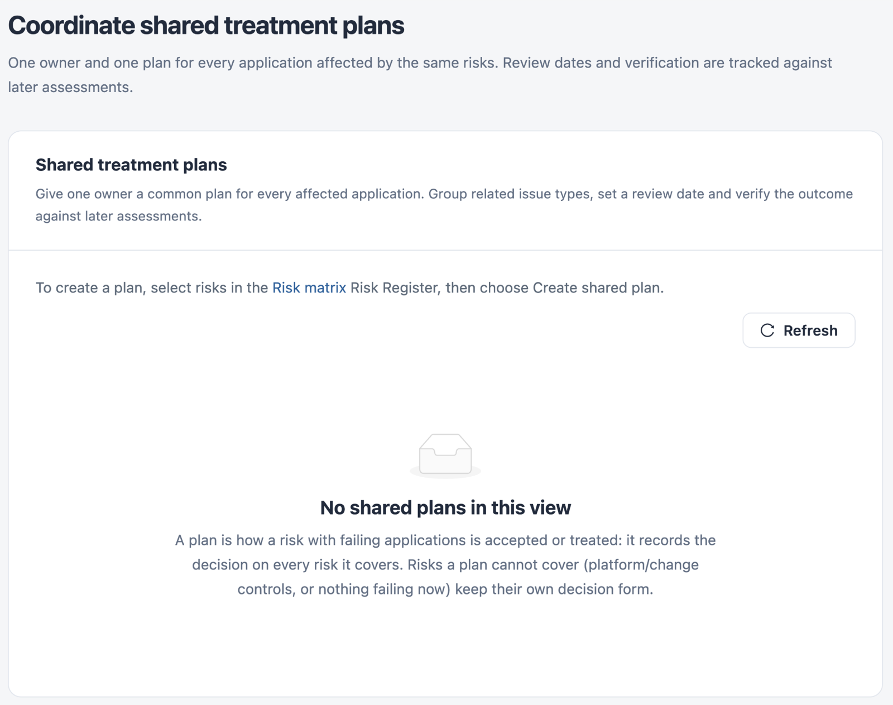

# Treatment Plans

**Treatment plans** coordinates shared treatment plans: one owner and one plan for every application affected by the same risks. Review dates and verification are tracked against later assessments.

Open it from **Workspaces** → **Compliance** → **Treatment plans** in the sidebar.


You need a role that can view compliance standards. Creating or updating a plan needs a role that can edit compliance standards.


<figure><figcaption>
Treatment plans
</figcaption></figure>

## Shared Treatment Plans

| Column           | Description                                                                    |
| ---------------- | ------------------------------------------------------------------------------ |
| **Plan / owner** | Plan title, owner, number of issue types and number of applications.           |
| **Decision**     | **Open**, **Treatment underway**, **Risk accepted** or **Treatment verified**. |
| **Next review**  | When the plan is due for review.                                               |
| **Open**         | **Review** opens the plan.                                                     |

Use **Newer plans** and **Older plans** to page through the list.

## Create a Shared Plan

A treatment plan is how you decide a risk it can cover. Saving the plan records its decision on every risk mapping it covers.

1. In [Risk Matrix](risk-matrix.md), select the risks in the **Risk Register**, then select **Create shared plan**. You can also select **Plan treatment for all occurrences** on an open risk.
2. Complete the fields below.
3. Select **Create shared treatment plan**.

| Field                                        | Description                                                                                                                                                                                                                                           |
| -------------------------------------------- | ----------------------------------------------------------------------------------------------------------------------------------------------------------------------------------------------------------------------------------------------------- |
| **Shared treatment plan**                    | Plan title, 5 to 200 characters. **Required.**                                                                                                                                                                                                        |
| **Accountable person or team**               | The owner. **Required.**                                                                                                                                                                                                                              |
| **Decision**                                 | **Open**, **Treatment underway** or **Risk accepted**. **Treatment verified** is available only when the plan can be closed.                                                                                                                          |
| **Treatment approach**                       | One of the treatments in [Scoring Settings](scoring-settings.md), for example **Treat** or **Tolerate: Residual risk**. **Required.**                                                                                                                 |
| **Occurrence scope**                         | **Current failing occurrences only** keeps the exact applications, issue types and assessment baseline. **Also watch these assessed applications** also shows new failures of the same issue types in those applications. It cannot be changed later. |
| **Remediation or acceptance plan**           | The common change, any exceptions, and how the owner will verify the outcome.                                                                                                                                                                         |
| **Review after**                             | **Custom date**, or 30, 60 or 90 days. Sets **Next review**.                                                                                                                                                                                          |
| **Next review**                              | **Required.**                                                                                                                                                                                                                                         |
| **Treatment target**                         | The target date.                                                                                                                                                                                                                                      |
| **Residual likelihood**, **Residual impact** | The rating after treatment. Used by **Residual risk** in the risk matrix.                                                                                                                                                                             |
| **Acceptance expiry (within one year)**      | Shown for **Risk accepted**, with a confirmation that the customer accepts the residual risk until that date.                                                                                                                                         |
| **Verification rationale**                   | Shown for **Treatment verified**. At least 20 characters. **Required.**                                                                                                                                                                               |
| **Reason for this decision**                 | At least 15 characters. **Required.**                                                                                                                                                                                                                 |

## Review a Plan

**Review** shows the plan's decision, owner, treatment, review and target dates, revision and plan text.

* **Update owner, plan or decision** records a new revision with the same fields.
* **Recheck latest assessments** reloads the latest results.
* **Verify the treatment** lists each application and issue type with its verification state, for example **Still failing**, and counts of verified, still failing and needing evidence.
* **Plan history** lists every revision.


Accepting a risk leaves its findings visible. A plan can be closed only when a newer passing assessment exists for every original occurrence and there are no new watched failures.


## Next Steps

* [Risk Matrix](risk-matrix.md): select the risks a plan should cover.
* [Assessment History](assessment-history.md): keep a snapshot of the outcome.
* [Scoring Settings](scoring-settings.md): read what each treatment means.
