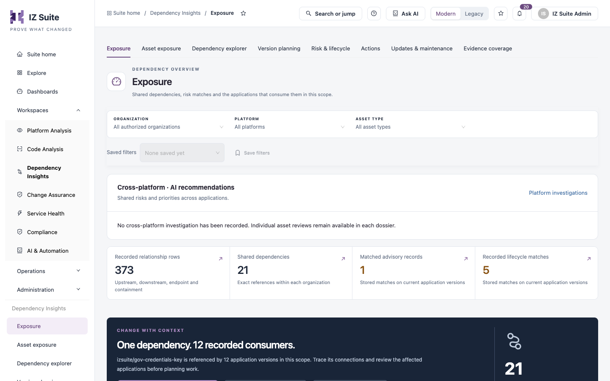

# Dependency Insights

Dependency Insights shows the dependencies, component versions and lifecycle or vulnerability matches recorded for your applications. Use it to see what a change could reach before you make it, and to plan and track upgrades across many applications.

Open it from **Workspaces** → **Dependency Insights** in the sidebar.


Requires the **Dependency Insights** licence.



You need a role that can view the inventory. Some tabs inside a view need more: for example **Vulnerability catalog** needs access to vulnerable applications and **Deprecation rules** needs access to deprecations.


<figure><figcaption>
Dependency Insights
</figcaption></figure>

## Views

Every view has the same tabs across the top and the same scope bar: **Organization**, **Platform** and **Asset type**. You can save a scope with **Save filters** and pick it again from **Saved filters**. The scope you choose stays the same when you switch views.

| View                                                                            | What it is for                                                                          |
| ------------------------------------------------------------------------------- | --------------------------------------------------------------------------------------- |
| [Exposure](exposure.md)                                                         | Summary of shared dependencies, advisory and lifecycle matches, and where to start.     |
| [Asset Exposure](asset-exposure.md)                                             | One row per application version with its connections, components and active risk.       |
| [Dependency Explorer](dependency-explorer.md)                                   | Trace recorded relationships between applications, components and endpoints.            |
| [Version Planning](version-planning.md)                                         | Component versions in use, exact inventory and upgrade waves.                           |
| [Risk & Lifecycle](/broken/pages/886c6a72c421c38183562850946b59d50c963bc3)      | Application risk, the vulnerability catalog, deprecation rules and the priority matrix. |
| [Actions](actions.md)                                                           | Assigned upgrade waves and saved risk review notes.                                     |
| [Updates & Maintenance](/broken/pages/56f71d517d3abfb5567dda056df1cd97183a623a) | Rules that tell affected teams about a change or assign maintenance work.               |
| [Evidence Coverage](evidence-coverage.md)                                       | Applications with no relationship evidence yet.                                         |
| [Assigned Work](assigned-work.md)                                               | The shared queue of upgrades, maintenance, change reviews and acknowledgments.          |


Counts describe the evidence that has been collected. A missing record does not mean an application is safe or isolated.


## Next steps

* [Exposure](exposure.md): start with the summary of shared dependencies and risk.
* [Version Planning](version-planning.md): plan an upgrade wave for a component.
* [Risk & Lifecycle](/broken/pages/886c6a72c421c38183562850946b59d50c963bc3): review vulnerability and deprecation matches.
