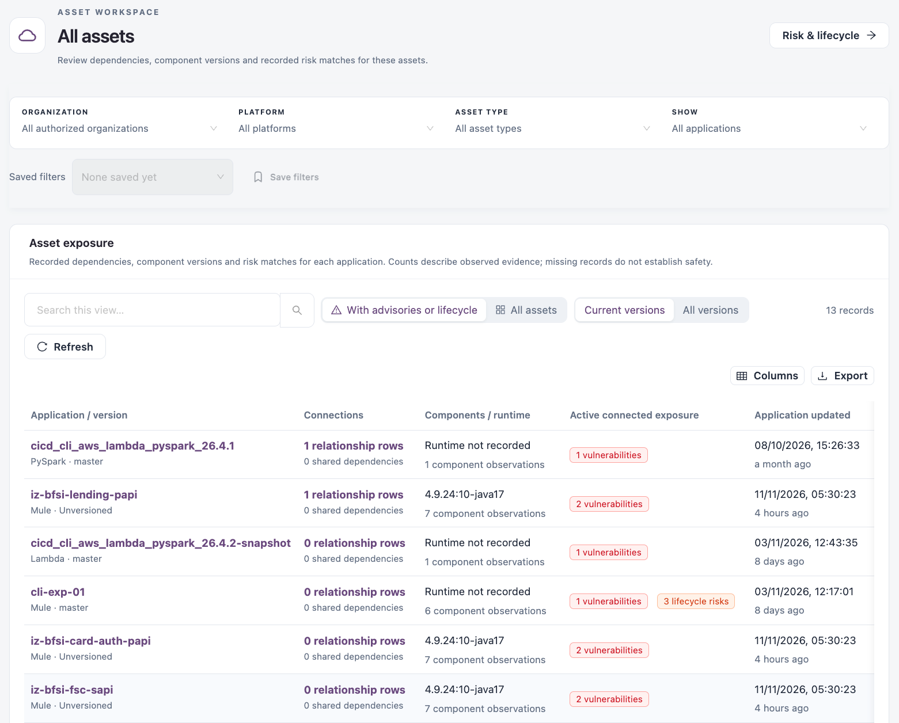
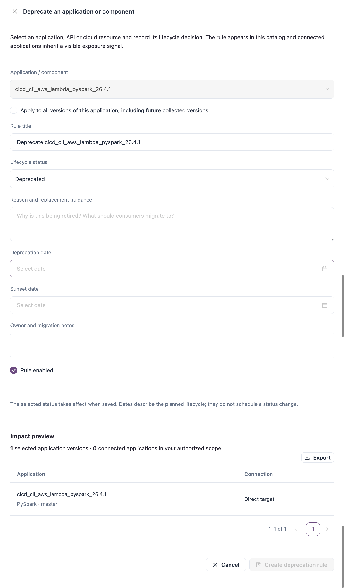

# Asset Exposure

**Asset exposure** lists one row per application version with its recorded connections, components, runtime and active risk. Use it to find the applications that need attention and to deprecate an application or component.

Open it from **Workspaces** → **Dependency Insights** → **Asset exposure** in the sidebar.


Requires the **Dependency Insights** licence.


<figure><figcaption>
Asset exposure
</figcaption></figure>

## Filters

| Filter                                            | Description                                                                                                                                                                      |
| ------------------------------------------------- | -------------------------------------------------------------------------------------------------------------------------------------------------------------------------------- |
| **Organization**, **Platform**, **Asset type**    | The scope shared by every Dependency Insights view.                                                                                                                              |
| **Show**                                          | **All applications**, **With relationship evidence**, **Using shared dependencies**, **Missing relationship evidence**, **With advisory matches** or **With lifecycle matches**. |
| **With advisories or lifecycle** / **All assets** | Show only applications with an active advisory or lifecycle match, or all of them.                                                                                               |
| **Current versions** / **All versions**           | Show the current version of each application, or every collected version.                                                                                                        |

**Save filters** stores the filters under a name. The **Risk & lifecycle** button at the top opens [Risk & Lifecycle](risk-and-lifecycle.md) for the same scope.

## Columns

| Column                        | Description                                                                                  |
| ----------------------------- | -------------------------------------------------------------------------------------------- |
| **Application / version**     | Application name, platform and version or branch. Select it to open the application dossier. |
| **Connections**               | Number of recorded relationship rows and shared dependencies.                                |
| **Components / runtime**      | The recorded runtime and the number of component observations.                               |
| **Active connected exposure** | Vulnerabilities and lifecycle risks on the application or reached through its dependencies.  |
| **Application updated**       | When the application's evidence was last updated.                                            |

**Columns** chooses the visible columns, **Export** downloads the list and **Refresh** reloads it.

## Row actions

| Action                   | Description                                                                      |
| ------------------------ | -------------------------------------------------------------------------------- |
| **Explore dependencies** | Opens [Dependency Explorer](dependency-explorer.md) focused on this application. |

## Deprecate an application or component

A deprecation records a lifecycle decision for an application, API or cloud resource. It appears in **Deprecation rules** under [Risk & Lifecycle](risk-and-lifecycle.md), and connected applications show an exposure signal.

1. Select the application to open its dossier, then select **Actions** → **Deprecate application**.
2. Complete the fields below and check the **Impact preview**.
3. Select **Create deprecation rule**.

| Field                                                                              | Description                                                                                                |
| ---------------------------------------------------------------------------------- | ---------------------------------------------------------------------------------------------------------- |
| **Application / component**                                                        | The target. It is filled in from the dossier. **Required.**                                                |
| **Apply to all versions of this application, including future collected versions** | Apply the rule to every version instead of only the selected one.                                          |
| **Rule title**                                                                     | Name of the rule. **Required.**                                                                            |
| **Lifecycle status**                                                               | **Active / supported**, **Obsolete**, **Deprecated** or **Sunset**. The status takes effect when you save. |
| **Reason and replacement guidance**                                                | Why the component is being retired and what to use instead. **Required.**                                  |
| **Deprecation date**                                                               | The planned deprecation date.                                                                              |
| **Sunset date**                                                                    | The planned sunset date. It cannot be before the deprecation date.                                         |
| **Owner and migration notes**                                                      | Who owns the migration and any notes.                                                                      |
| **Rule enabled**                                                                   | Whether the rule is active.                                                                                |

The dates describe the planned lifecycle; they do not schedule a status change. The **Impact preview** lists the selected application versions and the connected applications in your scope.

<figure><figcaption>
Deprecate an application or component
</figcaption></figure>


You need a role that can create deprecations. Without it, **Deprecate application** is not shown.


## Next Steps

* [Dependency Explorer](dependency-explorer.md): see what an application depends on and who consumes it.
* [Risk & Lifecycle](risk-and-lifecycle.md): review deprecation rules and their matches.
* [Version Planning](version-planning.md): plan an upgrade for a component these applications use.
