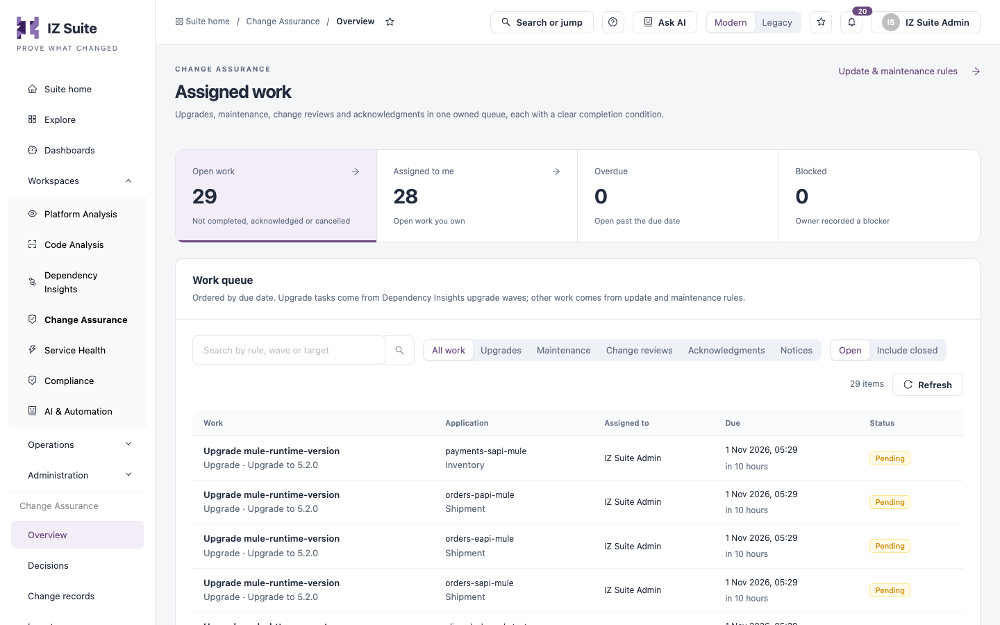
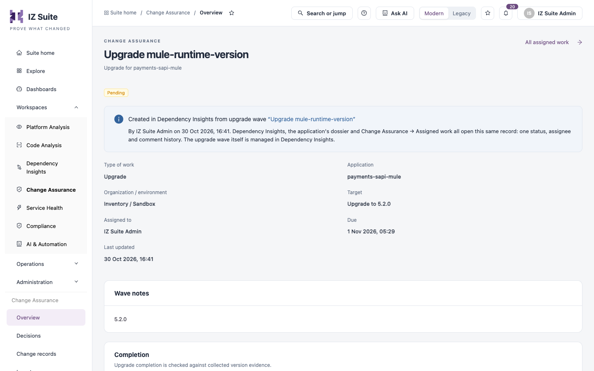

# Assigned Work

**Assigned work** is one owned queue for upgrades, maintenance, change reviews and acknowledgments. Each item has a clear completion condition. Upgrade tasks come from upgrade waves; other work comes from update and maintenance rules, tracked work and dependency change reviews.

Open it from any of these:

* **Workspaces** → **Dependency Insights** → **Updates & maintenance** → **Assigned work**.
* **Suite home** → **My open work**, which opens the queue filtered to your open work.
* The work record links in [Risk & Lifecycle](/broken/pages/886c6a72c421c38183562850946b59d50c963bc3) (tracked work) and [Dependency Explorer](dependency-explorer.md) (change reviews).


Requires the **Dependency Insights** licence.



You need a role that can view deprecations. Only the assignee or a lifecycle manager can update an item while its rule or wave is active.


<figure><figcaption>
Assigned work
</figcaption></figure>

**Update & maintenance rules** at the top opens [Updates & Maintenance](/broken/pages/56f71d517d3abfb5567dda056df1cd97183a623a).

## Summary tiles

| Tile               | Description                                                             |
| ------------------ | ----------------------------------------------------------------------- |
| **Open work**      | Items not completed, acknowledged or cancelled. Select it to list them. |
| **Assigned to me** | Open items you own. Select it to list them.                             |
| **Overdue**        | Open items past their due date.                                         |
| **Blocked**        | Items whose owner recorded a blocker.                                   |

## Work queue

The queue is ordered by due date.

| Filter       | Description                                                                                                                                           |
| ------------ | ----------------------------------------------------------------------------------------------------------------------------------------------------- |
| Search       | **Search by rule, wave or target**.                                                                                                                   |
| Type of work | **All work**, **Upgrades**, **Maintenance**, **Change reviews**, **Acknowledgments** or **Notices**. Notices inform teams and carry no assigned work. |
| Status scope | **Open**, or **Include closed**.                                                                                                                      |

| Column          | Description                                                                               |
| --------------- | ----------------------------------------------------------------------------------------- |
| **Work**        | The rule or wave title, the type of work and its target. Select it to open the item.      |
| **Application** | The application, version and organization.                                                |
| **Assigned to** | The owner, or **Not assigned**.                                                           |
| **Due**         | The due date, or **No due date**.                                                         |
| **Status**      | For example **Pending**, **In progress**, **Blocked**, **Completed** or **Acknowledged**. |

## Work item

Selecting an item opens it in a drawer. **Open full record** opens the same item on its own page, with **All assigned work** to return to the queue. The item is the same record wherever you open it: Dependency Insights, the application dossier and this queue share one status, assignee and comment history.

<figure><figcaption>
Work item
</figcaption></figure>

The record shows:

* Where it was created, with a link to the upgrade wave or rule.
* **Type of work**, **Application**, **Organization / environment**, **Target**, **Assigned to**, **Due** and **Last updated**.
* **Wave notes**, **What changed** or **Proposed change**, from the wave or rule.
* **Applications in this work** for maintenance and review items, with **Open work** for each application.
* **Completion**: the **Criteria** and the **Recorded notes**. Upgrades are checked against collected version evidence. Other work is recorded by the assignee and is not verified automatically.
* **Application dossier** and **Maintenance rule** (or **Review rule**) links.
* **Comments and history**, kept in an append-only audit trail with who made each entry and when.

### Update progress

1. Open the item and select **Update progress** (or **Record acknowledgment** for an acknowledgment).
2. Choose the **Status**: **Pending**, **In progress**, **Blocked** or **Completed**; or **Pending** or **Acknowledged** for an acknowledgment.
3. Enter the **Notes**. For **Completed** this is the **Completion evidence**, and for **Blocked** it is **What is blocking this work?**; both are **Required**.
4. Optionally choose who to **Reassign to**. Only people with Dependency Insights, lifecycle and application access to this work can be assigned. Leave it empty to keep the current assignee.
5. Save the update.


An upgrade item is accepted as completed only when collected evidence shows the target version.


### Add a comment

Type in **Add context, progress or a hand-off note** and select **Add comment**.

## Next steps

* [Updates & Maintenance](/broken/pages/56f71d517d3abfb5567dda056df1cd97183a623a): create the rules that assign work.
* [Actions](actions.md): follow upgrade waves and their tasks.
* [Risk & Lifecycle](/broken/pages/886c6a72c421c38183562850946b59d50c963bc3): create tracked work from the priority matrix.
