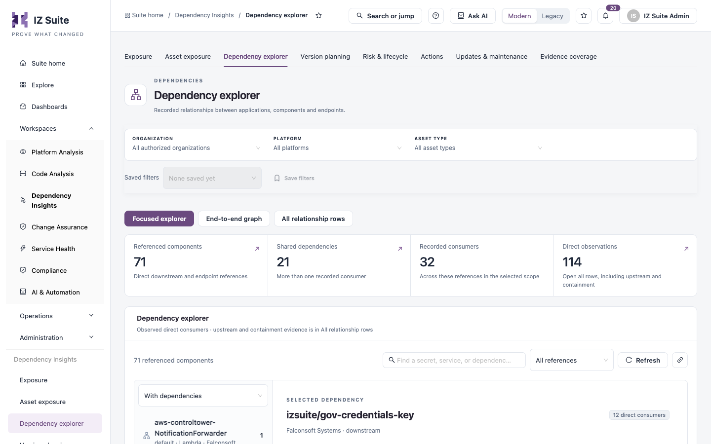
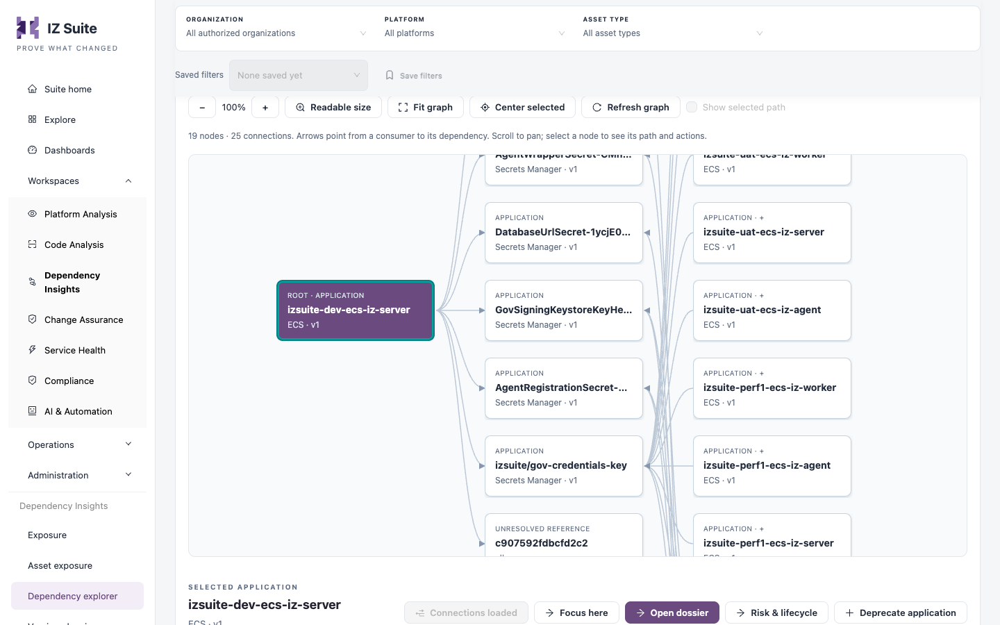

# Dependency Explorer

**Dependency explorer** shows the recorded relationships between applications, components and endpoints. Use it to see who consumes a dependency, what an application depends on, and to prepare a review before you change something shared.

Open it from **Workspaces** → **Dependency Insights** → **Dependency explorer** in the sidebar.


Requires the **Dependency Insights** licence.


The view has three presentations: **Focused explorer**, **End-to-end graph** and **All relationship rows**. The scope bar at the top (**Organization**, **Platform**, **Asset type**) applies to all three.


Connections are the direct references that the source reported. They do not prove transitive reach, runtime traffic or business impact. Applications are joined only by exact resource identities within the same organization.


## Focused explorer

<figure><figcaption>
Focused explorer
</figcaption></figure>

### Summary tiles

| Tile                      | Description                                                                    |
| ------------------------- | ------------------------------------------------------------------------------ |
| **Referenced components** | Direct downstream and endpoint references. Select it to list all references.   |
| **Shared dependencies**   | References with more than one recorded consumer. Select it to list only those. |
| **Recorded consumers**    | Applications that use these references in the selected scope.                  |
| **Direct observations**   | All direct observations. Select it to open **All relationship rows**.          |

### Find a dependency

* Type in **Find a secret, service, or dependency…** to search.
* Choose **All references** or **Multiple consumers** to narrow the list.
* Use the list selector to switch between applications (**With dependencies**, **All applications**) and **Referenced components**.
* **Copy dependency link** copies a link to the current selection.

### Selected dependency

Selecting a dependency shows its organization, its direct consumers and, for each consumer, **Explore dependencies** and **Open dossier**.

| Button                                      | Description                                                                                                                                                                 |
| ------------------------------------------- | --------------------------------------------------------------------------------------------------------------------------------------------------------------------------- |
| **Inspect&#x20;**_**n**_**&#x20;consumers** | Opens **Recorded consumers**: every application version that references the dependency, with its environment, gate result and evidence date. **Export** downloads the list. |
| **Prepare change review**                   | Opens **Prepare dependency change review** (see below).                                                                                                                     |

### Prepare a dependency change review

A change review assigns one tracked item per consumer to an owner. It appears in [Assigned Work](assigned-work.md) and **My open work**. It does not approve or run the change.

1. Select a dependency, then select **Prepare change review**.
2. Enter the **Review title**.
3. Choose who to **Assign review to** and the **Due date**.
4. Describe the **Proposed change and acceptance criteria**.
5. Check the dependency, the number of consumers and the review steps listed.
6. Select **Create and assign review for&#x20;**_**n**_**&#x20;consumers**.

Select **Download dependency review** instead to download the review for the consumers on the current page without assigning it.

## End-to-end graph

Select an application (with **Explore dependencies** or from the list), then select **End-to-end graph** to trace its dependencies and consumers across several hops.

<figure><figcaption>
End-to-end graph
</figcaption></figure>

| Control                                               | Description                                                                          |
| ----------------------------------------------------- | ------------------------------------------------------------------------------------ |
| Direction                                             | **Dependencies + consumers**, **Dependencies downstream** or **Consumers upstream**. |
| Depth                                                 | 1 to 5 hops.                                                                         |
| Find graph node                                       | Search for a node in the graph and select it.                                        |
| **−** / **+**                                         | Zoom out or in.                                                                      |
| **Readable size**, **Fit graph**, **Center selected** | Reset the zoom, fit the whole graph, or center the selected node.                    |
| **Refresh graph**                                     | Reload the graph.                                                                    |
| **Show selected path**                                | Highlight the path from the root to the selected node.                               |

Arrows point from a consumer to its dependency. Scroll to pan. Select a node to see its path and these actions: **Focus here** (make it the root), **Open dossier**, **Risk & lifecycle** and **Deprecate application**.

While an application is selected, the top of the view also shows **Open application dossier** and **Review connected impact**. **Review connected impact** opens an AI review of the connected evidence; see AI Coverage & Findings.

## All relationship rows

Every recorded relationship, including upstream and containment rows.

| Column                 | Description                                                                |
| ---------------------- | -------------------------------------------------------------------------- |
| **Source application** | The application that recorded the relationship, with its type and version. |
| **Direction**          | For example `downstream` or `contains`, as recorded by the collector.      |
| **Reference**          | The referenced resource or component.                                      |
| **Kind**               | The kind of the reference, for example a secret or a load balancer.        |
| **Navigate**           | **Explore dependencies** or **Open source dossier**.                       |

**Columns** chooses the visible columns and **Export this page** downloads the rows on the current page.

## Next steps

* [Version Planning](version-planning.md): plan an upgrade for a shared component.
* [Asset Exposure](asset-exposure.md): review the active risk of each application.
* [Evidence Coverage](evidence-coverage.md): find applications that have no relationship evidence.
