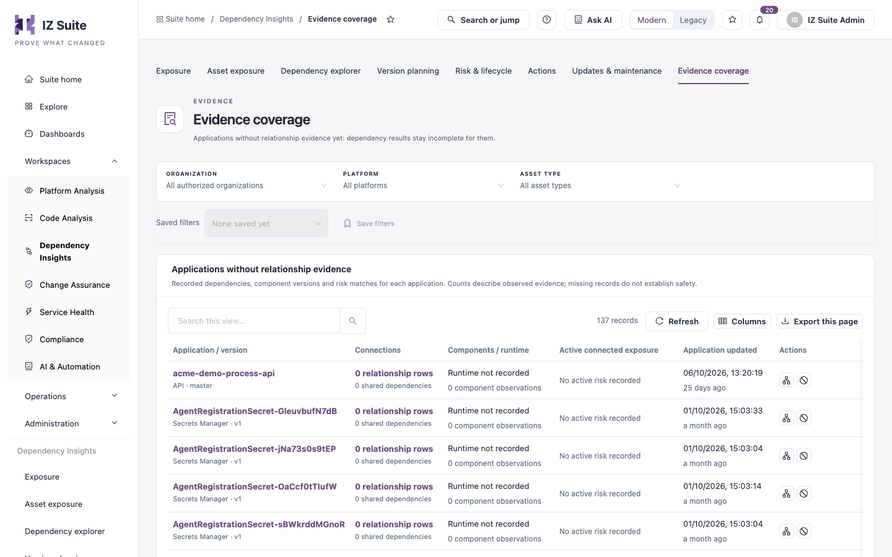

# Evidence Coverage

**Evidence coverage** lists the applications that have no relationship evidence yet. Dependency results for these applications stay incomplete until relationships are collected for them.

Open it from **Workspaces** → **Dependency Insights** → **Evidence coverage** in the sidebar.


Requires the **Dependency Insights** licence.


<figure><figcaption>
Evidence coverage
</figcaption></figure>

## Applications without relationship evidence

The list uses the scope at the top (**Organization**, **Platform**, **Asset type**) and the same columns as [Asset Exposure](asset-exposure.md):

| Column                        | Description                                                                                       |
| ----------------------------- | ------------------------------------------------------------------------------------------------- |
| **Application / version**     | Application name, platform and version or branch. Select it to open the application dossier.      |
| **Connections**               | Recorded relationship rows and shared dependencies (zero for every row here).                     |
| **Components / runtime**      | The recorded runtime and the number of component observations.                                    |
| **Active connected exposure** | Vulnerabilities and lifecycle risks recorded for the application, or **No active risk recorded**. |
| **Application updated**       | When the application's evidence was last updated.                                                 |

Each row has **Explore dependencies** and **Deprecate application**, as in [Asset Exposure](asset-exposure.md). **Columns** chooses the visible columns, **Export this page** downloads the rows on the current page and **Refresh** reloads the list.


An application listed here has no recorded relationships. That does not mean it has no dependencies.


## Next steps

* [Asset Exposure](asset-exposure.md): review applications that do have evidence.
* [Dependency Explorer](dependency-explorer.md): trace the relationships that are recorded.
* [Dependency Insights](./): see all views.
