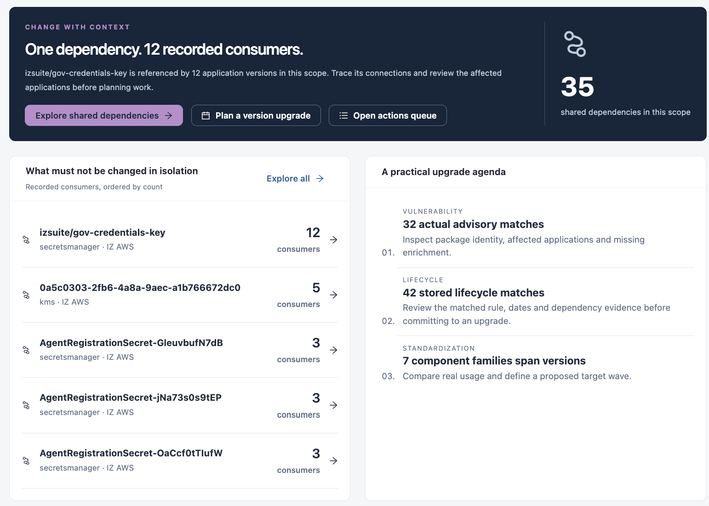

# Exposure

**Exposure** is the first view of Dependency Insights. It summarises the shared dependencies, risk matches and the applications that consume them in the scope you select.

Open it from **Workspaces** → **Dependency Insights** → **Exposure** in the sidebar.


Requires the **Dependency Insights** licence.


<figure><figcaption>
Exposure
</figcaption></figure>

## Scope

Choose the **Organization**, **Platform** and **Asset type** at the top. **Save filters** stores the scope under a name; pick it again from **Saved filters**.

## Cross-platform AI recommendations

The **Cross-platform · AI recommendations** panel lists the platform investigations recorded for shared risks across applications. When none is recorded, the panel says so; reviews of single applications stay available in each application dossier. **Platform investigations** opens the cross-asset findings in [AI Coverage & Findings](../ai-and-automation/ai-coverage-and-findings.md).

## Summary tiles

Select a tile to open the matching view.

| Tile                           | Description                                                                                                                                                  |
| ------------------------------ | ------------------------------------------------------------------------------------------------------------------------------------------------------------ |
| **Recorded relationship rows** | All recorded upstream, downstream, endpoint and containment relationships. Opens **All relationship rows** in [Dependency Explorer](dependency-explorer.md). |
| **Shared dependencies**        | Dependencies referenced by more than one application, matched exactly within each organization.                                                              |
| **Matched advisory records**   | Vulnerability advisories matched on current application versions.                                                                                            |
| **Recorded lifecycle matches** | Deprecation and lifecycle rules matched on current application versions.                                                                                     |

## Change with context

This panel names the dependency with the most recorded consumers and how many application versions reference it. Use its buttons to continue:

* **Explore shared dependencies** opens [Dependency Explorer](dependency-explorer.md).
* **Plan a version upgrade** opens [Version Planning](version-planning.md).
* **Open actions queue** opens [Actions](updates-and-maintenance/actions.md).

**What must not be changed in isolation** lists the shared dependencies ordered by number of consumers. Select one to explore it, or select **Explore all**.

## A practical upgrade agenda

Three cards suggest where to start:

| Card                | Description                                                                                                       |
| ------------------- | ----------------------------------------------------------------------------------------------------------------- |
| **Vulnerability**   | Advisory matches: inspect the package identity, the affected applications and any missing enrichment.             |
| **Lifecycle**       | Stored lifecycle matches: review the matched rule, dates and dependency evidence before you commit to an upgrade. |
| **Standardization** | Component families that span several versions: compare real usage and define a target wave.                       |

## Risk follows the affected application

The table lists the recorded matches with the application each one affects.

| Column                   | Description                                                                                                                                |
| ------------------------ | ------------------------------------------------------------------------------------------------------------------------------------------ |
| **Recorded match**       | The advisory or lifecycle rule, with its kind (Vulnerability or Deprecation) and source.                                                   |
| **Affected application** | The application, its version, and the component and version that matched.                                                                  |
| **Risk / lifecycle**     | Severity and EPSS for advisories, or the lifecycle status and sunset date for deprecations. Values that were not enriched show as unknown. |
| **Review status**        | The review state of the match, for example **Pending**.                                                                                    |

Select **Inspect evidence** on a row to open the match in [Risk & Lifecycle](risk-and-lifecycle.md). **Review all risk evidence** opens the full list. **Columns** chooses the columns shown and **Export** downloads the table.

## Next Steps

* [Dependency Explorer](dependency-explorer.md): trace a shared dependency to its consumers.
* [Version Planning](version-planning.md): plan an upgrade for a component family.
* [Dependency Insights](./): see all views.
