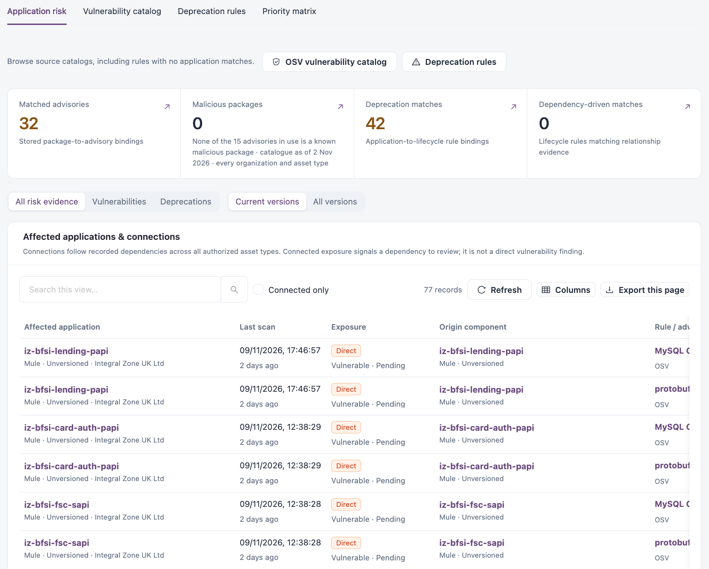
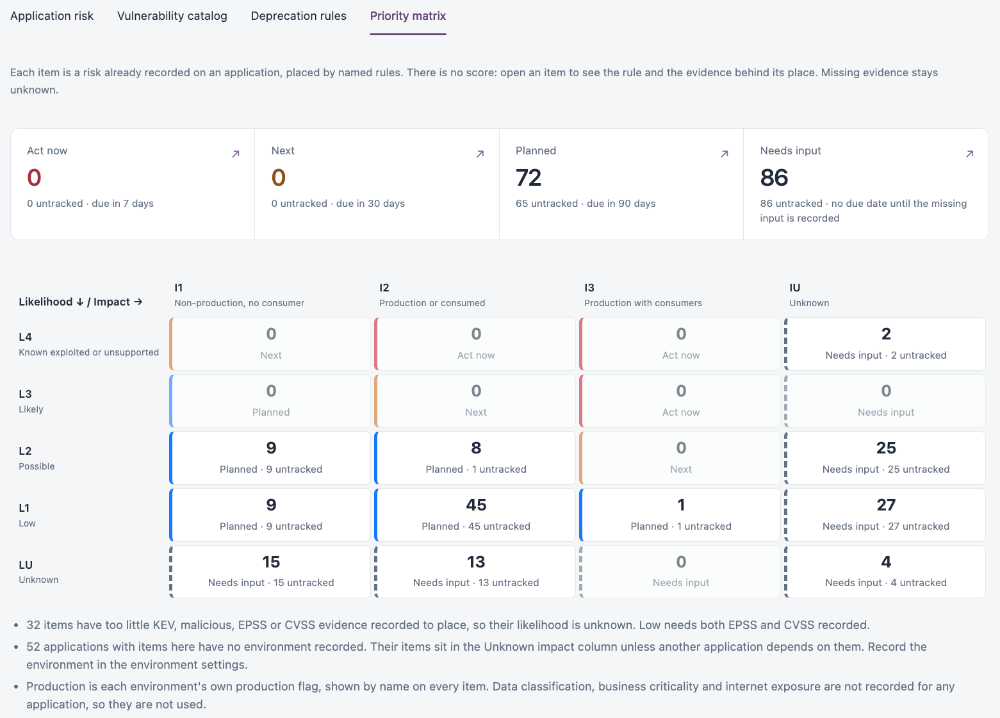

# Risk & Lifecycle

**Risk & lifecycle** shows the vulnerability and lifecycle matches recorded on your applications, the catalogs behind them, and a priority matrix that orders the work.

Open it from **Workspaces** → **Dependency Insights** → **Risk & lifecycle** in the sidebar.


Requires the **Dependency Insights** licence.


The view has four tabs: **Application risk**, **Vulnerability catalog**, **Deprecation rules** and **Priority matrix**. The scope bar at the top (**Organization**, **Platform**, **Asset type**) applies to **Application risk** and **Priority matrix**.


Each tab needs its own access. **Vulnerability catalog** needs a role that can view vulnerable applications, **Deprecation rules** a role that can view deprecations, and **Priority matrix** a role that can view vulnerable applications, deprecations or application issues. Tabs you cannot use are hidden.


## Application risk

<figure><figcaption>
Application risk
</figcaption></figure>

**OSV vulnerability catalog** and **Deprecation rules** at the top open the catalogs, including rules with no application matches.

| Tile                          | Description                                                                        |
| ----------------------------- | ---------------------------------------------------------------------------------- |
| **Matched advisories**        | Stored package-to-advisory matches.                                                |
| **Malicious packages**        | Advisories in use that are known malicious packages, with the date of the catalog. |
| **Deprecation matches**       | Application-to-lifecycle rule matches.                                             |
| **Dependency-driven matches** | Lifecycle rules that match relationship evidence.                                  |

Narrow the list with **All risk evidence**, **Vulnerabilities** or **Deprecations**, with **Current versions** or **All versions**, and with **Connected only**.

**Affected applications & connections** lists each affected application:

| Column                   | Description                                                                                                                                                                           |
| ------------------------ | ------------------------------------------------------------------------------------------------------------------------------------------------------------------------------------- |
| **Affected application** | Application, platform, version and organization.                                                                                                                                      |
| **Last scan**            | When the application was last scanned.                                                                                                                                                |
| **Exposure**             | **Direct** when the rule matches the application itself, or connected through a recorded dependency; with the status (for example **Vulnerable** or **Deprecated**) and review state. |
| **Origin component**     | The application or component where the risk starts.                                                                                                                                   |
| **Rule / advisory**      | The matched advisory or lifecycle rule and its source.                                                                                                                                |
| **Trace**                | **Trace dependencies** opens the path in [Dependency Explorer](dependency-explorer.md).                                                                                               |

Connected exposure means a dependency to review. It is not a direct vulnerability finding.

### Review a match

Select **Inspect evidence** on a row to open **Risk evidence**. It shows the advisory or rule, the affected application, the matched component and value, the match type, severity, EPSS, known-exploited status and the supporting match evidence.

1. Under **Capture review decision**, choose the **Review status**.
2. Enter the **Rationale and validation evidence** (up to 500 characters).
3. Select **Save review decision**.

The decision applies to the application's package and to every advisory match on that package. From the same drawer you can also select **Open application dossier**, **Explore dependency impact** or **Plan a version upgrade**.

## Vulnerability catalog

OSV advisories and other imported definitions, with their affected packages and the applications they reach. Select **Affects this workspace** to list only advisories that match applications in your scope.

| Column                   | Description                                                 |
| ------------------------ | ----------------------------------------------------------- |
| **Advisory**             | Advisory title and number of package definitions.           |
| **Source**               | For example **OSV**, and whether it is built in.            |
| **Severity / state**     | Severity when enriched, and whether the advisory is active. |
| **Updated**              | When the advisory was last updated.                         |
| **Application exposure** | Number of direct and connected applications.                |
| **Review**               | **Inspect rule** opens the advisory.                        |

Select an advisory to see its identifier, description, source, severity, EPSS, known-exploited status, **Affected packages & version rules**, and **Affected applications & connections**.

## Deprecation rules

Built-in lifecycle guidance and your own deprecation rules, with their direct targets and connected consumers. Select **Affects this workspace** to list only rules that match applications in your scope.

| Column                   | Description                                                                      |
| ------------------------ | -------------------------------------------------------------------------------- |
| **Lifecycle rule**       | Rule title and the component or application it targets.                          |
| **Source**               | Built-in catalog or **Custom**.                                                  |
| **Lifecycle**            | Status, for example **Deprecated**, and the sunset date if recorded.             |
| **Updated**              | When the rule was last changed.                                                  |
| **Application exposure** | Number of direct and connected applications.                                     |
| **Review**               | **Inspect rule** opens the rule. **Delete rule** is shown for custom rules only. |

Select a rule to see its target, scope, deprecation and sunset dates, migration notes and the affected applications.


**Delete rule** removes a custom lifecycle rule and the deprecations it raised on applications. This cannot be undone.


**New deprecation rule** opens the same form as **Deprecate application** in [Asset Exposure](asset-exposure.md#deprecate-an-application-or-component), with a search for the application, API or cloud resource to deprecate. Upgrade waves created in [Version Planning](version-planning.md) also add custom deprecation rules here.

## Priority matrix

Each item is a risk already recorded on an application, placed in a cell by named rules. There is no score: open an item to see the rule and the evidence that placed it. Missing evidence stays unknown.

<figure><figcaption>
Priority matrix
</figcaption></figure>

| Band            | Due                                              |
| --------------- | ------------------------------------------------ |
| **Act now**     | Due in 7 days.                                   |
| **Next**        | Due in 30 days.                                  |
| **Planned**     | Due in 90 days.                                  |
| **Needs input** | No due date until the missing input is recorded. |

Each band tile shows how many items are not yet tracked. The grid places items by:

* **Likelihood**: **L4** Known exploited or unsupported, **L3** Likely, **L2** Possible, **L1** Low, **LU** Unknown.
* **Impact**: **I1** Non-production, no consumer; **I2** Production or consumed; **I3** Production with consumers; **IU** Unknown.

Production comes from each environment's own production flag. Applications with no environment recorded sit in the **Unknown** impact column unless another application depends on them; record the environment in the environment settings.

### Priority list

The list orders items by band (**Act now** first), then by likelihood, impact and recorded consumers. Filter it with **All items**, **Vulnerabilities**, **Lifecycle** or **Findings**, and with **Current versions** or **All versions**.

| Column          | Description                                                         |
| --------------- | ------------------------------------------------------------------- |
| **Band**        | The band and the likelihood and impact cell, for example `L2 · I2`. |
| **Risk item**   | The risk and its kind.                                              |
| **Application** | The affected application.                                           |
| **Why here**    | The rules that placed the item.                                     |
| **Tracked**     | Whether open tracked work exists for it.                            |

### Create tracked work

Tracked work creates one assigned maintenance item per application, linked to the matrix items. It appears in [Assigned Work](../../assigned-work.md) and **My open work**, and the matrix counts the items as tracked while they are open.

1. Select **Create tracked work** on a row, or **Create tracked work for this list** for every item in the list.
2. Enter the **Title**.
3. Choose who to **Assign to** and the **Due date**. The due date is prefilled from the band.
4. Check **Items and why they are here**. **Completion criteria** is filled in for you.
5. Select **Create and assign for&#x20;**_**n**_**&#x20;applications**.


One piece of tracked work covers at most 1,000 items on 200 applications. For a larger list, narrow it by organization or platform first.


## Next Steps

* [Version Planning](version-planning.md): plan the upgrade that closes a match.
* [Updates & Maintenance](updates-and-maintenance/): see maintenance rules, including tracked work.
* [Actions](updates-and-maintenance/actions.md): follow upgrade waves and saved review notes.
