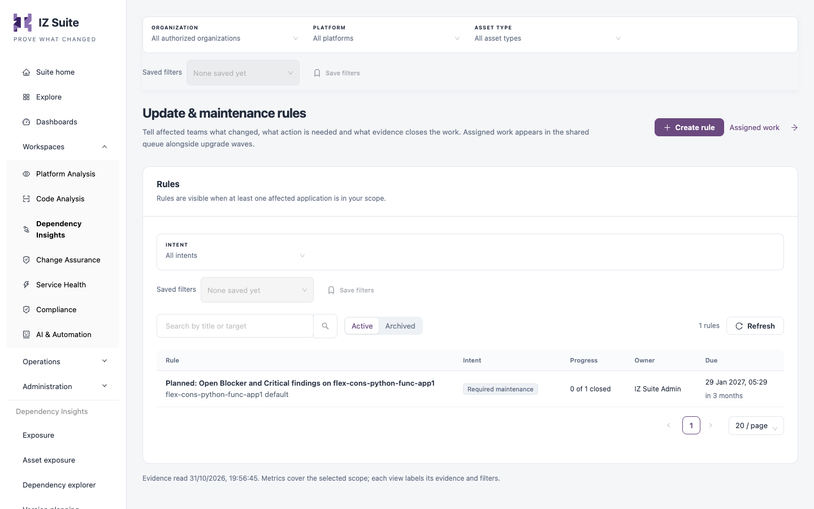
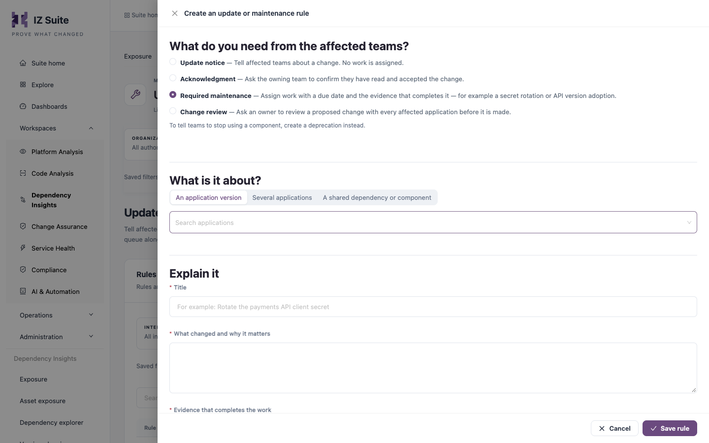

# Updates & Maintenance

**Updates & maintenance** keeps the lifecycle and maintenance rules for this workspace. A rule tells affected teams what changed, what action is needed and what evidence closes the work. Assigned work appears in the shared work queue next to upgrade waves.

Open it from **Workspaces** → **Dependency Insights** → **Updates & maintenance** in the sidebar.


Requires the **Dependency Insights** licence.


<figure><figcaption>
Update &#x26; maintenance rules
</figcaption></figure>

## Rules

A rule is visible when at least one affected application is in your scope.

| Filter                    | Description                                  |
| ------------------------- | -------------------------------------------- |
| **Intent**                | **All intents** or one of the intents below. |
| **Active** / **Archived** | Show active or archived rules.               |

| Column       | Description                                                                           |
| ------------ | ------------------------------------------------------------------------------------- |
| **Rule**     | Title and target.                                                                     |
| **Intent**   | **Update notice**, **Acknowledgment**, **Required maintenance** or **Change review**. |
| **Progress** | Closed items out of the total.                                                        |
| **Owner**    | Who owns the work, or **No assignee** for a notice.                                   |
| **Due**      | The due date, or **No due date**.                                                     |

**Assigned work** opens the shared work queue ([Assigned Work](assigned-work.md)) with upgrades, maintenance, change reviews, acknowledgments and notices.

### Open a rule

Select a rule to see its intent, target, status, owner, due date, affected applications, what changed and the completion evidence. **Applications in this work** lists each application with its own status and assignee; use **Add to this work** to add applications on any platform.


**Archive rule** cancels the rule's open items. Completed and acknowledged work stays as history.


## Create a rule

1. Select **Create rule**.
2. Under **What do you need from the affected teams?**, choose the intent:
   * **Update notice**: tell affected teams about a change. No work is assigned.
   * **Acknowledgment**: ask the owning team to confirm they have read and accepted the change.
   * **Required maintenance**: assign work with a due date and the evidence that completes it, for example a secret rotation or API version adoption.
   * **Change review**: ask an owner to review a proposed change with every affected application before it is made.
3. Under **What is it about?**, choose **An application version**, **Several applications** or **A shared dependency or component**, then select the target.
4. Complete the fields below.
5. Select **Save rule**.

| Field                                | Description                                                                                                                                                     |
| ------------------------------------ | --------------------------------------------------------------------------------------------------------------------------------------------------------------- |
| **Title**                            | For example "Rotate the payments API client secret". **Required.**                                                                                              |
| **What changed and why it matters**  | The change and its reason. **Required.**                                                                                                                        |
| **Evidence that completes the work** | Shown for **Required maintenance** and **Change review**. The assignee records this evidence when completing the work. **Required.**                            |
| **Assign to**                        | Who owns the work; not used for an update notice. They need Dependency Insights, lifecycle and application access for every affected application. **Required.** |
| **Due date**                         | When the work is due.                                                                                                                                           |

<figure><figcaption>
Create an update or maintenance rule
</figcaption></figure>


To tell teams to stop using a component, create a deprecation instead. See [Asset Exposure](asset-exposure.md#deprecate-an-application-or-component).


## Next steps

* [Actions](actions.md): follow upgrade waves next to maintenance work.
* [Risk & Lifecycle](/broken/pages/886c6a72c421c38183562850946b59d50c963bc3): create tracked work from the priority matrix.
* Change Assurance: review change before it reaches production.
