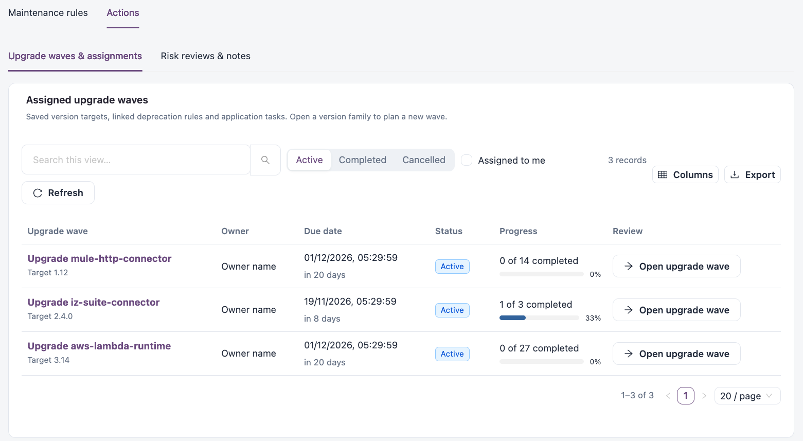
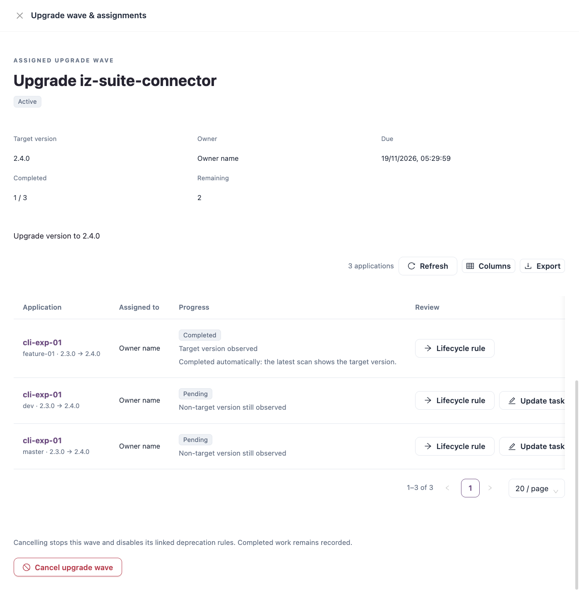

# Actions

**Actions** tracks assigned upgrades, due dates, progress and saved review decisions.

Open it from **Workspaces** → **Dependency Insights** → **Updates & maintenance** → **Actions**, or with **Open actions queue** on **Exposure**.


Requires the **Dependency Insights** licence.


The view has two tabs: **Upgrade waves & assignments** and **Risk reviews & notes**.

## Upgrade waves & assignments

**Assigned upgrade waves** lists the saved version targets, their linked deprecation rules and application tasks. To plan a new wave, open a version family in [Version Planning](../version-planning.md).

<figure><figcaption>
Assigned upgrade waves
</figcaption></figure>

Filter by **Active**, **Completed** or **Cancelled**, and select **Assigned to me** to see only your waves.

| Column           | Description                                         |
| ---------------- | --------------------------------------------------- |
| **Upgrade wave** | Title and target version.                           |
| **Owner**        | Who owns the wave.                                  |
| **Due date**     | When the wave is due.                               |
| **Status**       | **Active**, **Completed** or **Cancelled**.         |
| **Progress**     | Completed tasks out of the total, and a percentage. |
| **Review**       | **Open upgrade wave**.                              |

### Open an upgrade wave

**Open upgrade wave** shows the target version, owner, due date, completed and remaining tasks, and one row per application:

| Column          | Description                                                                                                                                 |
| --------------- | ------------------------------------------------------------------------------------------------------------------------------------------- |
| **Application** | The application, its current version and the target.                                                                                        |
| **Assigned to** | Who owns the task.                                                                                                                          |
| **Progress**    | Task status and what was observed: **Non-target version still observed**, **Target version observed** or **Fresh version evidence needed**. |
| **Review**      | **Lifecycle rule** opens the deprecation rule behind the task. **Update task** lets the owner update an open task.                          |

<figure><figcaption>
Upgrade wave &#x26; assignments
</figcaption></figure>

A task needs fresh version evidence for its application before it can show the target as observed.


**Cancel upgrade wave** stops the wave and disables its linked deprecation rules. Completed work stays recorded.


## Risk reviews & notes

**Lifecycle plans & saved review notes** lists the recorded matches that have a saved review.

| Column                   | Description                                     |
| ------------------------ | ----------------------------------------------- |
| **Recorded match**       | The advisory or lifecycle rule and its source.  |
| **Affected application** | The application, version and matched component. |
| **Risk / lifecycle**     | Severity or lifecycle status.                   |
| **Review status**        | The saved review state.                         |
| **Review notes**         | The notes saved with the review.                |

An empty list means no reviews are saved in this scope. It does not mean the applications are free of vulnerabilities or supported.

## Next Steps

* [Version Planning](../version-planning.md): plan a new upgrade wave.
* [Updates & Maintenance](./): assign other maintenance work.
* [Risk & Lifecycle](../risk-and-lifecycle.md): review and decide on risk matches.
