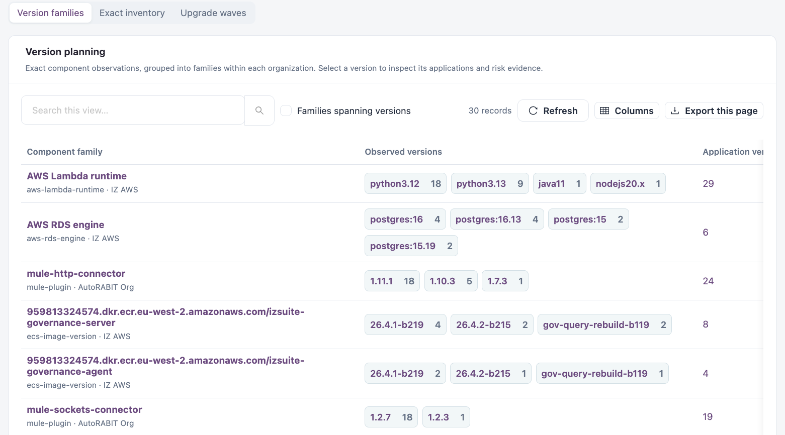
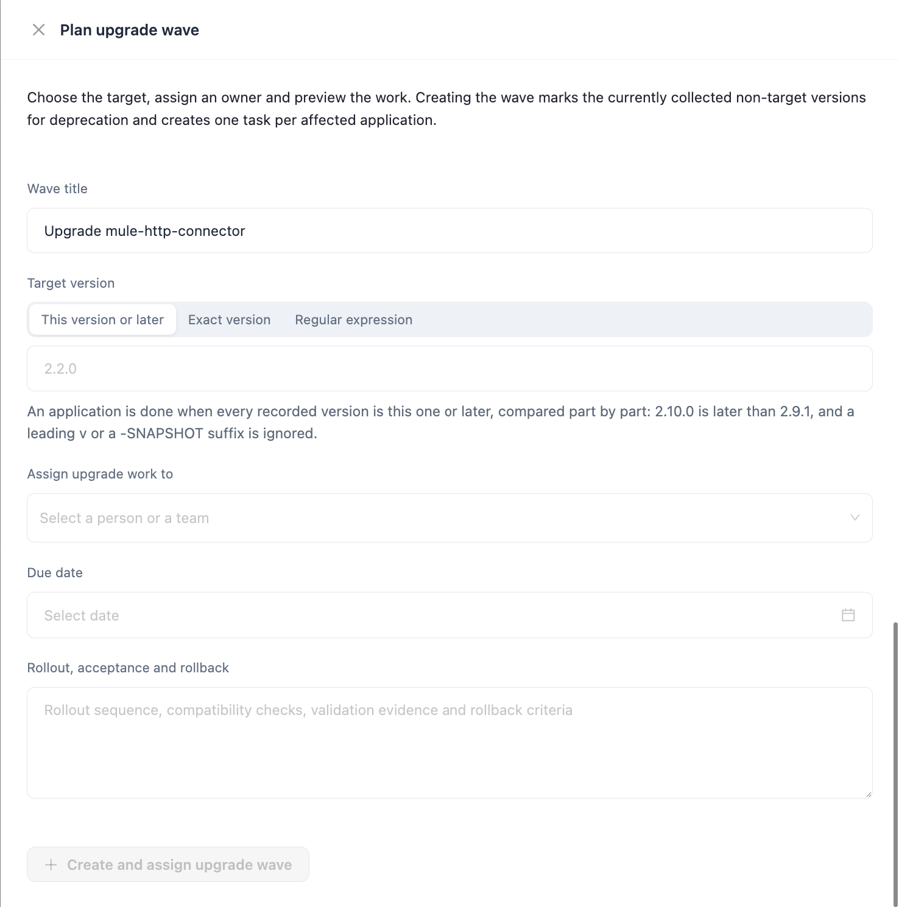

# Version Planning

**Version planning** shows the component versions in use and the upgrades that close recorded risk. Use it to compare versions across applications and to plan an upgrade wave that assigns one task per affected application.

Open it from **Workspaces** → **Dependency Insights** → **Version planning** in the sidebar.


Requires the **Dependency Insights** licence.


The view has three tabs: **Version families**, **Exact inventory** and **Upgrade waves**. The scope bar at the top (**Organization**, **Platform**, **Asset type**) applies to all three.

## Version families

Component observations grouped into families within each organization.

<figure><figcaption>
Version families
</figcaption></figure>

| Column                   | Description                                                                                                                               |
| ------------------------ | ----------------------------------------------------------------------------------------------------------------------------------------- |
| **Component family**     | The component, its kind and organization.                                                                                                 |
| **Observed versions**    | Each version seen, with the number of application versions that use it. Select a version to see its exact applications and risk evidence. |
| **Application versions** | Total application versions that use the family.                                                                                           |
| **Next step**            | **Plan upgrade wave** for this family.                                                                                                    |

Select **Families spanning versions** to list only families with more than one version in use. Use the search box to find a family. **Export this page** downloads the rows on the current page. **Refresh** reloads the list and **Columns** chooses the visible columns.


Upgrade targets are proposed by the reviewer. Check support and compatibility before you pick one.


## Exact inventory

Every recorded component and version.

| Tile                           | Description                                                        |
| ------------------------------ | ------------------------------------------------------------------ |
| **Component identities**       | Distinct components in your scope.                                 |
| **Shared components**          | Components used by more than one application version.              |
| **Applications with evidence** | Distinct application versions or branches with inventory evidence. |
| **Observations**               | Recorded inventory rows.                                           |

The **Version inventory** table lists **Component / version**, **Kind**, **Organization** and **Application versions**. Select a component, an application count or **Inspect applications** to see where it is used. **Shared components only** limits the list to shared components.

## Upgrade waves

The same list of assigned upgrade waves as in [Actions](updates-and-maintenance/actions.md). Filter by **Active**, **Completed** or **Cancelled**, and select **Assigned to me** to see only your waves.

## Plan an upgrade wave

Creating a wave marks the collected versions that are not the target for deprecation and creates one task per affected application.

1. On **Version families**, select **Plan upgrade wave** for the component family.
2. Enter the **Wave title**.
3. Enter the **Target version** and choose how it is matched (see the table below).
4. Choose who to **Assign upgrade work to** and the **Due date**.
5. Optionally describe the **Rollout, acceptance and rollback** plan.
6. Check the **Upgrade impact preview**.
7. Select **Create and assign upgrade wave**.

| Match                     | An application is done when                                                                                                                           |
| ------------------------- | ----------------------------------------------------------------------------------------------------------------------------------------------------- |
| **This version or later** | Every recorded version is this one or later, compared part by part: `2.10.0` is later than `2.9.1`. A leading `v` or a `-SNAPSHOT` suffix is ignored. |
| **Exact version**         | Every recorded version is exactly this text, for example `2.2.0` or `nodejs22.x`.                                                                     |
| **Regular expression**    | Every recorded version matches the PostgreSQL regular expression, for example `^2\.2\.\d+$` for any 2.2.x. Use `^` and `$` to match whole versions.   |

<figure><figcaption>
Plan upgrade wave
</figcaption></figure>


You need a role that can create lifecycle (deprecation) rules to create a wave.


## Next Steps

* [Actions](updates-and-maintenance/actions.md): follow the progress of a wave.
* [Risk & Lifecycle](risk-and-lifecycle.md): review the deprecation rules a wave creates.
* [Dependency Explorer](dependency-explorer.md): check who consumes a component before you upgrade it.
