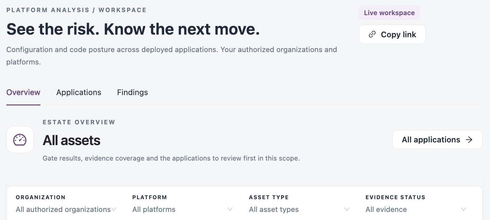

# Platform Analysis

Platform Analysis shows the configuration and code posture of the applications deployed on your connected platforms (for example MuleSoft, AWS or Azure): their quality gate results, open findings and the evidence behind each verdict. Use it to decide which applications to fix first and to follow an application from one assessment to the next.

Open it from **Workspaces** → **Platform Analysis** in the sidebar.


Requires the **Platform Analysis** licence.



You need a role that can view the applications of at least one licensed platform. The workspace shows only the organizations and platforms your role covers.


<figure><figcaption>
Platform Analysis workspace
</figcaption></figure>

## Tabs

| Tab                             | Use it to                                                                                                                                               |
| ------------------------------- | ------------------------------------------------------------------------------------------------------------------------------------------------------- |
| [Overview](overview.md)         | See gate results, evidence coverage, defect trends and the applications to review first.                                                                |
| [Applications](applications.md) | List application versions, open an application's dossier and manage it. The dossier also holds the application's [AI Focus Report](ai-focus-report.md). |
| [Findings](findings.md)         | Investigate open findings, estimate the time to fix them and review exceptions.                                                                         |

## Header actions

| Action        | Description                                        |
| ------------- | -------------------------------------------------- |
| **Copy link** | Copies the address of the current tab and filters. |

The filters, saved filters and table tools work as described in [Workspaces](../). AI reviews are requested for one application at a time, from its dossier: see [AI Focus Report](ai-focus-report.md).

## Next Steps

* [Overview](overview.md): start with the applications that need a gate review.
* [Applications](applications.md): open an application's dossier.
* [Findings](findings.md): investigate findings across applications.&#x20;
* [AI Focus Report](ai-focus-report.md): see what to fix first in one application.
