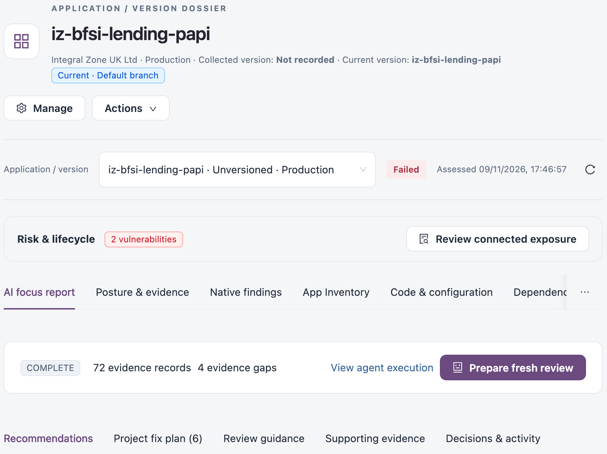
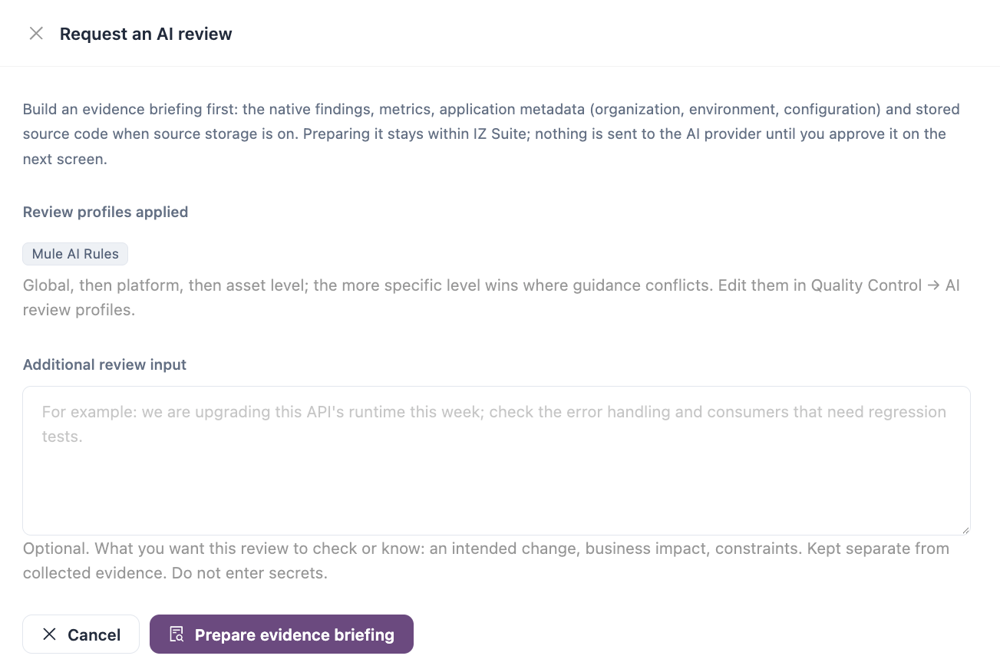
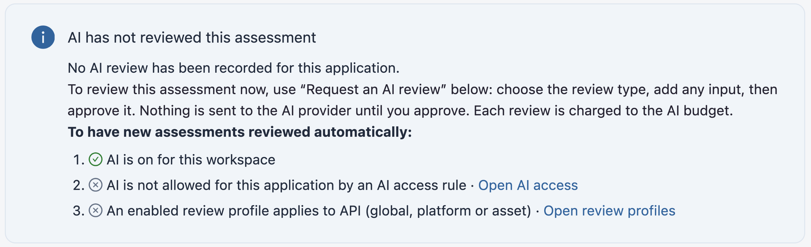
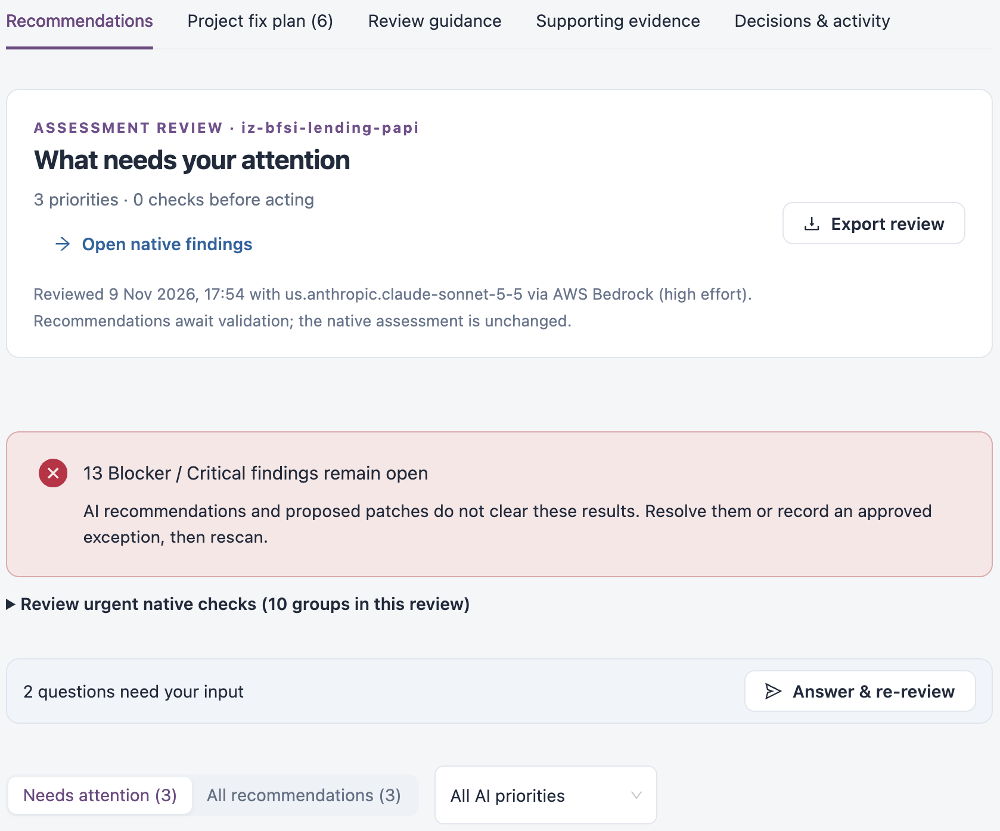
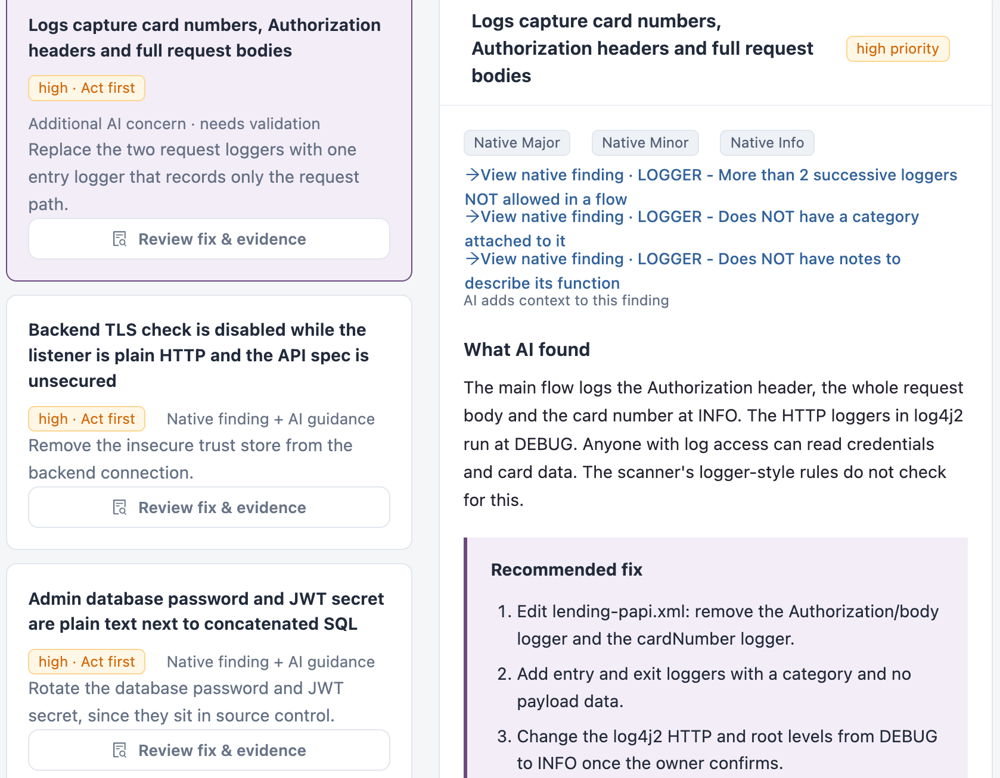
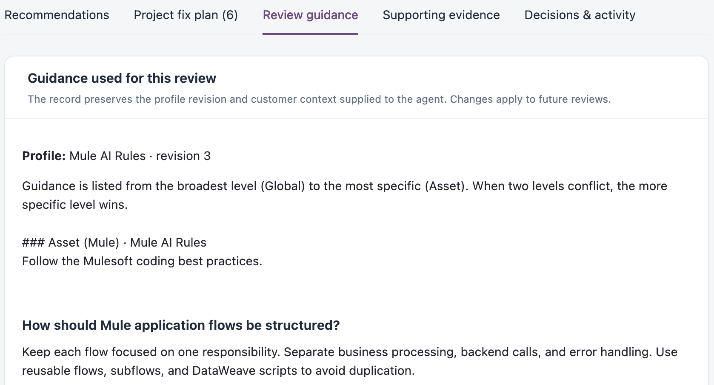
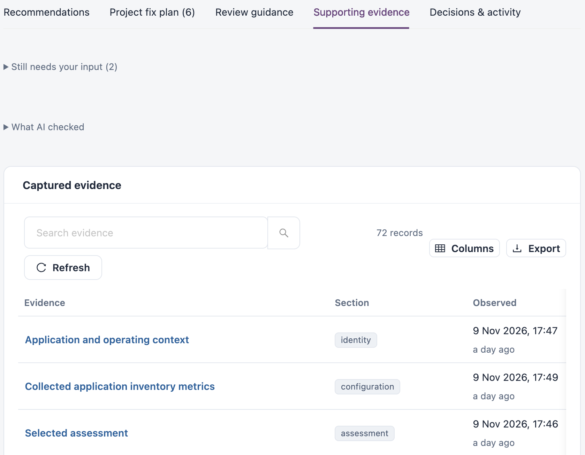
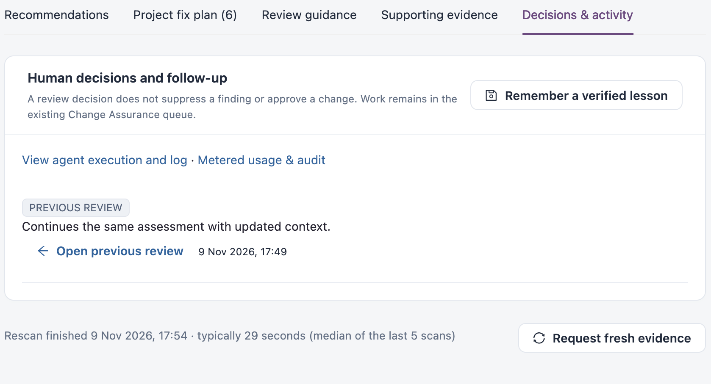

# AI Focus Report

The **AI focus report** is a tab in an application's dossier. It shows an AI review of one assessment: what to fix first, a fix plan, the guidance the review followed, the evidence it relied on, and the decisions your team records afterwards. Use it to decide what to act on without reading every finding, and to plan the fix.

Open it from **Workspaces → Platform Analysis → Applications**: open an application, then select the **AI focus report** tab. When the selected assessment already has a completed AI review, the dossier opens on this tab.


Requires the **Platform Analysis** licence, AI turned on for your workspace, and a role that can view AI reviews. Requesting a review also needs a role that can run AI reviews.


## How a Review Is Created

A review covers one assessment of one application. It is created in one of two ways.

### Automatically After an Assessment

New assessments are reviewed automatically when all three of these are true:

1. AI is turned on for your workspace.
2. AI is allowed for the application by your [AI access](../ai-and-automation/ai-access.md) rules.
3. An enabled [AI review profile](../../operations/quality-control/ai-review-profiles.md) applies to the application's asset type, at the global, platform or asset level.

### On Request

1. On the **AI focus report** tab, select **Request an AI review**. If the application already has a report, select **Prepare fresh review**.
2. Check the **Review profiles applied**. Profiles apply from global, to platform, to asset level; where their guidance conflicts, the more specific level wins.
3. Optionally, add **Additional review input**: what you want the review to check or know, such as an intended change, its business impact or a constraint.
4. Select **Prepare evidence briefing**. IZ Suite gathers the native findings, metrics, application details (organization, environment, configuration) and, when source storage is on, the stored source code. The briefing stays within IZ Suite.
5. Review the inputs and the budget on the next screen, then approve sending the evidence to your configured AI provider and model.
6. The review runs. Its progress is shown on the tab, and the report appears when it completes.


Nothing is sent to the AI provider until you approve it, and each review is charged to your AI budget. See [Usage & Budgets](../ai-and-automation/usage-and-budgets.md).



Do not enter passwords, tokens or other secrets in **Additional review input**.


### When AI Has Not Reviewed an Assessment

If the selected assessment has no review, the tab shows **AI has not reviewed this assessment** with a checklist of what automatic reviews need. Each step that is not met links to the screen where you fix it. When an earlier assessment of the application was reviewed, the tab also links to that review and its fix plan.

## Reading the Report

The strip at the top shows the review status, how many evidence records the review used and how many evidence gaps it found. **View agent execution** shows how the review ran, and **Prepare fresh review** starts a new one.

The report has five tabs:

| Tab                      | What it shows                                                                                      |
| ------------------------ | -------------------------------------------------------------------------------------------------- |
| **Recommendations**      | What needs your attention, in priority order, with each recommendation and how to confirm the fix. |
| **Project fix plan**     | Related recommendations combined into one reviewed change per file, ready to apply together.       |
| **Review guidance**      | The review profiles and guidance this review followed.                                             |
| **Supporting evidence**  | What AI checked and the evidence the review is based on.                                           |
| **Decisions & activity** | Decisions and follow-up recorded by your team, earlier reviews, and usage.                         |

### Recommendations

**What needs your attention** summarises the review: the number of priorities and the AI model that produced it. **Open native findings** opens the assessment's own findings, and **Export review** downloads the review.

Above the list, a banner shows how many Blocker and Critical findings remain open. When the review has questions for you, **Answer & re-review** lets you answer them and run the review again with that context.

Filter the list with **Needs attention** or **All recommendations**, and by AI priority. Select a recommendation to see:

| Section                           | Description                                                                                                                                                         |
| --------------------------------- | ------------------------------------------------------------------------------------------------------------------------------------------------------------------- |
| Native findings                   | The assessment findings the recommendation relates to, each linked to its finding. A recommendation with no matching finding is marked as an additional AI concern. |
| **What AI found**                 | The problem, and why it matters.                                                                                                                                    |
| **Recommended fix**               | The steps to fix it.                                                                                                                                                |
| **Review coordinated fix**        | The proposed change for each affected file.                                                                                                                         |
| **How to confirm the fix**        | How to check that the fix worked, usually a rescan and a test.                                                                                                      |
| **What still needs verification** | What the review could not confirm from the evidence.                                                                                                                |
| **Affected configuration / code** | The lines the recommendation refers to, from the assessment's snapshot.                                                                                             |

### Project Fix Plan

The fix plan starts with a short summary of where to begin. It then combines the recommendations into one change per file and counts the proposed file changes, the files inspected and the recommendations with work remaining. **Download combined patch** downloads all proposed changes together, and **Review coverage and limits** lists what the plan does and does not cover.

### Review Guidance

Shows the review profile and revision used, and each guideline the review applied, from the broadest level (global) to the most specific (asset). The report keeps the guidance as it was when the review ran; changes you make to a profile apply to future reviews. To change the guidance, edit the [AI review profiles](../../operations/quality-control/ai-review-profiles.md).

### Supporting Evidence

Lists **What AI checked**, the questions that still need your input, and the **Captured evidence** the review used, such as the application context, inventory metrics, the selected assessment, quality gates and findings. Search, refresh and export the list, and open any record.

### Decisions & Activity

Records the decisions and follow-up your team adds to the review, and links to earlier reviews of the same assessment. From here you can view the review's usage and audit trail, and **Remember a verified lesson** for future reviews of the application.

## Things to Know


* **The assessment does not change.** AI recommendations and proposed changes do not close findings or change the quality gate. Fix the findings, or record an approved exception, then rescan.
* **Proposed changes are proposals.** Review each change, then build, test and rescan the application before you rely on it.
* **A missing record is not proof.** If the evidence does not show a control, dependency or vulnerability, that does not mean it is absent. Check the evidence gaps and the coverage limits.
* **A review belongs to one assessment.** After a new assessment, the earlier review stays linked to its own assessment. Request a fresh review to cover the new one.


When AI access allows AI for an application but not its source code, the review uses only its findings, metrics and context, and no source code is sent.

## Next Steps

* [Applications](applications.md): open an application's dossier.
* [AI Review Profiles](../../operations/quality-control/ai-review-profiles.md): set the guidance reviews follow and which applications are reviewed automatically.
* [AI Access](../ai-and-automation/ai-access.md): choose which applications AI may review, and whether it may see their source code.
* [Usage & Budgets](../ai-and-automation/usage-and-budgets.md): set AI budgets and see what reviews cost.
* [AI Coverage & Findings](../ai-and-automation/ai-coverage-and-findings.md): see AI review coverage across all applications.
