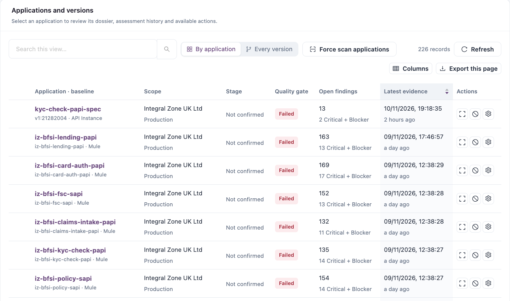
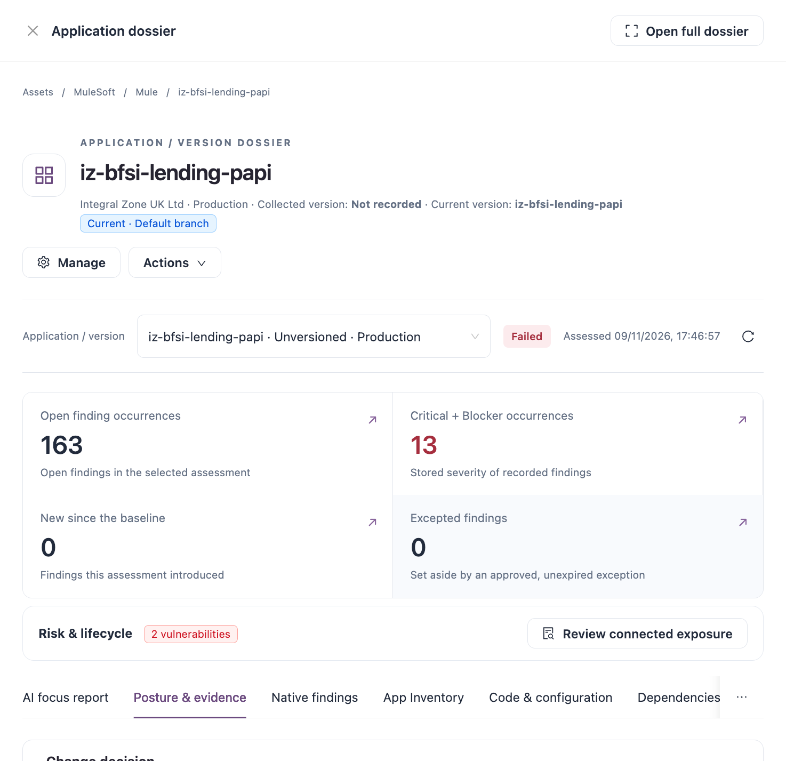
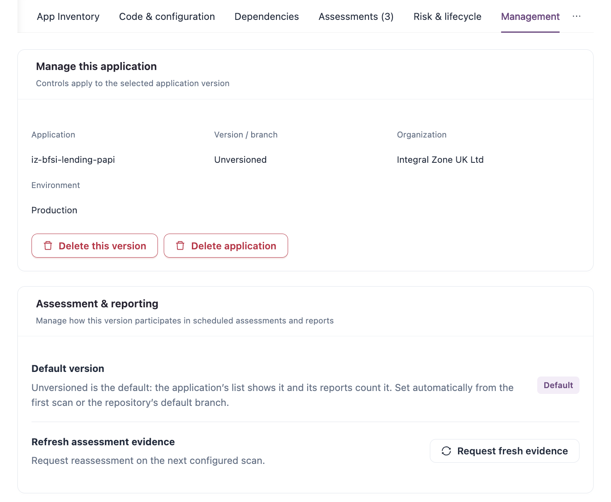

# Applications

The **Applications** tab of Platform Analysis lists every application version in your scope with its latest quality gate, open findings and evidence date. From a row you open the application's dossier: its AI focus report, assessments, findings, inventory, dependencies and management settings.

Open it from **Workspaces** → **Platform Analysis** → **Applications** in the sidebar.


Requires the **Platform Analysis** licence.


<figure><figcaption>
Applications and versions
</figcaption></figure>

## Filters, tiles and charts

The filter bar, **Filters** panel and metric tiles are the same as on the [Overview](overview.md#filters) tab. Two charts sit above the list while no asset type is selected:

* **Assets by type and quality gate**: select a segment to list those records.
* **Top rules behind Critical + Blocker findings**: select a bar to list the applications with that rule's findings.

When your role can change applications, **Force scan applications** appears beside the table tools. It marks the applications of one asset type for a forced scan, chosen by organization and environment. With no Asset type chosen, it asks for the type first.

## Applications and versions

| Control                 | Description                                                                                             |
| ----------------------- | ------------------------------------------------------------------------------------------------------- |
| **By application**      | One row per application, showing its baseline version. Expand a row to see its other versions.          |
| **Every version**       | One row per collected version.                                                                          |
| **Set lifecycle stage** | Sets the lifecycle stage of the selected rows (see [Lifecycle stage](applications.md#lifecycle-stage)). |

Search, **Refresh**, **Columns** and **Export this page** work as described in Workspaces.

### Columns

| Column                                                                      | Description                                                                                                                                               |
| --------------------------------------------------------------------------- | --------------------------------------------------------------------------------------------------------------------------------------------------------- |
| **Application · baseline** (**Application / version** in **Every version**) | Application name, version and asset type. With **By application**, a tag shows how many versions the application has. Click the name to open the dossier. |
| **Scope**                                                                   | Organization and environment.                                                                                                                             |
| **Stage**                                                                   | The confirmed lifecycle stage, or **Not confirmed**. Shown with the **Change Assurance** licence.                                                         |
| **Quality gate**                                                            | **Passed**, **Failed**, **Not evaluated** or **No scan**. **Refresh requested** means a new assessment was requested.                                     |
| **Open findings**                                                           | Open findings in the latest assessment, with the Critical + Blocker count.                                                                                |
| **Latest evidence**                                                         | When the latest assessment was recorded. Sortable; newest first by default.                                                                               |
| **Actions**                                                                 | Row actions, below.                                                                                                                                       |

### Row actions

| Action                       | Description                                                                                                         |
| ---------------------------- | ------------------------------------------------------------------------------------------------------------------- |
| **View application details** | Opens the application's dossier as a full page.                                                                     |
| **Deprecate application**    | Records a deprecation (status, reason and dates) for the application. Shown when your role can manage deprecations. |
| **Manage application**       | Opens the dossier on its **Management** panel.                                                                      |

## Lifecycle stage

With the **Change Assurance** licence, each application copy has a lifecycle stage (for example Test or Production). IZ Suite suggests a stage from signals such as the stage tag, CloudFormation stack name, name or environment; someone confirms it.

1. Tick the rows to change (up to one page at a time).
2. Click **Set lifecycle stage**.
3. Choose the stage and confirm.

A **Stage review** card under the table lists suggested stages and applications that look like the same application in another stage. Use **Accept selected**, **Accept** or **Change** on its rows.


You need a role that can manage Change Assurance assets to set or accept stages.


## Application dossier

Click an application's name to open its dossier in a drawer. **Open full dossier** opens it as a full page with **Back to workspace**, **View in drawer** and **Copy dossier link**.

<figure><figcaption>
Application dossier
</figcaption></figure>

### Header

| Item                      | Description                                                                                                                                                                                                                                                           |
| ------------------------- | --------------------------------------------------------------------------------------------------------------------------------------------------------------------------------------------------------------------------------------------------------------------- |
| Breadcrumb                | **Assets** / platform / asset type / application. Each part opens the matching list.                                                                                                                                                                                  |
| Subtitle                  | Organization, environment, collected version and current version (with how it was chosen, for example **Production**).                                                                                                                                                |
| **Manage**                | Opens the **Management** panel.                                                                                                                                                                                                                                       |
| **Actions**               | **Stages** (with the **Change Assurance** licence), **Link applications**, **Deprecate application**, **Review this application** (see [AI Focus Report](ai-focus-report.md)), **Monitoring**, **Lifecycle** and **Exceptions**. Items you cannot use are not listed. |
| **Application / version** | Switches the dossier to another version of the same application. Shows the gate and assessment date of the selected version. The refresh icon reloads the dossier.                                                                                                    |

When the dossier shows an older assessment, a **Historical assessment** notice appears; click **Use latest assessment** to return.

### Metric tiles

| Tile                               | Description                                                                   |
| ---------------------------------- | ----------------------------------------------------------------------------- |
| **Open finding occurrences**       | Open findings in the selected assessment.                                     |
| **Critical + Blocker occurrences** | Of those, Critical and Blocker.                                               |
| **New since the baseline**         | Findings this assessment introduced.                                          |
| **Excepted findings**              | Findings set aside by an approved, unexpired exception. Opens **Exceptions**. |

When you can use Dependency Insights, a **Risk & lifecycle** strip shows active risks with **Review connected exposure**. When you can use Service Health, a **Monitoring** card shows the monitor status with **Open monitoring**. The tiles show on every panel except AI focus report.

### Panels

| Panel                                         | Description                                                                                                                                                                                                                                                                                                                  |
| --------------------------------------------- | ---------------------------------------------------------------------------------------------------------------------------------------------------------------------------------------------------------------------------------------------------------------------------------------------------------------------------- |
| **AI focus report**                           | The latest AI review of this assessment: priorities, recommendations, project fix plan, review guidance, supporting evidence and team decisions. Without a review, it explains how to request one with **Request an AI review**. Shown when your role can view or run AI reviews. See [AI Focus Report](ai-focus-report.md). |
| **Posture & evidence**                        | Why the gate failed (checkpoint outcomes), top findings, the asset's operating context, the profiles that produced the evidence and the assessment trend.                                                                                                                                                                    |
| **Native findings** (**Findings** without AI) | The findings of this application, with the same grouping and detail as the [Findings](findings.md) tab.                                                                                                                                                                                                                      |
| **App Inventory**                             | The latest values the metric rules recorded: configuration, deployment, components, runtimes and relationships.                                                                                                                                                                                                              |
| **Code & configuration**                      | Files with findings and the configuration history with diffs.                                                                                                                                                                                                                                                                |
| **Dependencies and Risk & lifecycle**         | Two panels, shown with Dependency Insights. Dependencies: the dependency graph of this application. Risk & lifecycle: the applications it depends on or is used by, and the connected exposure from active advisories and lifecycle rules.                                                                                   |
| **Assessments**                               | **Assessment progression** chart, **Compare recorded assessments** (choose a baseline and a compared assessment) and every recorded assessment. Use **Inspect assessment** to view an older assessment.                                                                                                                      |
| **Versions**                                  | Collected versions of the same application, with their gates. Shown when there is more than one.                                                                                                                                                                                                                             |
| **Management**                                | Settings for this version, below.                                                                                                                                                                                                                                                                                            |

## Manage an application

The **Management** panel applies to the selected application version.

<figure><figcaption>
Management panel
</figcaption></figure>

| Section                     | Description                                                                                                                                                                                                                                                                                                                                                     |
| --------------------------- | --------------------------------------------------------------------------------------------------------------------------------------------------------------------------------------------------------------------------------------------------------------------------------------------------------------------------------------------------------------- |
| **Manage this application** | Application, version, organization and environment. **Review versions** opens the versions; **Delete this version** and **Delete application** remove the records.                                                                                                                                                                                              |
| **Assessment & reporting**  | **Default version**: the version the application's list shows and its reports count; **Make default** chooses another. **Refresh assessment evidence**: **Request fresh evidence** requests a reassessment on the next configured scan.                                                                                                                         |
| **Assessment settings**     | The quality profiles, quality gates and rule settings for future assessments. Choose **This version** or **All versions (application default)**, edit the **Quality profiles**, **Quality gates** or **Rule settings** tab, and save. **Reset to application default** (or **Reset to global default**) removes the override. Recorded evidence is not changed. |
| **Update subscriptions**    | Who receives updates about this application (scan, delete, quality gate failure). **Subscribe to updates** adds a subscription; **Needs attention** lists updates nobody receives, with **Subscribe**.                                                                                                                                                          |


**Delete this version** and **Delete application** permanently delete the records and cannot be undone. They are shown only when your role can delete applications of this type.



Without a role that can change this application, the settings are read only.


## Next Steps

* [Findings](findings.md): investigate findings across applications.
* [AI Focus Report](ai-focus-report.md): read the AI review of an assessment and plan the fix.
* Quality Gates: change the conditions an assessment must pass.
* Dependency Insights: trace the dependencies of an application.
* [Platform Analysis](./): back to the workspace.
