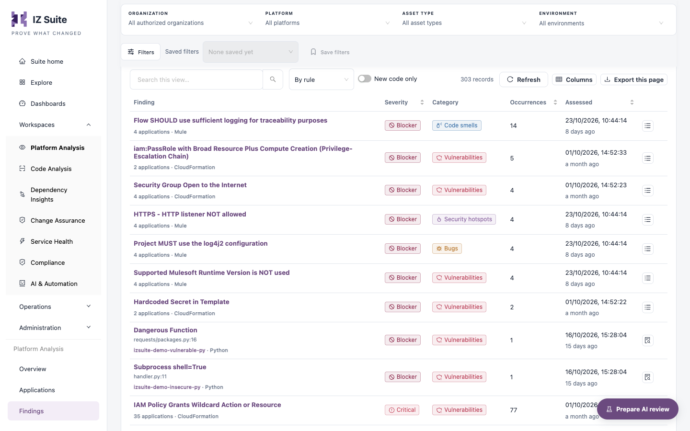
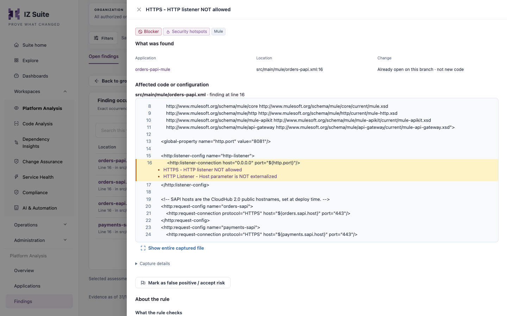
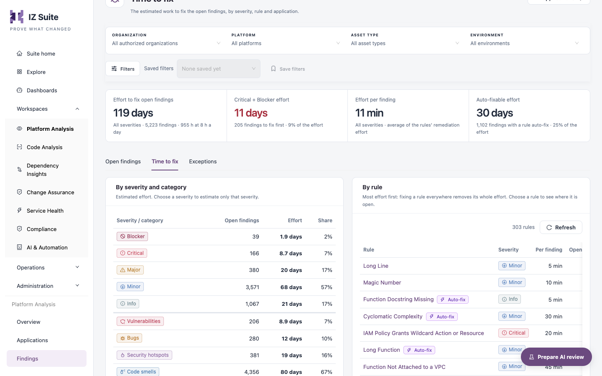

# Findings

The **Findings** tab of Platform Analysis lists the open findings in the latest assessment of each application you can see, grouped by rule or file. It also estimates the effort to fix them and keeps the register of exceptions (false positives and accepted risks).

Open it from **Workspaces** → **Platform Analysis** → **Findings** in the sidebar.


Requires the **Platform Analysis** licence.


<figure><figcaption>
Open findings
</figcaption></figure>

## Filters and effort tiles

The filter bar has **Organization**, **Platform**, **Asset type** and **Environment**. The **Filters** panel adds **Severity**, **Category**, **Rule** and **Security standard**. **All applications** opens the [Applications](applications.md) tab.

| Tile                            | Description                                                                                            |
| ------------------------------- | ------------------------------------------------------------------------------------------------------ |
| **Effort to fix open findings** | Estimated effort for all open findings in scope, from each rule's remediation effort, in working days. |
| **Critical + Blocker effort**   | The effort for the Critical and Blocker findings to fix first, and its share of the total.             |
| **Effort per finding**          | The average remediation effort per finding.                                                            |
| **Auto-fixable effort**         | The effort for findings whose rule has an auto-fix, and its share of the total.                        |

## Open findings

The **Open findings** sub-tab is the investigation list (**Investigate findings**).

| Control           | Description                                                                                                                                    |
| ----------------- | ---------------------------------------------------------------------------------------------------------------------------------------------- |
| Grouping          | **By rule**: one row per rule across applications. **By file**: one row per file, with its severity mix. **Occurrences**: one row per finding. |
| **New code only** | Shows only findings the change introduced: findings new since the previous assessment.                                                         |

### Columns

| Column          | Description                                                                                                 |
| --------------- | ----------------------------------------------------------------------------------------------------------- |
| **Finding**     | Rule name, the number of applications and the asset type. For a single occurrence, the file and line.       |
| **Severity**    | Blocker, Critical, Major, Minor or Info. Sortable.                                                          |
| **Category**    | Vulnerabilities, Bugs, Security hotspots or Code smells.                                                    |
| **Occurrences** | Number of open occurrences in the group. Sortable.                                                          |
| **Assessed**    | When the assessment was recorded. Sortable.                                                                 |
| **AI review**   | The AI review's view of the finding (for example **Possible false positive**), when an AI review covers it. |

The row action is **Inspect occurrences** for a group and **Read finding** for a single finding.

### Inspect the occurrences of a group

1. Click **Inspect occurrences** on a group row.
2. Review the **Finding occurrences** list: **Location**, **Application**, **Status on branch** and **Assessed**.
3. Click **Read finding** on a row to open its detail.
4. Click **Back to groups** to return.

**Status on branch** is **New** (introduced by this change), **Reopened** (fixed before, found again), **Already open**, or shows an exception request.

## Finding detail

<figure><figcaption>
Finding detail
</figcaption></figure>

| Section                            | Description                                                                                                                                                 |
| ---------------------------------- | ----------------------------------------------------------------------------------------------------------------------------------------------------------- |
| Tags                               | Severity, category, language and change status.                                                                                                             |
| **What was found**                 | The description, **Application** (opens the dossier), **Location** and **Change**.                                                                          |
| **Affected code or configuration** | The lines around the finding, when the assessment retained the files.                                                                                       |
| **How to fix**                     | The rule's remediation guidance, when recorded.                                                                                                             |
| **About the rule**                 | What the rule checks, compliant and non-compliant examples and references (for example CWE or OWASP). **Open this rule in Quality Control** opens the rule. |
| **Technical details**              | Assessment id, profile id, recorded path and finding fingerprint.                                                                                           |

### Mark a finding as a false positive or accepted risk

1. In the finding detail, click **Mark as false positive / accept risk**.
2. Choose the **Kind**: **False positive** or **Accepted risk**.
3. Enter the **Reason** (required, at least 10 characters).
4. Set **Expires after (days)**: 90 unless you choose otherwise, at most 365.
5. Click **Request exception**.

Another person with edit access to the application approves or rejects the request. Once approved, the finding no longer counts towards the quality gate or the open-finding counts on any version of the application until the exception expires.


The button is unavailable for findings recorded before issue tracking existed. Run a fresh assessment, then request the exception on the new result.


## Time to fix

The **Time to fix** sub-tab estimates the work to fix the open findings, by severity, rule and application.

<figure><figcaption>
Time to fix
</figcaption></figure>

| Section                      | Description                                                                                                                                                                           |
| ---------------------------- | ------------------------------------------------------------------------------------------------------------------------------------------------------------------------------------- |
| **Severity** filter          | Estimates only one severity.                                                                                                                                                          |
| **By severity and category** | **Open findings**, **Effort** and **Share** per severity and per category.                                                                                                            |
| **By rule**                  | **Rule** (with an **Auto-fix** tag when the rule has one), **Severity**, **Per finding**, **Open findings** and **Effort**, most effort first. Choose a rule to see where it is open. |
| **By application**           | Effort per application, with its findings per severity. Choose an application to estimate only its findings.                                                                          |

## Exceptions

The **Exceptions** sub-tab lists findings excepted as false positives or accepted risks, and the requests awaiting a decision.

| Tile                    | Description                                                                    |
| ----------------------- | ------------------------------------------------------------------------------ |
| **In force**            | Approved, unexpired exceptions, split into accepted risks and false positives. |
| **Expire in 30 days**   | Exceptions still in force that expire soon.                                    |
| **Lapsed**              | Expired with nothing newer requested.                                          |
| **Awaiting a decision** | Requested, not yet decided.                                                    |
| **Revoked**             | Ended early or withdrawn.                                                      |

The **Exception register** lists the soonest expiry first. Filter it with **All**, **In force**, **Expiring**, **Lapsed**, **Awaiting a decision** or **Revoked**.

| Column                            | Description                                                            |
| --------------------------------- | ---------------------------------------------------------------------- |
| **Application**                   | Opens the application's exceptions.                                    |
| **Finding**                       | Rule and file.                                                         |
| **Kind**                          | **False positive** or **Accepted risk**.                               |
| **Requested by** / **Decided by** | Who requested and who decided, with dates.                             |
| **Status**                        | **Requested**, **Approved**, **Rejected**, **Revoked** or **Expired**. |
| **Expires**                       | Expiry date.                                                           |

Row actions are **Approve exception**, **Reject exception** and **Revoke exception**.


Deciding or revoking an exception needs edit access to the application. The person who requested an exception cannot decide it.


## Next steps

* [Applications](applications.md): open the dossier of an affected application.
* Quality Rules: review the rules behind the findings.
* [Overview](overview.md): prepare an AI review of the findings.
* [Platform Analysis](./): back to the workspace.
