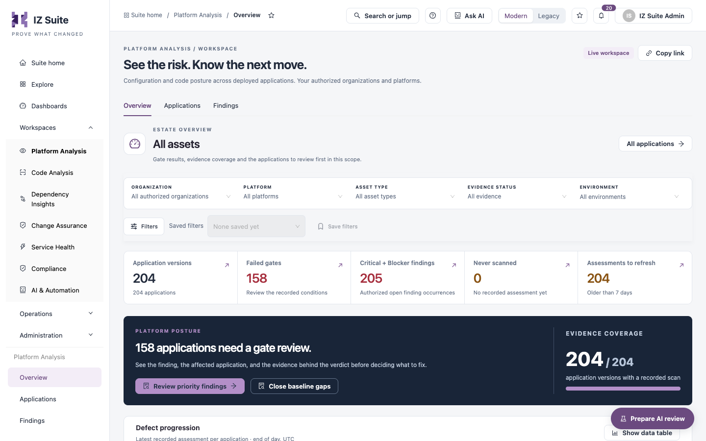
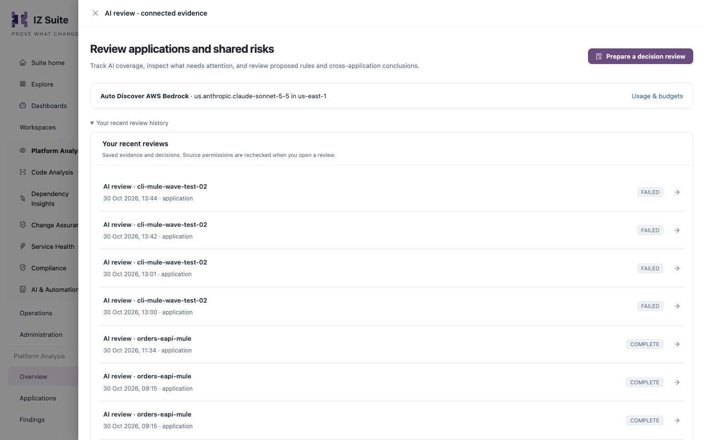

# Overview

The **Overview** tab of Platform Analysis summarizes the applications in your scope: how many failed their quality gate, how many have Critical or Blocker findings, how complete the evidence is, and which applications to review first.

Open it from **Workspaces** → **Platform Analysis** → **Overview** in the sidebar.


Requires the **Platform Analysis** licence.


<figure><figcaption>
Platform Analysis overview
</figcaption></figure>

## Filters

| Filter              | Description                                                                                                           |
| ------------------- | --------------------------------------------------------------------------------------------------------------------- |
| **Organization**    | One organization, or **All authorized organizations**.                                                                |
| **Platform**        | One connected platform, or **All platforms**.                                                                         |
| **Asset type**      | One asset type (for example Mule, Lambda or CloudFormation), or **All asset types**.                                  |
| **Evidence status** | **All evidence**, **Failed gates**, **Passed gates**, **No gate result**, **Never scanned** or **Older than N days**. |
| **Environment**     | One or more environments, or **Without an environment**.                                                              |
| **Filters** panel   | **Severity**, **Category**, **Rule** and **Security standard**: keep applications with open findings that match.      |

**All applications** at the top right opens the [Applications](applications.md) tab with the same scope. Saved filters and **Copy link** work as described in Workspaces.

## Metric tiles

Each tile opens the records it counts.

| Tile                            | Description                                                                                          |
| ------------------------------- | ---------------------------------------------------------------------------------------------------- |
| **Application versions**        | Application versions in scope, with the number of applications. Opens the full list.                 |
| **Failed gates**                | Versions whose latest recorded quality gate failed. Opens them in **Applications**.                  |
| **Critical + Blocker findings** | Open Critical and Blocker finding occurrences you are authorized to see. Opens them in **Findings**. |
| **Never scanned**               | Versions with no recorded assessment yet.                                                            |
| **Assessments to refresh**      | Versions whose latest assessment is older than the configured number of days.                        |

## Platform posture

The dark banner states how many applications need a gate review and how many application versions have a recorded scan (**Evidence coverage**).

* **Review priority findings** opens the findings to fix first.
* **Close baseline gaps** lists the versions that were never scanned.

## Charts

| Chart                                            | Description                                                                                                                                                                                                                                                  |
| ------------------------------------------------ | ------------------------------------------------------------------------------------------------------------------------------------------------------------------------------------------------------------------------------------------------------------ |
| **Defect progression**                           | The latest recorded assessment of each application per day. Choose **Total & high severity**, **Severity breakdown**, **Defect types** or **Gates & assessment coverage**. The tiles under the chart compare the earliest and newest recorded defect counts. |
| **Security standards**                           | How many open findings map to CWE, OWASP and the other security standards, by category. Choose a standard to chart it; select a bar to list its findings.                                                                                                    |
| **Assets by type and quality gate**              | Failed, passed and not assessed records per asset type. **Show all** lists every type; select a segment to list those records.                                                                                                                               |
| **Top rules behind Critical + Blocker findings** | The rules with the most Critical and Blocker occurrences, Blocker rules first. Select a bar to list the applications with that rule's findings.                                                                                                              |

Every chart has **Show data table**.

## Applications to review first

The applications to look at first: most high-severity occurrences, then a failed gate, then the most recorded findings.

| Column                 | Description                              |
| ---------------------- | ---------------------------------------- |
| **Application**        | Name, asset type and version.            |
| **Gate evidence**      | Latest quality gate result.              |
| **Critical / Blocker** | Open Critical and Blocker occurrences.   |
| **Last assessment**    | When the latest assessment was recorded. |
| **Review**             | Opens the application's dossier.         |

**View all** opens the full list in **Applications**.

## Cross-platform AI recommendations

**Cross-platform · AI recommendations** lists recorded **Platform investigations**: shared risks and priorities that an AI review found across applications. Individual application reviews stay in each application's dossier.

## Prepare an AI review

**Prepare AI review** (bottom right of every Platform Analysis tab) opens the **AI review · connected evidence** drawer. It is shown only when your role can run AI reviews.

<figure><figcaption>
AI review · connected evidence
</figcaption></figure>

The drawer lists your recent reviews and their status. To prepare a new one:

1. Click **Prepare a decision review**.
2. In **Review scope**, choose what to review (for example **Application / version** or **Platform / connected portfolio**).
3. Choose the **Evidence workspace** and the **Application or record**.
4. Choose the **Review type**. **Review profiles applied** shows the AI review profiles that apply.
5. Optionally, add **Additional review input**: what the review should check or know. Do not enter secrets.
6. Click **Prepare evidence briefing**, or **Cancel** to close the form.

Preparing a review only collects evidence inside IZ Suite. Nothing is sent to the AI provider until you approve the investigation on the next screen.


Each AI review is charged to your AI budget. See AI & Automation.


## Next steps

* [Applications](applications.md): open an application's dossier.
* [Findings](findings.md): investigate the findings behind a failed gate.
* AI Review Profiles: change what AI reviews check.
* [Platform Analysis](./): back to the workspace.
