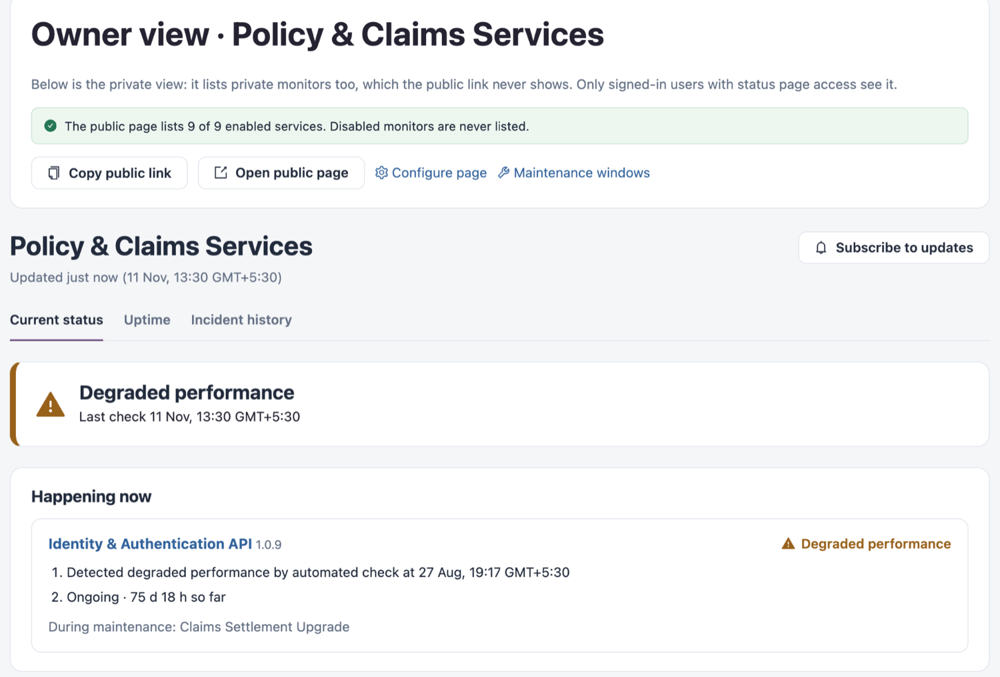

# Service Health

Service Health checks that your APIs and integration runtimes answer as expected, shows how close each service is to its availability target, and tells the people who depend on a service what is happening. Health checks run on your agent, from its network.

Open it from **Workspaces** → **Service Health** in the sidebar. Every Service Health screen has the same tabs at the top: **Service readiness**, **Monitoring coverage**, **Service objectives**, **Monitors**, **Status pages**, **Categories**, **Runbooks** and **Maintenance windows**.


Requires the **Service Health** licence.


<figure><figcaption>
A status page as its owner sees it
</figcaption></figure>


The tabs you see depend on your role. For example, a role that can view status pages but not monitors sees only status pages, runbooks and maintenance windows.


## Screens in Service Health

| Page                                          | What you do there                                                                                             |
| --------------------------------------------- | ------------------------------------------------------------------------------------------------------------- |
| [Service Readiness](service-readiness.md)     | See whether monitoring is running, what needs attention now and which applications still have no monitor.     |
| [Monitoring Coverage](monitoring-coverage.md) | Go through your deployed applications, link a monitor to each one and set up monitors in bulk or by policy.   |
| [Service Objectives](service-objectives.md)   | Agree availability targets with an owner and see which monitors are letting them down.                        |
| [Monitors](monitors.md)                       | Create, inspect, enable and disable HTTP, AWS, MuleSoft and Azure monitors, including how a monitor signs in. |
| [Status Pages](status-pages.md)               | Publish the health of a set of monitors on a public or private status page.                                   |
| [Categories](categories.md)                   | Group monitors under headings that several status pages can share.                                            |
| [Runbooks](runbooks.md)                       | Write the response procedure a team follows when a monitor fails.                                             |
| [Maintenance Windows](maintenance-windows.md) | Plan maintenance so checks inside the window do not count as down, and announce it to subscribers.            |

## How the Pieces Fit Together

1. A **monitor** checks one endpoint or resource and records each result.
2. A **category** groups monitors; a **status page** shows categories, monitors added directly, or both.
3. A **service objective** sets an availability target for one or more monitors.
4. A **runbook** is linked to a monitor so responders know what to do when it fails.
5. A **maintenance window** covers monitors, categories or status pages while planned work runs.

## Next Steps

* [Monitors](monitors.md): create your first monitor.
* [Monitoring Coverage](monitoring-coverage.md): find applications that are not monitored yet.
* [Status Pages](status-pages.md): share service health with your audience.
