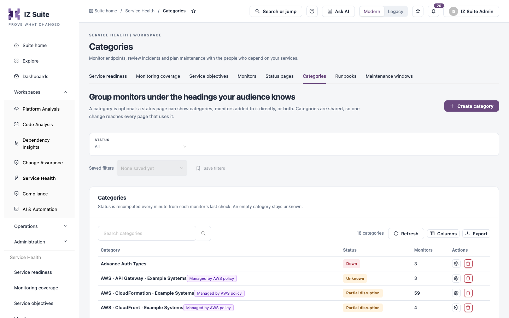

# Categories

A category groups monitors under one heading, such as "Payments" or "Order APIs". Categories are shared: a change to a category reaches every status page that uses it. A category is optional; a status page can also show monitors added to it directly.

Open it from **Workspaces** → **Service Health** → **Categories** in the sidebar.


Requires the **Service Health** licence.


<figure><figcaption>
Categories
</figcaption></figure>

## Categories list

Use the **Status** filter to show **All**, **Needs attention** or **Unknown** categories. The list has a search box, **Refresh**, **Columns** and **Export**.

| Column       | Description                                                                                  |
| ------------ | -------------------------------------------------------------------------------------------- |
| **Category** | Category name, with a **Managed by** tag when a monitoring policy maintains it.              |
| **Status**   | Recomputed every minute from each monitor's last check. An empty category stays **Unknown**. |
| **Monitors** | Number of monitors in the category.                                                          |
| **Actions**  | **Manage monitors** and delete.                                                              |

## Create a category

1. Click **Create category**.
2. Enter the **Category name** (**Required**, up to 100 characters).
3. Optionally pick **Monitors** to add now. You can change them later.
4. Click **Create category**. The category opens so you can keep adding monitors.

## Manage a category's monitors

1. Click **Manage monitors** on the row.
2. In **Monitors in this category**, search for a monitor and click **Add monitor**.
3. To take a monitor out, click **Remove monitor** on it. The monitor itself is unchanged.

The drawer also shows the category's status, monitor count and when it last changed. Click **Rename category** to change its name.


Only public, enabled monitors in a category appear on a public status page.


A category created by a monitoring policy shows **Maintained by**: the policy adds monitors of its type as it creates them, including any you removed. Click **Take over** to stop that.


You need a role that can create monitors to create a category, a role that can create or edit monitors to add monitors to it, a role that can edit monitors to rename it or take it over, and a role that can delete monitors to remove monitors from it or delete it.


## Next steps

* [Status Pages](status-pages.md): add the category to a status page.
* [Monitors](monitors.md): create the monitors a category groups.
* [Service Health](./): see how the screens fit together.
