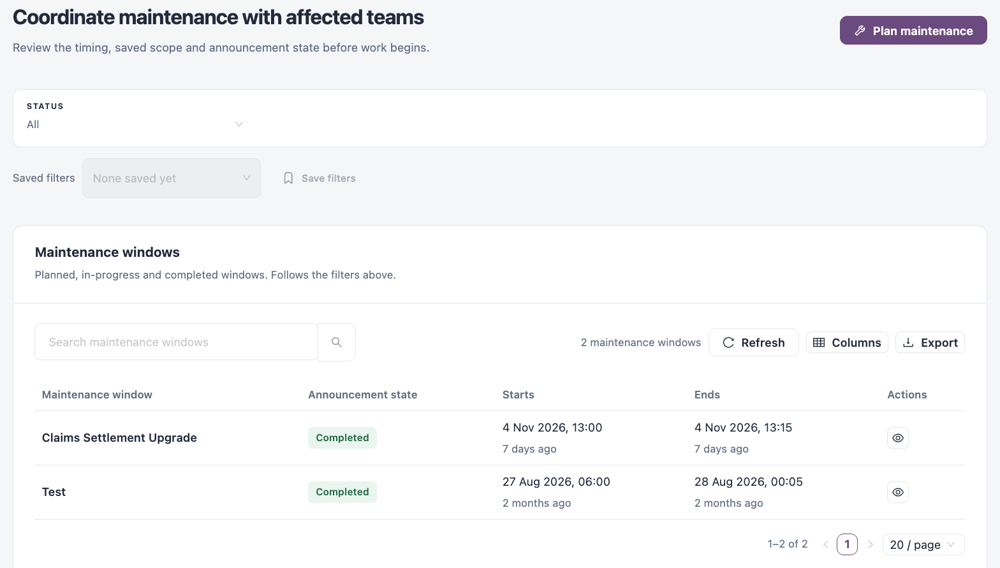
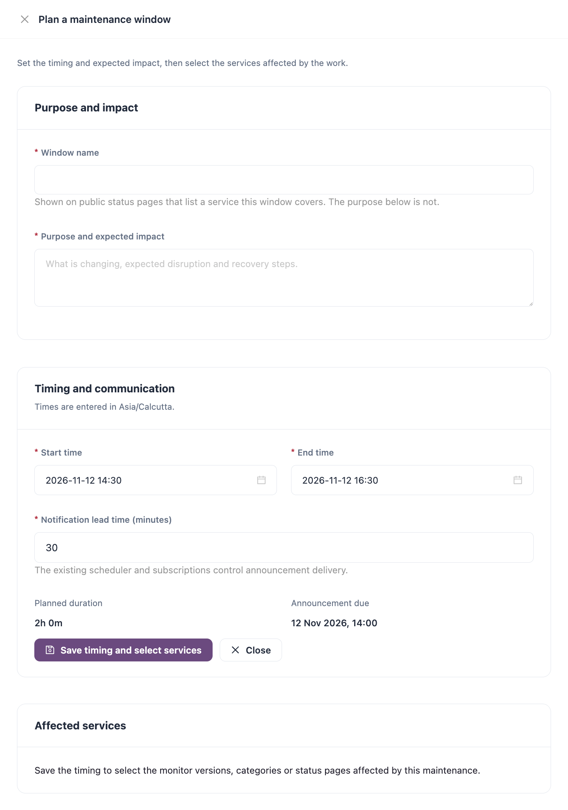

# Maintenance Windows

A maintenance window marks a period of planned work on some services. While it runs, checks on the covered monitors still run but do not count as down, and the time is left out of service objective measurements. The window's name is shown on the public status pages that list a covered service, and subscribers are notified ahead of the start.

Open it from **Workspaces** → **Service Health** → **Maintenance windows** in the sidebar.


Requires the **Service Health** licence.


<figure><figcaption>
Maintenance windows
</figcaption></figure>

## Maintenance Windows List

Use the **Status** filter to show **All**, **Scheduled**, **In progress** or **Completed** windows; **Save filters** keeps a combination to pick again from **Saved filters**. The list has a search box, **Refresh**, **Columns** and **Export**.

| Column                 | Description                                           |
| ---------------------- | ----------------------------------------------------- |
| **Maintenance window** | Window name. Click it to review the window.           |
| **Announcement state** | **Scheduled**, **In progress** or **Completed**.      |
| **Starts**             | Start time.                                           |
| **Ends**               | End time.                                             |
| **Actions**            | **Review window**, and delete for a scheduled window. |

## Plan a Maintenance Window

<figure><figcaption>
Plan a maintenance window
</figcaption></figure>

1. Click **Plan maintenance**.
2. Fill in **Purpose and impact** and **Timing and communication** (fields below). **Planned duration** and **Announcement due** update as you type.
3. Click **Save timing and select services**.
4. Under **Affected services**, choose a **Target type**: **Monitor version**, **Monitor category** or **Status page**.
5. Search in **Find a maintenance target** and click **Add selected service**. Repeat for each affected service. Each addition saves on its own.
6. Check the saved list, then click **Close**.

| Field                                | Description                                                                                                                                                   |
| ------------------------------------ | ------------------------------------------------------------------------------------------------------------------------------------------------------------- |
| **Window name**                      | **Required.** Up to 100 characters. Shown on public status pages that list a service this window covers.                                                      |
| **Purpose and expected impact**      | **Required.** What is changing, the expected disruption and recovery steps. Not shown on public status pages.                                                 |
| **Start time**                       | **Required.** Must be in the future. Times are entered in your browser's time zone, shown above the fields.                                                   |
| **End time**                         | **Required.** Must be after the start.                                                                                                                        |
| **Notification lead time (minutes)** | **Required.** How long before the start the window is announced, from 0 to 43,200 minutes. Default `30`. Subscriptions control who receives the announcement. |

To take a service out of a window, click **Remove service** on it. The monitor itself is unchanged.

## Review a Window

Click **Review window** on a row to see its purpose, timing and affected services. Click **Save timing changes** after changing the timing.


Only a **Scheduled** window can be changed or deleted. Once it is in progress or completed it is available for review only. You need a role that can create, edit or delete maintenance windows for those actions.


## Next Steps

* [Status Pages](status-pages.md): see how the window appears to your audience.
* [Service Objectives](service-objectives.md): maintenance time is left out of availability.
* [Monitors](monitors.md): check which monitors are in **Maintenance mode**.
