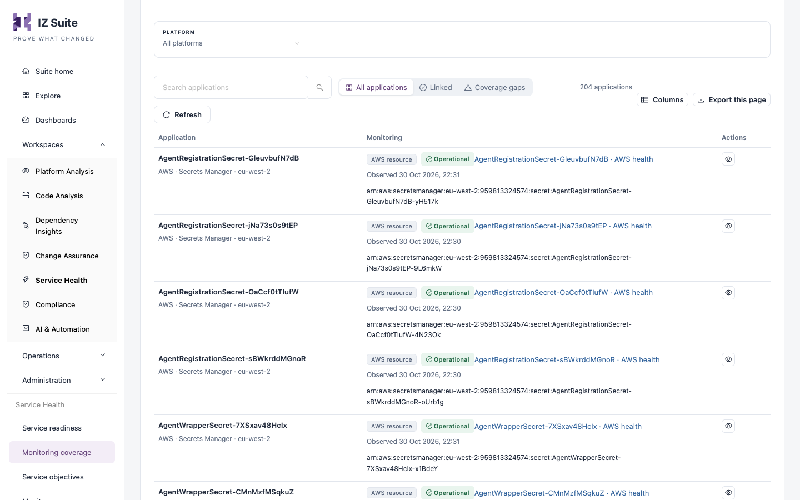

# Monitoring Coverage

Monitoring coverage starts from your deployed application inventory. For each application it shows the monitors already linked to it and suggests what to monitor next: an HTTP target found in the inventory, or the resource signals of an AWS, MuleSoft or Azure asset.

Open it from **Workspaces** → **Service Health** → **Monitoring coverage** in the sidebar.


Requires the **Service Health** licence. The application list comes from the inventory collected by Platform Analysis.


<figure><figcaption>
Monitoring coverage
</figcaption></figure>

## Tiles

The tiles also filter the list below them.

| Tile                      | Description                                                               |
| ------------------------- | ------------------------------------------------------------------------- |
| **Applications in scope** | Deployed applications you can access. Shows all applications.             |
| **Linked monitoring**     | Applications with an enabled HTTP monitor or a linked resource collector. |
| **Coverage gaps**         | Applications with no enabled HTTP monitor or resource collector linked.   |

A red notice above the tiles tells you when checks have stopped running; see [Service Readiness](service-readiness.md#probe-notice).

## Application monitoring coverage

| Control                                                | Description                                                                  |
| ------------------------------------------------------ | ---------------------------------------------------------------------------- |
| **Platform** filter                                    | **All platforms**, **AWS**, **MuleSoft** or **Azure Integration Services**.  |
| **Organization** filter                                | Shown when the platform is **AWS**: limits the list to one AWS organization. |
| **All applications** / **Linked** / **Coverage gaps**  | Same choice as the tiles.                                                    |
| Search, **Refresh**, **Columns**, **Export this page** | Search the list, reload it, choose columns and export the current page.      |

| Column          | Description                                                                                                                                                                                                                              |
| --------------- | ---------------------------------------------------------------------------------------------------------------------------------------------------------------------------------------------------------------------------------------- |
| **Application** | Application name with its platform, type and environment or organization. Click the name to review its monitoring.                                                                                                                       |
| **Monitoring**  | The monitors already linked, with their status and last observation, and what can still be monitored: the number of HTTP targets, the resource type and its identifier, or a hint such as **Ready to review target and authentication**. |
| **Actions**     | **Review monitoring** opens the application's monitoring drawer.                                                                                                                                                                         |

## Review an application's monitoring

Click **Review monitoring** on a row. The drawer shows:

* The application, its scope, the resource target and when its inventory was assessed.
* **Linked monitors**: the monitors that point to this application. Click **Link an existing monitor** to link a monitor you already use.
* **Review discovered HTTP targets**: URLs found in the inventory. Click **Review & create monitor** to open the HTTP monitor form with the URL filled in. The new monitor starts disabled; enable it when the probe is ready.
* For an AWS, MuleSoft or Azure asset, the resource signals that can be collected through the assigned agent, the latest observation and the previous observations. For an AWS resource, **Collect AWS signals now** queues one extra collection and **Refresh results** reloads them.


Resource monitors read provider state and metrics through the agent. They do not invoke functions, read secret values or change cloud resources. A signal that cannot be read stays **Unknown**.


## Set up monitors in bulk

1. Filter the list to the platform and organization you want.
2. Click **Set up monitors in bulk**.
3. Review the targets in **Review monitoring setup**. Use the search box, **Select all new targets** or tick targets one by one. Targets that already have a monitor cannot be selected.
4. Click **Create** _n_ **selected monitors**.
5. Open **See setup results** to check what was created, what already existed and what failed.

## Monitoring policies

A monitoring policy keeps resource monitors collected on a schedule for one organization. Click **Monitoring policies** and choose **AWS monitoring policy**, **MuleSoft monitoring policy** or **AIS monitoring policy**, then pick the AWS account, Anypoint organization or Azure subscription.

For AWS, the policy offers:

| Field                                            | Description                                                                                                                                                                                                                                                             |
| ------------------------------------------------ | ----------------------------------------------------------------------------------------------------------------------------------------------------------------------------------------------------------------------------------------------------------------------- |
| **What should happen to discovered AWS assets?** | **Off: review suggestions and collect manually**, **Collect existing monitors** on a schedule, or **Collect and auto-create monitors**, which also creates a monitor, status page, categories and starter runbooks for each newly discovered asset of the chosen types. |
| **AWS resource types**                           | **Required.** The resource types the policy covers. **Select all supported AWS types** ticks them all.                                                                                                                                                                  |
| Schedule                                         | How often to collect, when the policy is not off.                                                                                                                                                                                                                       |

Click **Save monitoring policy**. Status pages, categories and runbooks that a policy creates are tagged **Managed by AWS policy** (or the platform's name).


Each monitor a policy creates counts against your Service Health licence. You need a role that can create or edit monitors to use bulk setup and monitoring policies.


## Next steps

* [Monitors](monitors.md): inspect and configure the monitors you created.
* [Service Objectives](service-objectives.md): set availability targets for HTTP monitors.
* [Status Pages](status-pages.md): publish the monitored services.
